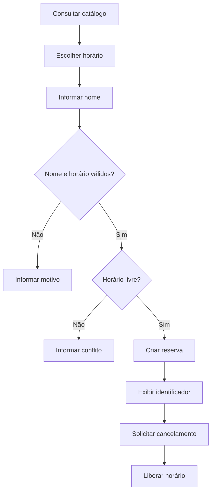

# Caso contínuo — Agenda Clara

**Empresa fictícia:** um estúdio de atendimento profissional que agenda serviços por mensagens. Os dados abaixo são inventados e destinados à aprendizagem.

## Problema e objetivo

A recepção copia horários manualmente e confirma reservas duplicadas. Em uma semana fictícia, 10 de 50 tentativas tiveram conflito: 10 / 50 × 100 = 20%. O produto pretende reduzir conflitos; essa hipótese será validada, não assumida como resultado.

O MVP permite consultar horários, reservar e cancelar. Ficam fora: pagamentos, login, notificações reais, múltiplas unidades e integração com calendário. O protótipo não representa um serviço pronto para uso por clientes.

## Regras de negócio fornecidas

| ID | Regra verificável |
|---|---|
| RN01 | Para o serviço S01, o catálogo inicial contém H09, H10 e H11 |
| RN02 | Cada horário aceita no máximo uma reserva ativa |
| RN03 | O nome é obrigatório e deve permanecer não vazio após remover espaços das extremidades |
| RN04 | Reserva de horário disponível retorna sucesso e ocupa o horário |
| RN05 | Reserva de horário ocupado retorna conflito e não altera a reserva existente |
| RN06 | Cancelar uma reserva ativa libera seu horário |
| RN07 | Cancelar um identificador inexistente retorna não encontrado sem alterar a agenda |
| RN08 | Reservar horário fora do catálogo retorna horário inválido |

H09, H10 e H11 são identificadores, não datas reais. A versão inicial não tem validação de data nem de fuso. No projeto final, qualquer extensão recebe uma regra nova, cenários novos e identificação de versão.

## Dados de entrada

| Pessoa fictícia | Horário solicitado | Intenção |
|---|---|---|
| Ana Exemplo | H09 | Primeira reserva |
| Bruno Exemplo | H09 | Tentativa concorrente em sequência |
| Carla Exemplo | H10 | Reserva seguida de cancelamento |
| Nome composto somente por espaços | H11 | Validar RN03 |
| Dani Exemplo | H12 | Validar RN08 |

## Contrato didático

O simulador retorna dicionários com um campo `status`. Os valores são `sucesso`, `conflito`, `nome_invalido`, `horario_invalido` e `nao_encontrado`. Sucesso na reserva também retorna `id`. Cancelamento bem-sucedido retorna `cancelado`.

Esses rótulos não são códigos HTTP. Em uma futura API, a equipe definiria um contrato HTTP próprio. As chamadas do simulador são sequenciais; ele não implementa segurança, persistência ou prevenção de concorrência real entre processos.

## Jornada



## Kit de execução

Usar [agenda_clara.py](../portfolio/agenda-clara/agenda_clara.py), que contém uma implementação de referência e uma variante com defeito intencional. Abrir o arquivo para estudar; executar com Python 3, sem bibliotecas adicionais:

```text
python portfolio/agenda-clara/agenda_clara.py
```

No Windows, se o comando disponível for `py`, substituir `python` por `py`. O professor verifica o ambiente antes da aula. Sem Python, percorrer cada linha com uma tabela de estados; marcar a evidência como simulação manual e realizar a execução depois.

## Registro de evidência

Em cada execução, anotar versão (`referencia` ou `com_defeito`), entrada, estado inicial, resultado esperado pela regra, resultado observado e estado final. Reiniciar a agenda antes de cenários independentes. Para regressão, manter também sequências que dependem do estado.

Não apresentar bugs plantados como incidentes reais. As entregas de portfólio devem declarar “projeto educacional com empresa e dados fictícios”.

