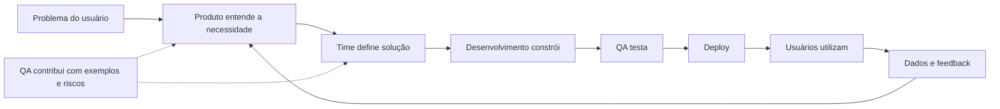

# ROTEIRO DE AULA - Módulo 1, Aula 2

**Condução com falas prontas:** [script do professor](scripts/modulo-01-aula-02-como-funciona-uma-empresa-tech.md). Seguir a sequência de até 90 minutos. As atividades abaixo formam o caderno completo; o script define o recorte ao vivo e a conclusão em casa. A gravação serve para revisão posterior.

> **Revisão pedagógica — outubro de 2026:** Ao final, o aluno desenha um fluxo com feedback e mostra contribuições de Produto, Dev e QA antes e depois da construção. Aplicar a atividade 2 do [caderno de prática](../atividades/modulo-01-caderno-de-pratica.md), com entrega, resposta de referência, rubrica e recuperação. Usar essa avaliação explícita para orientar a devolutiva das tarefas deste roteiro. Usar o script para distribuir o encontro de até 90 minutos e orientar a conclusão em casa.

# Como Funciona uma Empresa de Tecnologia

---

# Objetivo da aula

Explicar como uma empresa de tecnologia organiza pessoas, áreas, processos e ferramentas para criar produtos digitais.

Ao final da aula, o aluno deverá conseguir:

- entender o fluxo básico de trabalho em uma empresa tech;
- reconhecer papéis como PO, QA, Dev, UX/UI, Dados, Suporte e Infra;
- visualizar como uma ideia vira uma funcionalidade;
- relacionar colaboração, comunicação e documentação com carreira tech.

---

# Duração estimada

| Etapa | Minutos |
|---|---:|
| Abertura e diagnóstico | 8 |
| Conceitos e exemplos | 17 |
| Demonstração guiada | 20 |
| Pausa | 5 |
| Dinâmica em dupla ou grupo | 15 |
| Exercício individual | 12 |
| Correção e dúvidas | 8 |
| Fechamento e orientação da tarefa | 5 |
| Total | 90 |

---

# Materiais necessários

- Quadro branco ou ferramenta visual
- Navegador
- Exemplo simples de Kanban
- Modelo de backlog
- Exemplo de card de tarefa
- Exemplo de bug report
- Ferramenta opcional: Trello, Jira, Azure DevOps, Notion ou GitHub Projects

---

# Abertura da aula

## Quebra-gelo

Pergunte:

- Como você imagina que uma funcionalidade nasce dentro de uma empresa?
- Quem decide o que será feito primeiro?
- Quem garante que aquilo funciona?
- O que acontece depois que o sistema vai para o ar?

## Contextualização

Explique que, em empresas tech, quase nada é feito de forma isolada. Mesmo uma tela simples, como "esqueci minha senha", pode envolver Produto, UX, Desenvolvimento, QA, Infra, Segurança e Atendimento.

Mensagem principal:

> Uma empresa tech transforma problemas em soluções por meio de times colaborativos.

---

# Explicação didática

## Conceito principal

Uma empresa de tecnologia é uma organização que cria, entrega, mantém ou usa sistemas digitais para resolver problemas de negócio e de usuários.

Ela pode ser:

- uma startup;
- uma software house;
- uma consultoria;
- um banco;
- uma empresa de varejo;
- uma empresa de logística;
- uma edtech;
- uma healthtech;
- uma área interna de tecnologia dentro de uma empresa tradicional.

## Explicação simples

Imagine uma empresa como uma cozinha profissional:

- alguém entende o pedido do cliente;
- alguém organiza prioridades;
- alguém prepara a receita;
- alguém confere se saiu certo;
- alguém entrega;
- alguém acompanha a satisfação.

Na tecnologia acontece algo parecido. A diferença é que a entrega é digital.

## Explicação técnica

Empresas tech costumam organizar o trabalho usando conceitos como:

- backlog;
- sprint;
- tarefas;
- requisitos;
- User Stories;
- critérios de aceite;
- testes;
- deploy;
- monitoramento;
- métricas.

Esses elementos ajudam o time a saber o que precisa ser feito, por que precisa ser feito, quem está fazendo e como validar se ficou correto.

---

# Papéis comuns dentro de uma empresa tech

| Papel | O que faz | Exemplo prático |
|---|---|---|
| Product Owner | Organiza necessidades e prioridades | Define que "login com Google" será priorizado |
| UX/UI Designer | Desenha experiência e interface | Cria o protótipo da tela de cadastro |
| Desenvolvedor Front-end | Constrói a parte visual | Implementa tela, botões e validações |
| Desenvolvedor Back-end | Constrói regras e APIs | Cria endpoint para salvar cadastro |
| QA | Testa e valida qualidade | Verifica se cadastro funciona corretamente |
| Dados | Analisa informações | Mede quantos usuários concluem cadastro |
| Infra/DevOps | Cuida de ambiente e deploy | Publica nova versão com estabilidade |
| Suporte | Ajuda usuários e identifica problemas | Registra reclamações e dúvidas recorrentes |

---

# Fluxo básico de trabalho

Explique que esse fluxo é cíclico. Produto digital nunca fica totalmente pronto. Ele evolui conforme feedback, métricas e novas necessidades.

---

# Exemplos reais

## Exemplo 1: botão de cancelar pedido

Uma empresa de delivery percebe que muitos clientes entram em contato com suporte para cancelar pedidos.

Possível fluxo:

- Suporte identifica reclamação recorrente;
- Produto analisa o problema;
- UX desenha botão de cancelamento;
- Desenvolvimento implementa regra;
- QA testa situações possíveis;
- Dados mede redução de chamados;
- Produto avalia se a solução funcionou.

## Exemplo 2: erro no pagamento

Clientes relatam que o pagamento por cartão falha.

Possível fluxo:

- Suporte registra ocorrências;
- QA tenta reproduzir o erro;
- Dev analisa logs;
- Infra verifica instabilidade;
- Produto comunica impacto;
- Dev corrige;
- QA valida;
- Deploy publica correção.

---

# Exemplo corporativo

## Cenário: plataforma de cursos online

A DTEM quer criar uma plataforma EAD simples. A primeira funcionalidade será "aluno acessar aula gravada".

Como cada área participa:

| Área | Atividade |
|---|---|
| Produto | Define que o aluno precisa ver aulas por módulo |
| UX/UI | Desenha tela de módulos e player de vídeo |
| Front-end | Cria interface da listagem de aulas |
| Back-end | Cria API para buscar aulas disponíveis |
| Banco de dados | Armazena curso, módulo, aula e progresso |
| QA | Testa acesso, progresso, bloqueios e erros |
| Infra | Hospeda aplicação e arquivos de vídeo |
| Dados | Mede aulas assistidas e conclusão |

---

# Demonstração prática

## Passo a passo

1. Desenhe no quadro uma funcionalidade simples: "Cadastro de aluno".
2. Pergunte: o que o usuário precisa informar?
3. Transforme as respostas em requisitos simples.
4. Mostre como Produto escreveria uma necessidade.
5. Mostre como Dev transformaria isso em tela e API.
6. Mostre como QA testaria o cadastro.
7. Mostre como Dados poderia medir cadastros concluídos.

## Exemplo de requisito

O aluno deve conseguir criar uma conta informando nome, e-mail e senha.

## Exemplo de critério de aceite

- O sistema deve exigir e-mail válido.
- A senha deve ter pelo menos 8 caracteres.
- O aluno deve ver mensagem de sucesso após cadastro.
- O sistema não deve aceitar e-mail duplicado.

---

# Dinâmica em grupo

## Nome da dinâmica

"Da ideia ao deploy"

## Desafio

Cada grupo recebe uma funcionalidade:

- recuperar senha;
- cadastrar produto;
- agendar consulta;
- acompanhar entrega;
- emitir certificado.

O grupo deve responder:

- Qual problema essa funcionalidade resolve?
- Quais áreas participam?
- O que Produto precisa definir?
- O que Desenvolvimento precisa construir?
- O que QA precisa testar?
- Que métrica Dados poderia acompanhar?

## Apresentação

Cada grupo apresenta o fluxo em até 4 minutos.

O professor deve corrigir com cuidado, reforçando colaboração e clareza de responsabilidades.

---

# Exercício prático

## Atividade individual

Escolha uma funcionalidade comum de aplicativo e descreva o caminho dela dentro de uma empresa tech.

Sugestões:

- login;
- cadastro;
- pagamento;
- pesquisa;
- avaliação;
- notificação;
- cancelamento.

O aluno deve preencher:

| Pergunta | Resposta |
|---|---|
| Qual funcionalidade escolhi? | |
| Qual problema ela resolve? | |
| O que Produto precisa definir? | |
| O que Dev precisa construir? | |
| O que QA precisa testar? | |
| Que dado pode ser acompanhado? | |
| Qual risco pode acontecer? | |

---

# Perguntas para os alunos

- Por que uma funcionalidade precisa passar por várias pessoas?
- O que pode acontecer se Produto não explicar bem a necessidade?
- O que pode acontecer se QA não testar um fluxo crítico?
- Por que comunicação é uma habilidade importante em tecnologia?
- Qual papel parece combinar mais com você hoje?

---

# Possíveis dúvidas

| Dúvida | Como responder |
|---|---|
| Toda empresa usa Scrum? | Não. Muitas usam Scrum, Kanban ou modelos híbridos. O importante é entender organização, prioridade e colaboração. |
| QA testa depois que tudo está pronto? | Em empresas maduras, QA participa antes, ajudando a pensar em cenários e riscos. |
| PO programa? | Normalmente não. PO precisa entender tecnologia o suficiente para conversar com o time e tomar boas decisões. |
| Dev decide tudo sozinho? | Não. Dev contribui tecnicamente, mas decisões de produto envolvem negócio, usuário, prioridade e viabilidade. |
| Suporte faz parte de tecnologia? | Pode fazer. Suporte é uma área importante para entender problemas reais dos usuários. |

---

# Resumo da aula

Nesta aula, os alunos entenderam que empresas tech funcionam por meio de colaboração entre áreas. Uma ideia vira produto passando por análise, priorização, desenvolvimento, testes, deploy e melhoria contínua.

Mensagem final:

> Saber como o time trabalha ajuda o iniciante a se posicionar melhor em qualquer área de tecnologia.

---

# Tarefa para casa

1. Escolher um aplicativo que você usa.
2. Selecionar uma funcionalidade.
3. Descrever quais áreas provavelmente participaram da criação dela.
4. Atualizar o mapa mental com:
   - papéis dentro de empresa tech;
   - responsabilidades;
   - ferramentas citadas em aula.

---

# Dicas para o professor

- Use exemplos muito próximos do cotidiano.
- Evite transformar a aula em teoria de metodologia ágil ainda; isso será aprofundado no Módulo 6.
- Reforce que o objetivo é entender o funcionamento geral.
- Valorize respostas dos alunos, mesmo quando estiverem incompletas.
- Conecte cada papel com vagas reais do mercado.

---

# Fechamento

Finalize explicando que, na próxima aula, os alunos verão conceitos técnicos que aparecem em praticamente todas as áreas: front-end, back-end, APIs e banco de dados.
