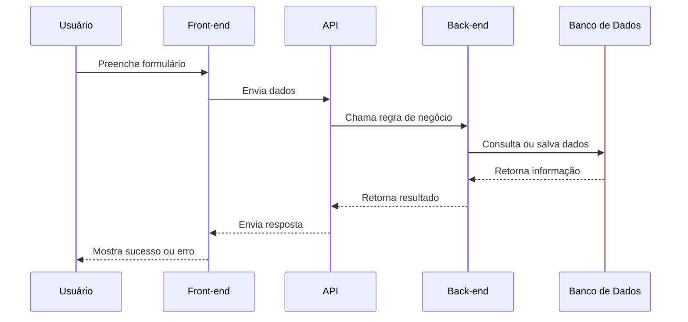

# ROTEIRO DE AULA - Módulo 1, Aula 3

> **Revisão pedagógica — outubro de 2026:** Ao final, o aluno diferencia interface, regra, API e armazenamento e identifica o que é observação e o que é hipótese. Aplicar a atividade 3 do [caderno de prática](../atividades/modulo-01-caderno-de-pratica.md), com entrega, resposta de referência, rubrica e recuperação. Usar essa avaliação explícita para orientar a devolutiva das tarefas deste roteiro. Preservar o tempo de aula já indicado, distribuindo a prática dentro das etapas existentes.

# Conceitos Básicos: Front-end, Back-end, APIs e Banco de Dados

---

# Objetivo da aula

Ensinar os conceitos técnicos básicos que um iniciante precisa reconhecer para entender conversas, vagas e tarefas em empresas de tecnologia.

Ao final da aula, o aluno deverá conseguir:

- diferenciar front-end e back-end;
- explicar o que é uma API de forma simples;
- entender o papel de um banco de dados;
- visualizar como tela, API e banco se conectam;
- identificar como esses conceitos aparecem em QA, Produto, Desenvolvimento e Dados.

---

# Duração estimada

| Etapa | Tempo |
|---|---:|
| Abertura e revisão | 10 min |
| Front-end vs back-end | 30 min |
| APIs | 30 min |
| Banco de dados | 30 min |
| Demonstração prática com fluxo | 25 min |
| Dinâmica em grupo | 25 min |
| Exercício individual | 20 min |
| Perguntas e fechamento | 10 min |
| Total sugerido | 3h |

---

# Materiais necessários

- Navegador
- Quadro branco ou ferramenta visual
- Exemplo de tela de cadastro
- Exemplo de resposta JSON simples
- Planilha para simular banco de dados
- Ferramenta opcional: Postman, Insomnia ou Hoppscotch

---

# Abertura da aula

## Quebra-gelo

Mostre uma tela simples de login ou cadastro e pergunte:

- O que vocês conseguem ver nessa tela?
- O que acontece depois que clicamos em "Entrar"?
- Onde o sistema confere se o e-mail e a senha estão corretos?
- Onde os dados ficam guardados?

## Contextualização

Explique que o usuário enxerga uma tela, mas por trás dela existem camadas trabalhando juntas. Mesmo quem não vai começar como Dev precisa entender essas camadas, porque elas aparecem em testes, requisitos, bugs, métricas e entrevistas.

Mensagem principal:

> Entender front-end, back-end, APIs e banco de dados ajuda você a conversar melhor com times técnicos.

---

# Explicação didática

## Conceito principal

Sistemas digitais geralmente possuem partes visíveis para o usuário e partes internas que processam regras, guardam dados e conectam serviços.

## Explicação simples

Use a analogia do restaurante:

- Front-end é o salão, o cardápio e a experiência do cliente.
- Back-end é a cozinha, onde o pedido é preparado.
- API é o garçom, que leva pedidos e traz respostas.
- Banco de dados é o estoque e o histórico, onde informações ficam armazenadas.

## Explicação técnica

Em uma aplicação web comum:

- o front-end roda no navegador ou aplicativo;
- o back-end roda em um servidor;
- a API define como front-end e back-end se comunicam;
- o banco de dados armazena informações persistentes;
- a infraestrutura mantém tudo disponível e seguro.

---

# Front-end

## Conceito

Front-end é a parte do sistema com a qual o usuário interage diretamente.

## Exemplos

- botão;
- formulário;
- menu;
- tela de login;
- página de produto;
- dashboard;
- mensagens de erro;
- layout responsivo.

## Como aparece no trabalho

Em QA:

- testar se botão funciona;
- validar mensagens;
- verificar responsividade;
- testar campos obrigatórios.

Em Produto:

- definir comportamento da tela;
- escrever critérios de aceite;
- validar experiência do usuário.

Em Desenvolvimento:

- implementar interface;
- conectar tela com API;
- tratar estados de erro e carregamento.

---

# Back-end

## Conceito

Back-end é a parte interna do sistema, responsável por regras de negócio, processamento, segurança, integrações e comunicação com banco de dados.

## Exemplos

- validar login;
- calcular frete;
- processar pagamento;
- criar pedido;
- verificar saldo;
- aplicar cupom;
- gerar certificado.

## Como aparece no trabalho

Em QA:

- testar regras;
- validar respostas da API;
- verificar comportamento em erro;
- testar cenários de permissão.

Em Produto:

- entender limitações técnicas;
- definir regras claras;
- priorizar integrações.

Em Dados:

- entender origem das informações;
- analisar eventos e registros.

---

# APIs

## Conceito

API é uma forma padronizada de sistemas conversarem entre si.

## Explicação simples

Quando o front-end precisa buscar ou enviar informação, ele conversa com o back-end por meio de uma API.

Exemplo:

O usuário clica em "Entrar". A tela envia e-mail e senha para uma API. A API verifica se os dados estão corretos e devolve uma resposta.

## Exemplo técnico simplificado

Requisição:

```http
POST /login
```

Corpo:

```json
{
  "email": "aluno@dtem.com",
  "senha": "12345678"
}
```

Resposta de sucesso:

```json
{
  "mensagem": "Login realizado com sucesso",
  "usuario": "Aluno DTEM"
}
```

Resposta de erro:

```json
{
  "erro": "E-mail ou senha inválidos"
}
```

## Como aparece em vagas

- "Conhecimento em APIs REST";
- "Teste de APIs";
- "Integração com APIs";
- "Consumo de APIs";
- "Postman";
- "JSON".

---

# Banco de dados

## Conceito

Banco de dados é onde o sistema armazena informações de forma organizada.

## Explicação simples

Se um aluno se cadastra em uma plataforma, os dados dele precisam ficar guardados em algum lugar. Esse lugar é o banco de dados.

## Exemplos de dados

- nome;
- e-mail;
- senha criptografada;
- curso comprado;
- progresso nas aulas;
- certificado emitido;
- data de cadastro.

## Exemplo de tabela simples

| id | nome | email | curso | status |
|---:|---|---|---|---|
| 1 | Ana Souza | ana@email.com | Formação Tech | Ativo |
| 2 | Bruno Lima | bruno@email.com | Formação Tech | Ativo |
| 3 | Carla Dias | carla@email.com | QA Inicial | Inativo |

## Como aparece em vagas

- "Noções de SQL";
- "Banco de dados relacional";
- "Consulta em base de dados";
- "Modelagem de dados";
- "Validação de dados".

---

# Fluxo completo



---

# Exemplos reais

## Exemplo 1: compra em e-commerce

- Front-end: tela do produto, carrinho e pagamento.
- API: envia dados do pedido para o back-end.
- Back-end: calcula frete, valida estoque e processa pagamento.
- Banco de dados: salva pedido, cliente e status.

## Exemplo 2: aplicativo de transporte

- Front-end: mapa, destino e botão de solicitar corrida.
- API: envia localização e destino.
- Back-end: encontra motoristas próximos.
- Banco de dados: registra corrida, usuário, motorista e pagamento.

---

# Exemplo corporativo

## Cenário: cadastro de aluno na DTEM

Requisito:

> Como novo aluno, quero criar uma conta informando nome, e-mail e senha para acessar os módulos da formação.

Critérios de aceite:

- nome é obrigatório;
- e-mail deve ter formato válido;
- senha deve ter pelo menos 8 caracteres;
- e-mail não pode ser duplicado;
- sistema deve mostrar mensagem de sucesso;
- sistema deve mostrar erro claro se houver falha.

Como cada área olha para isso:

| Área | Olhar sobre o cadastro |
|---|---|
| Produto | O que o aluno precisa informar? O fluxo está simples? |
| Dev Front-end | Como criar a tela e validações visuais? |
| Dev Back-end | Como validar, salvar e proteger os dados? |
| QA | Quais cenários positivos e negativos testar? |
| Dados | Quantos alunos iniciam e concluem cadastro? |
| Infra | O sistema suporta acessos simultâneos? |

---

# Demonstração prática

## Passo a passo

1. Desenhe uma tela de cadastro no quadro.
2. Liste os campos: nome, e-mail, senha.
3. Mostre que o front-end coleta os dados.
4. Escreva uma requisição JSON simples.
5. Mostre uma tabela simulando o banco.
6. Pergunte quais erros podem acontecer.
7. Transforme os erros em cenários de teste.

## Cenários de teste derivados

- cadastro com todos os dados válidos;
- cadastro sem nome;
- cadastro com e-mail inválido;
- cadastro com senha curta;
- cadastro com e-mail já existente;
- erro de servidor;
- tentativa de cadastro duplicado.

---

# Dinâmica em grupo

## Nome da dinâmica

"Separe as camadas"

## Instruções

Entregue uma lista de itens misturados:

- botão "Entrar";
- regra de senha mínima;
- tabela de usuários;
- endpoint `/login`;
- mensagem "senha inválida";
- cálculo de frete;
- lista de pedidos;
- dashboard de vendas;
- consulta SQL;
- resposta JSON.

Cada grupo deve classificar cada item em:

- Front-end;
- Back-end;
- API;
- Banco de dados;
- Dados/BI.

Depois, cada grupo justifica 3 escolhas.

---

# Exercício prático

## Atividade individual

Escolha uma funcionalidade e desenhe o fluxo entre front-end, API, back-end e banco de dados.

Sugestões:

- login;
- cadastro;
- compra;
- agendamento;
- emissão de certificado;
- recuperação de senha.

O aluno deve entregar:

- nome da funcionalidade;
- desenho do fluxo;
- dados enviados;
- resposta esperada;
- 3 possíveis erros;
- 3 cenários de teste.

---

# Perguntas para os alunos

- O que o usuário vê em um sistema?
- O que acontece por trás da tela?
- Por que QA precisa entender API?
- Por que Produto precisa entender banco de dados minimamente?
- Por que erro de cadastro pode estar no front-end, na API, no back-end ou no banco?
- Qual parte parece mais difícil até agora?

---

# Possíveis dúvidas

| Dúvida | Como responder |
|---|---|
| API é um sistema? | API é uma interface de comunicação. Ela permite que sistemas troquem informações. |
| Back-end é igual banco de dados? | Não. Back-end processa regras e conversa com o banco. Banco armazena dados. |
| Front-end é só design? | Não. Front-end envolve interface, comportamento, validações, integração com API e experiência do usuário. |
| QA precisa saber programar para testar API? | Para começar, não necessariamente. Mas entender requisição, resposta, status e JSON ajuda muito. |
| Banco de dados é uma planilha? | Não, mas a planilha pode ajudar a explicar. Banco é mais estruturado, seguro e preparado para sistemas. |

---

# Resumo da aula

Nesta aula, os alunos aprenderam que sistemas digitais possuem camadas. Front-end é o que o usuário interage, back-end processa regras, API conecta sistemas e banco de dados armazena informações.

Mensagem final:

> Mesmo sem programar ainda, entender essas camadas muda a forma como você lê vagas, testa sistemas e conversa com times técnicos.

---

# Tarefa para casa

1. Escolher um aplicativo usado no dia a dia.
2. Selecionar uma funcionalidade.
3. Descrever:
   - o que seria front-end;
   - o que seria back-end;
   - qual API poderia existir;
   - quais dados seriam armazenados;
   - quais testes seriam importantes.
4. Atualizar o mapa mental com os termos:
   - front-end;
   - back-end;
   - API;
   - banco de dados;
   - JSON;
   - requisição;
   - resposta.

---

# Dicas para o professor

- Use analogias, mas sempre volte para exemplos reais.
- Não aprofunde código neste momento.
- Mostre que QA e Produto precisam entender conceitos técnicos, mesmo sem serem Devs.
- Se usar Postman ou ferramenta similar, faça uma demonstração leve.
- Evite excesso de siglas sem aplicação prática.

---

# Fechamento

Finalize explicando que a próxima aula vai conectar esses conceitos ao pensamento computacional, que é a base para resolver problemas em qualquer área de tecnologia.
