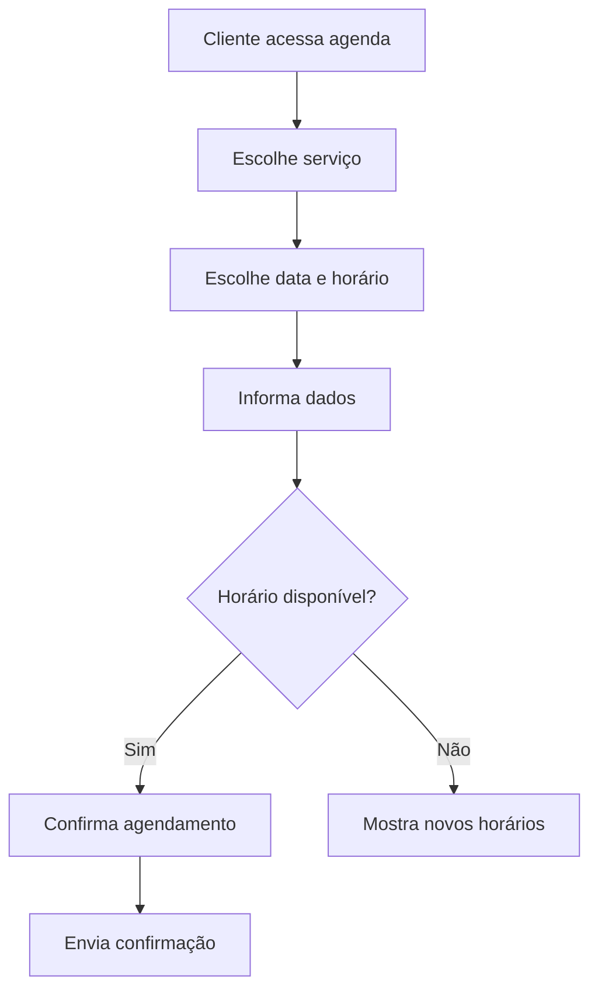

# ROTEIRO DE AULA - Módulo 1, Aula 4

> **Revisão pedagógica — outubro de 2026:** Ao final, o aluno aplica quatro pilares a uma investigação e explica três conexões no mapa final. Aplicar a atividade 4 do [caderno de prática](../atividades/modulo-01-caderno-de-pratica.md), com entrega, resposta de referência, rubrica e recuperação. Usar essa avaliação explícita para orientar a devolutiva das tarefas deste roteiro. Preservar o tempo de aula já indicado, distribuindo a prática dentro das etapas existentes.

# Pensamento Computacional e Entrega do Mapa Mental de TI

---

# Objetivo da aula

Introduzir pensamento computacional como forma de organizar problemas, criar raciocínio lógico e estruturar soluções, conectando o conteúdo do Módulo 1 à entrega final: o mapa mental das áreas de TI.

Ao final da aula, o aluno deverá conseguir:

- explicar pensamento computacional com linguagem simples;
- aplicar decomposição, reconhecimento de padrões, abstração e algoritmo;
- relacionar pensamento computacional com QA, Produto, Dev, Dados e Gestão;
- finalizar o mapa mental do Módulo 1;
- apresentar sua visão inicial de carreira tech.

---

# Duração estimada

| Etapa | Tempo |
|---|---:|
| Abertura e revisão do módulo | 15 min |
| Explicação de pensamento computacional | 35 min |
| Exemplos práticos por área | 30 min |
| Dinâmica em grupo | 30 min |
| Construção da entrega final | 35 min |
| Apresentações rápidas | 25 min |
| Fechamento do módulo | 10 min |
| Total sugerido | 3h |

---

# Materiais necessários

- Quadro branco ou ferramenta visual
- Template de mapa mental
- Papel, caneta ou ferramenta digital
- Navegador
- Exemplos de problemas do dia a dia
- Lista de áreas e conceitos estudados no Módulo 1

---

# Abertura da aula

## Quebra-gelo

Peça aos alunos para responderem:

- O que você já entende melhor sobre tecnologia depois das aulas anteriores?
- Qual conceito ainda parece confuso?
- Qual área chamou mais sua atenção?

Depois, mostre que a aula final do módulo vai organizar esse conhecimento em uma entrega visual.

## Contextualização

Explique que pensamento computacional não é "pensar como computador". É pensar de forma organizada para resolver problemas.

Mensagem principal:

> Tecnologia exige menos mágica e mais método. Pensamento computacional ajuda a quebrar problemas grandes em partes menores.

---

# Explicação didática

## Conceito principal

Pensamento computacional é uma forma de resolver problemas usando organização, lógica, análise e passos claros.

Ele costuma envolver quatro pilares:

- decomposição;
- reconhecimento de padrões;
- abstração;
- algoritmo.

## Explicação simples

Quando você organiza uma viagem, você já usa pensamento computacional:

- separa o problema em partes: passagem, hospedagem, roteiro, orçamento;
- percebe padrões: horários, preços, deslocamentos;
- ignora detalhes menos importantes no início;
- cria uma sequência de passos.

Na tecnologia, fazemos algo parecido com sistemas, processos, testes, produtos e dados.

## Explicação técnica

Pensamento computacional apoia a criação de soluções digitais porque ajuda times a:

- entender o problema antes de construir;
- separar responsabilidades;
- identificar entradas e saídas;
- mapear regras;
- prever cenários;
- organizar passos;
- reduzir ambiguidade;
- testar soluções.

---

# Os 4 pilares

## 1. Decomposição

Dividir um problema grande em partes menores.

Exemplo:

Problema: criar uma plataforma de cursos.

Partes menores:

- cadastro de aluno;
- login;
- lista de cursos;
- player de aula;
- progresso;
- certificado;
- pagamento;
- suporte.

Como aparece no mercado:

- Produto quebra uma ideia em funcionalidades;
- Dev quebra uma funcionalidade em tarefas técnicas;
- QA quebra um fluxo em cenários de teste;
- Gestão quebra um projeto em etapas.

## 2. Reconhecimento de padrões

Identificar semelhanças entre problemas, comportamentos ou soluções.

Exemplo:

Vários alunos reclamam que não conseguem acessar a aula. O time percebe um padrão: todos usam o mesmo navegador ou todos estão tentando acessar pelo celular.

Como aparece no mercado:

- QA percebe bugs parecidos;
- Dados identifica comportamento recorrente;
- Produto percebe dores comuns;
- Suporte agrupa chamados semelhantes.

## 3. Abstração

Focar no que importa e ignorar detalhes desnecessários naquele momento.

Exemplo:

Ao explicar login para um iniciante, não precisamos começar falando de criptografia, token e arquitetura. Primeiro, basta entender:

- usuário informa e-mail e senha;
- sistema valida;
- sistema libera ou bloqueia acesso.

Como aparece no mercado:

- Produto escreve requisitos claros;
- Dev desenha solução sem excesso inicial;
- QA cria cenários principais antes de casos raros;
- Gestão comunica status sem detalhes técnicos demais.

## 4. Algoritmo

Criar uma sequência de passos para resolver um problema.

Exemplo simples:

```text
1. Usuário informa e-mail e senha.
2. Sistema verifica se os campos estão preenchidos.
3. Sistema consulta os dados do usuário.
4. Se os dados forem válidos, libera acesso.
5. Se os dados forem inválidos, mostra mensagem de erro.
```

Como aparece no mercado:

- Dev transforma passos em código;
- QA transforma passos em testes;
- Produto transforma passos em fluxo do usuário;
- Dados transforma passos em regra de análise.

---

# Exemplos reais

## Exemplo 1: QA testando recuperação de senha

Decomposição:

- informar e-mail;
- receber link;
- abrir link;
- cadastrar nova senha;
- acessar conta.

Padrões:

- erro com e-mail inválido;
- link expirado;
- senha fraca.

Abstração:

- focar primeiro no fluxo principal.

Algoritmo:

- criar sequência de teste com resultado esperado.

## Exemplo 2: Produto criando uma funcionalidade

Problema:

Alunos esquecem onde pararam no curso.

Decomposição:

- registrar progresso;
- mostrar última aula;
- permitir continuar de onde parou.

Padrões:

- alunos abandonam aulas longas;
- alunos retornam pelo celular.

Abstração:

- priorizar "continuar assistindo" antes de relatórios avançados.

Algoritmo:

- quando aluno assistir aula, salvar progresso;
- quando voltar, exibir próxima aula.

---

# Exemplo corporativo

## Cenário: sistema de agendamento

A empresa quer permitir que clientes agendem atendimento online.

Aplicando pensamento computacional:

| Pilar | Aplicação |
|---|---|
| Decomposição | Separar cadastro, escolha de horário, confirmação e cancelamento |
| Padrões | Identificar horários mais escolhidos e motivos de cancelamento |
| Abstração | Focar no fluxo principal antes de exceções complexas |
| Algoritmo | Definir passo a passo do agendamento |

Fluxo simplificado:



---

# Demonstração prática

## Passo a passo

Use o problema: "Aluno não consegue acessar a aula online".

1. Pergunte o que pode estar acontecendo.
2. Separe hipóteses:
   - senha errada;
   - e-mail não cadastrado;
   - curso não liberado;
   - problema no navegador;
   - instabilidade no sistema.
3. Agrupe padrões.
4. Foque no fluxo principal.
5. Crie uma sequência de investigação.

## Resultado esperado

Os alunos devem perceber que resolver problema em tecnologia exige organização antes de solução.

---

# Dinâmica em grupo

## Nome da dinâmica

"Quebre o problema"

## Desafio

Cada grupo escolhe um problema:

- cliente não consegue pagar;
- usuário não recebe e-mail;
- aluno não consegue acessar aula;
- pedido não aparece no histórico;
- certificado não é gerado.

O grupo deve aplicar os 4 pilares:

| Pilar | Resposta do grupo |
|---|---|
| Decomposição | |
| Padrões | |
| Abstração | |
| Algoritmo | |

## Apresentação

Cada grupo apresenta em até 5 minutos.

O professor deve perguntar:

- Qual parte vocês investigariam primeiro?
- O que seria evidência?
- Que área ajudaria nesse problema?

---

# Exercício prático

## Atividade individual

Finalizar o mapa mental das áreas de TI.

O mapa deve conter:

- principais áreas:
  - Desenvolvimento;
  - QA;
  - Produto;
  - Dados;
  - Infraestrutura;
  - Gestão de Projetos;
- conceitos técnicos:
  - front-end;
  - back-end;
  - API;
  - banco de dados;
  - pensamento computacional;
- funcionamento de empresa tech:
  - problema;
  - requisitos;
  - desenvolvimento;
  - testes;
  - deploy;
  - melhoria;
- cargos relacionados;
- ferramentas citadas;
- área que mais despertou interesse;
- próximos estudos.

## Critérios de avaliação formativa

| Critério | Esperado |
|---|---|
| Clareza | O mapa é fácil de entender |
| Conexão com mercado | As áreas estão ligadas a atividades reais |
| Organização | Os conceitos estão agrupados de forma lógica |
| Reflexão pessoal | O aluno indica interesses e dúvidas |
| Evolução | O mapa mostra aprendizado do módulo |

---

# Perguntas para os alunos

- Como pensamento computacional pode ajudar alguém de QA?
- Como pode ajudar alguém de Produto?
- Como pode ajudar alguém que ainda não programa?
- Qual problema você conseguiu dividir melhor hoje?
- Qual área você quer explorar nos próximos módulos?
- O que seu mapa mental mostra sobre sua evolução?

---

# Possíveis dúvidas

| Dúvida | Como responder |
|---|---|
| Pensamento computacional é programação? | Não. Ele ajuda na programação, mas também ajuda em QA, Produto, Dados, Gestão e suporte. |
| Preciso decorar os quatro pilares? | Mais importante que decorar é praticar. Use os pilares como guia para organizar problemas. |
| Algoritmo sempre tem código? | Não. Algoritmo é sequência de passos. Código é uma forma de implementar algoritmo. |
| Meu mapa mental precisa ficar bonito? | O mais importante é clareza. Visual ajuda, mas entendimento vem primeiro. |
| E se eu ainda não souber qual área seguir? | Normal. O Módulo 1 serve para abrir visão. A escolha amadurece com prática nos próximos módulos. |

---

# Resumo da aula

Nesta aula, os alunos aprenderam que pensamento computacional é uma forma organizada de resolver problemas. Eles aplicaram decomposição, reconhecimento de padrões, abstração e algoritmo em exemplos reais de tecnologia e finalizaram o mapa mental das áreas de TI.

Mensagem final:

> Quem aprende a organizar problemas aprende melhor qualquer área de tecnologia.

---

# Tarefa para casa

1. Revisar o mapa mental.
2. Melhorar a organização visual.
3. Adicionar pelo menos:
   - 3 cargos reais encontrados em vagas;
   - 3 ferramentas citadas no módulo;
   - 3 dúvidas para levar ao próximo módulo.
4. Publicar ou salvar a versão final para usar como primeiro item do portfólio de estudos.

---

# Dicas para o professor

- Valorize mapas simples, desde que estejam claros.
- Incentive alunos a explicarem o mapa com suas próprias palavras.
- Evite transformar a apresentação em avaliação rígida.
- Use os mapas para identificar dúvidas da turma.
- Conecte a entrega ao portfólio: mesmo uma entrega inicial mostra organização e evolução.

---

# Fechamento

Encerre o Módulo 1 reforçando que os alunos agora possuem uma visão inicial do mercado tech, das áreas de atuação, de como empresas trabalham, dos conceitos técnicos básicos e do pensamento computacional.

Prepare a ponte para o Módulo 2:

> Agora que vocês entendem o cenário da tecnologia, vamos fortalecer a lógica de programação, que é uma base poderosa para QA, Produto, Dados, Desenvolvimento e resolução de problemas.
