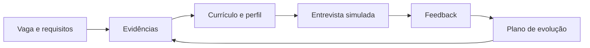

# Bônus — Preparação para o Mercado

## Capa e apresentação

**DTEM Treinamentos — Formação Inicial para Carreira em Tecnologia**  
**Público:** iniciantes e pessoas em transição. **Edição:** outubro de 2026.  
**Formato:** material de estudo, prática e revisão em Markdown.

O bônus transforma as entregas em uma narrativa profissional verificável. O objetivo é explicar o que você sabe fazer, com exemplos, e identificar o que precisa estudar para a oportunidade escolhida. O curso não permite concluir qual vaga estará disponível nem oferece garantia de contratação.

## Objetivo, visão geral e percurso

Ao final, produzir currículo, proposta de perfil LinkedIn, apresentação pessoal e plano de evolução. Pré-requisito: dossiê do projeto final, com contribuição individual identificada.

[Aula 1 — Currículo, LinkedIn e portfólio](../bonus/aula-01-curriculo-linkedin-e-portfolio.md) e [Aula 2 — Entrevistas e plano de evolução](../bonus/aula-02-entrevistas-e-plano-de-evolucao.md). Sugestão: dois encontros de 120 minutos, com pausa incluída; 30–45 minutos de revisão por encontro.

## Tópico 1 — Mercado, recrutamento e leitura de vagas

**Conceito:** uma candidatura relaciona exigências da função a evidências do candidato. **Explicação simples:** em vez de dizer que “sabe tudo de tecnologia”, mostre uma atividade que consegue explicar.

**Explicação técnica:** descrições variam por organização. Separe responsabilidades, competências essenciais, desejáveis, condições e dúvidas. Não trate “júnior” como um conjunto universal de requisitos. QA, suporte técnico e funções de análise de produto podem ter expectativas distintas. Uma responsabilidade de PO pode exigir experiência anterior. Avaliação humana pode considerar clareza, adequação e evidências; não existe uma fórmula universal de aprovação.

**Exemplo cotidiano:** alguém pede organização de estoque; experiência anterior com planilhas pode ser transferível, mas não prova domínio de engenharia de dados. **Empresa:** um recrutador pergunta sobre BUG01; o aluno mostra passos e explica o impacto.

**Erros:** candidatar-se sem ler; repetir termos sem evidência; apresentar exercício como emprego. **Boas práticas:** investigar função e conectar uma exigência a uma entrega. **Em vagas:** comunicação, testes, requisitos e colaboração são vocabulários a verificar na descrição real. **Carreira:** ajuda a escolher estudos a partir de lacunas.

**Atividade — Matriz de aderência.** Contexto: selecionar uma candidatura coerente com o perfil iniciante. Objetivo: identificar evidências e lacunas.

1. Escolher três descrições reais, registrar links e data; se indisponíveis, usar exemplos fornecidos como simulação.
2. Separar essencial e desejável sem inventar classificação.
3. Para três exigências, apontar um artefato ou reconhecer ausência.
4. Escolher uma lacuna e definir próxima prática.

Entrega: tabela exigência/evidência/lacuna/ação. Critérios: fonte identificada, honestidade e ação específica. Exemplo: “reportar bugs → BUG01 → preciso praticar outro domínio → testar fluxo fictício de cadastro”. Dica: habilidade transferível precisa de exemplo. Desafio: comparar diferenças entre duas funções.

## Tópico 2 — Currículo, ATS e LinkedIn

**Conceito:** currículo organiza evidências para uma candidatura; LinkedIn apresenta perfil e projetos; ATS gerencia candidaturas em um processo seletivo. **Explicação simples:** são recursos distintos que devem contar uma história coerente.

**Explicação técnica:** alguns sistemas extraem dados do currículo automaticamente; formato pode afetar essa extração. Isso não equivale a uma regra universal de rejeição por palavras-chave. Use texto selecionável, títulos claros e siga formato solicitado na candidatura. Revise campos preenchidos automaticamente. A documentação de [Greenhouse sobre leitura de currículos](https://support.greenhouse.io/hc/en-us/articles/200989175-Unsuccessful-resume-parse) descreve dificuldades de interpretação. Esta orientação de layout é uma escolha prática do curso, sem garantir comportamento de todo ATS.

Estrutura inicial: contato, objetivo coerente, resumo breve, projetos, experiência anterior pertinente, formação e habilidades comprováveis. Headline informa direção e evidência; Sobre explica trajetória, foco e prática. A orientação oficial de [LinkedIn para perfil](https://www.linkedin.com/help/linkedin/answer/a554351/how-do-i-create-a-good-linkedin-profile) aborda headline e apresentação. Publicar alterações não é necessário para a atividade: entregar primeiro um rascunho revisável.

**Exemplo cotidiano:** uma ficha clara é mais fácil de conferir que uma imagem de texto. **Empresa:** um avaliador abre o link do projeto para conferir contribuição. **Erros:** palavras-chave escondidas, habilidade sem prova, lista interminável de cursos, números inventados. **Boas práticas:** frases com ação, artefato e limite. **Em vagas:** use a terminologia correspondente ao que realizou. **Carreira:** coerência reduz explicações contraditórias.

**Atividade — Currículo e perfil.** Contexto: apresentar a prática educacional para uma função escolhida. Objetivo: comunicar contribuição sem exagero.

1. Escolha uma vaga da matriz e escreva objetivo compatível.
2. Descreva o projeto em duas frases, incluindo contribuição.
3. Crie headline, Sobre e indicação de um projeto.
4. Peça revisão de clareza e correspondência com evidências.
5. Confira se os links funcionam para o avaliador.

Entrega: currículo em Markdown e rascunho de perfil. Critérios: clareza, consistência, evidência e declaração educacional. Exemplo de headline: “Em transição para QA | Testes funcionais e documentação de bugs | Projeto educacional Agenda Clara”. Exemplo de Sobre: “Venho de atendimento e estou desenvolvendo base em qualidade de software. No projeto educacional Agenda Clara, escrevi casos, executei testes e documentei uma falha simulada. Busco ampliar minha prática em análise de regras e comunicação com times.” Dica: mantenha uma versão principal e ajuste conforme exigências reais. Desafio: adaptar para análise de produto sem atribuir cargo de PO que nunca exerceu.

## Tópico 3 — Entrevistas, apresentação e plano de evolução

**Conceito:** entrevista verifica adequação e capacidade de explicar experiências; o plano de evolução transforma lacunas em prática. **Explicação simples:** conte uma situação, sua ação, evidência e aprendizado.

**Explicação técnica:** uma estrutura situação/tarefa/ação/resultado ajuda a organizar respostas, mas não deve virar fala decorada. Em projeto fictício, o resultado é educacional, não impacto empresarial comprovado. Se não souber, descreva o que verificaria e com quem. Perguntas sobre QA podem pedir diferença entre esperado e observado; Produto pode pedir justificativa de prioridade. Prepare também perguntas sobre responsabilidades, apoio, avaliação e rotina da equipe. Um plano de quatro semanas deve ter entregas observáveis e revisão, não apenas horas assistindo vídeos.

**Exemplo cotidiano:** admitir que não executou uma integração é melhor que inventar explicação técnica. **Empresa:** o avaliador pergunta por que pagamento foi adiado; o aluno explica evidências e escopo. **Erros:** memorizar sem entender; inventar números; dizer “sou perfeccionista” sem situação; culpar colega. **Boas práticas:** resposta curta, evidência e reflexão. **Em vagas:** comunicação e resolução de problemas precisam de exemplos. **Carreira:** melhora a defesa do próprio portfólio.

**Atividade — Entrevista em dupla.** Contexto: seleção simulada para QA ou análise de produto. Objetivo: sustentar uma resposta e identificar lacuna.

1. Prepare apresentação de 60 segundos.
2. Responda duas perguntas técnicas e uma comportamental.
3. Mostre um artefato e explique uma decisão.
4. Peça feedback de clareza, evidência e limite.
5. Escreva um plano de quatro semanas com entrega por semana.

Entrega: roteiro de respostas, feedback e plano. Critérios: evidência correta, honestidade, clareza e ação de evolução. Exemplo QA: “Usei RN03 como esperado; a variante aceitou espaços e ocupou H11. Registrei BUG01 e retestei na referência. A evidência é local e não valida concorrência real.” Dica: não ler uma resposta longa durante a simulação. Desafio: responder uma pergunta inesperada sobre limitação.

## Perguntas comuns e respostas de referência

| Pergunta | Caminho de resposta |
|---|---|
| Por que está em transição? | Conectar trajetória, interesse e prática já realizada |
| Qual a diferença entre reteste e regressão? | Usar BUG01 e casos de reserva/cancelamento |
| Como priorizou o backlog? | Relacionar conflito, valor e dependências |
| Conte uma dificuldade | Descrever lacuna, ajuda recebida e revisão |
| Você já trabalhou como QA/PO? | Diferenciar projeto educacional de experiência contratada |
| O que faria se não soubesse a causa? | Reproduzir, registrar, formular hipótese e pedir apoio |

## Comparação e glossário

| Termo | Papel | Cuidado |
|---|---|---|
| Currículo | Evidências para candidatura | Ajustar sem inventar |
| LinkedIn | Perfil e visibilidade | Coerência com currículo |
| ATS | Gestão de candidaturas | Sistemas e configurações variam |
| Portfólio | Artefatos e explicações | Link acessível e contribuição |
| Pitch | Apresentação breve | Não prometer domínio inexistente |
| Lacuna | Competência a desenvolver | Converter em tarefa |

## Diagrama

## Mini desafio e entrega final

Desafio: um avaliador pede experiência de produção que você não tem. Responda com limite e proposta de investigação. Referência: “Minha experiência é educacional. Posso explicar os testes executados e o que estudaria para lidar com produção, sem afirmar que já fiz isso.”

Entrega: matriz de três vagas, currículo, headline, Sobre, link de projeto, pitch, três respostas e plano. Aplicar [rubrica da formação](../planejamento/analise-pedagogica.md). Revisar se houver afirmação não sustentada por artefato.

## Guia do professor e resumo do aluno

Conduzir as duas aulas com revisão em dupla e defesa individual. Não avaliar número de contatos ou publicações. Evitar fórmulas de “burlar ATS”; conferir clareza e verdade das evidências. No feedback, apontar uma frase vaga e pedir um exemplo concreto.

O aluno termina com documentos revisáveis, consciência de limites e próximas práticas. A qualidade da apresentação depende da capacidade de explicar o que realizou.

## Plano de quatro semanas — exemplo

| Semana | Prática | Entrega e revisão |
|---|---|---|
| 1 | Testar novo fluxo fictício | Seis casos com feedback |
| 2 | Escrever requisitos | Duas histórias com critérios |
| 3 | Revisar portfólio | README e evidências acessíveis |
| 4 | Simular entrevista | Respostas revisadas e próxima lacuna |

A frequência de candidaturas e estudos deve ser adaptada à disponibilidade e às oportunidades, sem tratar volume como substituto de adequação.

