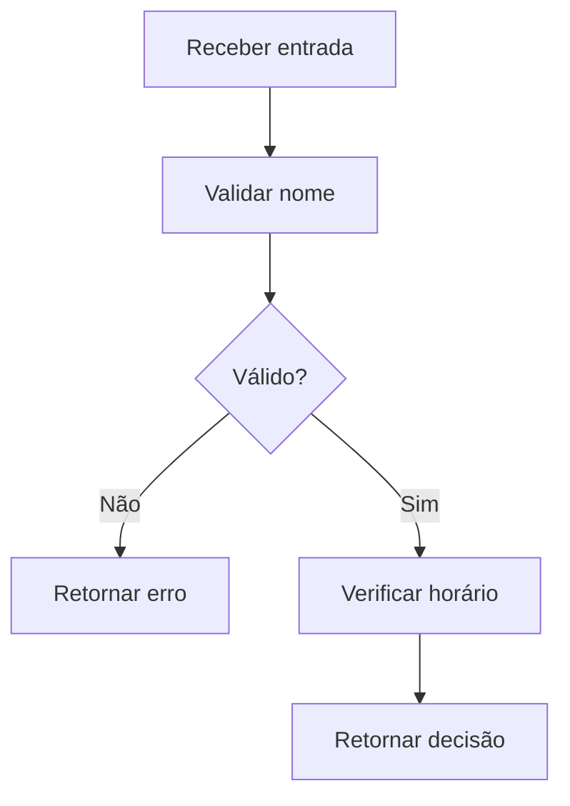

# Módulo 2 — Lógica de Programação

## Capa

**DTEM Treinamentos — Formação Inicial para Carreira em Tecnologia**  
**Público:** iniciantes e pessoas em transição de carreira.  
**Formato:** E-book de estudo e prática em Markdown.  
**Edição pedagógica:** outubro de 2026.  
**Caso de trabalho:** Agenda Clara, empresa e dados fictícios.

## Apresentação


Neste módulo, você vai transformar regras de negócio em algoritmos, rastrear variáveis e validar condições, repetições e funções. O conteúdo foi organizado para estudar antes do encontro, acompanhar a demonstração e revisar a própria entrega depois do feedback. Não é necessário dominar previamente uma profissão: cada tarefa oferece uma entrada concreta e um exemplo de conferência.

Ao estudar, faça uma previsão, execute ou percorra o exemplo manualmente, explique a diferença e tente um caso novo. Copiar a resposta produz um arquivo; explicar como chegou ao resultado produz evidência de aprendizagem.

## Objetivo do módulo

Ao final, o aluno deve conseguir transformar regras de negócio em algoritmos, rastrear variáveis e validar condições, repetições e funções. A comprovação será a entrega descrita ao final, acompanhada da explicação individual.

**Pré-requisitos:** mapa mental do Módulo 1 e capacidade de explicar entrada, processamento e saída.

## O que o aluno aprenderá e visão geral

- Algoritmos e lógica básica.
- Variáveis e tipos de dados.
- Condições e operadores.
- Laços for e while.
- Funções e responsabilidade.
- Resolução de problemas e depuração inicial.

O módulo se conecta à ementa da formação e usa as regras do [caso contínuo](../atividades/caso-agenda-clara.md). Este E-book reúne conteúdo de estudo, exemplos e atividades para acompanhar e revisar o módulo. O aluno pode usar editor de texto e papel; tarefas que exigem execução precisam receber evidência de execução posteriormente.

## Percurso das aulas

| Aula | Tema | Leitura e prática |
|---|---|---|
| 1 | [Algoritmos e rastreamento](../aulas/modulo-02-aula-01-algoritmos-e-rastreamento.md) | Tópicos 1 |
| 2 | [Variáveis, tipos e decisões](../aulas/modulo-02-aula-02-variaveis-e-condicoes.md) | Tópicos 2, 3 |
| 3 | [Laços e listas](../aulas/modulo-02-aula-03-lacos-e-listas.md) | Tópicos 4 |
| 4 | [Funções e resolução de problemas](../aulas/modulo-02-aula-04-funcoes-e-desafios.md) | Tópicos 5, 6 |

**Tempo proposto:** quatro encontros de até 90 minutos, com pausa de 5 minutos incluída: até 6 horas ao vivo por módulo. Reservar estudo posterior para concluir atividades e revisar a entrega. A gravação é a do próprio encontro; não há vídeos teóricos prévios obrigatórios.


## Tópico 1 — Algoritmos e lógica básica

### Conceito

Um algoritmo descreve uma sequência de passos com entradas, decisões e resultados definidos.

### Explicação simples

Uma receita pode orientar um iniciante, mas “faça uma reserva” é amplo demais. Precisamos dizer o que verificar e o que fazer quando a verificação falha.

### Explicação técnica

Defina entrada (nome e horário), pré-condição (catálogo disponível), processamento (validar e verificar ocupação) e saída (sucesso ou motivo de recusa). A ordem interfere no resultado: não ocupe um horário antes de validar o nome. Um algoritmo pode estar em linguagem natural, fluxograma ou pseudocódigo; nenhum deles exige conhecer sintaxe de Python. Rastrear significa executar os passos manualmente, anotando o estado após cada mudança. Terminação e clareza são importantes: um procedimento que manda “tentar de novo” sem uma condição de parada precisa ser revisto.

### Exemplo do mundo real

Ao comprar um ingresso, selecionar uma sessão não significa que o assento já esteja reservado. Este é um exemplo de aplicação, não uma descrição comprovada de processos internos de uma empresa específica.

### Exemplo dentro de uma empresa

Produto explicita RN02 e QA verifica o que acontece na segunda tentativa de reservar H09. Dev transforma a decisão em comportamento executável. O caso Agenda Clara é fictício e permite observar decisões e resultados com dados controlados.

### Erros comuns de iniciantes

Pular o caso de erro; confundir um desejo de negócio com passos executáveis; escrever “verificar” sem informar como reagir.

### Boas práticas

Escrever verbos concretos, registrar entradas e testar manualmente uma situação positiva e uma negativa.

### Como isso aparece em vagas

Vocabulário ilustrativo de vagas: raciocínio lógico, análise de regras e resolução de problemas. Os termos são ilustrativos; a atividade de carreira pede comparar descrições reais selecionadas pelo aluno, com data e link.

### Como isso ajuda na carreira

Ajuda QA a prever resultados e Produto a descobrir ambiguidades antes da implementação.

### Exercício prático

### Atividade 1 — Desenhar o algoritmo de reserva sem escrever código.

**Contexto profissional e cenário:** no projeto fictício Agenda Clara, o time precisa de uma evidência que outra pessoa consiga revisar. Consulte as regras do [caderno do caso](../atividades/caso-agenda-clara.md).

**Objetivo:** Desenhar o algoritmo de reserva sem escrever código. Produza o artefato e explique sua decisão.

**Instruções passo a passo:**

1. Leia RN01 a RN05 no caderno do caso.
2. Escreva entradas, três verificações e saídas possíveis.
3. Percorra Ana/H09 e depois Bruno/H09 mantendo a primeira reserva.
4. Anote o estado do horário depois de cada tentativa.

**Entrega esperada:** registro em Markdown, tabela ou desenho legível com entradas, regra ou referência, resultado e justificativa. Nome sugerido: `m02-atividade-01.md`.

**Critérios específicos:** cumprir todas as etapas, preservar as regras citadas e permitir que um colega confira o resultado. Aplicar também a rubrica ao final do módulo.


**Dica:** escreva sua resposta antes de consultar a referência; depois registre uma diferença e a razão da revisão.

**Variação mais difícil:** Se a segunda tentativa falhar, por que o estado anterior deve permanecer? Acrescente um exemplo novo à entrega e justifique sem copiar o caso resolvido.


## Tópico 2 — Variáveis e tipos de dados

### Conceito

Variáveis associam nomes a valores usados para representar informações durante a execução.

### Explicação simples

Uma ficha “nome = Ana” guarda uma informação; outra ficha “reservas = 1” guarda uma quantidade. Não usamos as duas da mesma forma.

### Explicação técnica

Em Python, texto é str, inteiro é int, verdadeiro/falso é bool e uma sequência de elementos pode ser list. A atribuição usa =; comparação de igualdade usa ==. “2” é texto, enquanto 2 é inteiro: comparar ou somar esses valores exige decidir a conversão. Escolha nomes que expliquem o dado. Uma lista como ["H09", "H10"] preserva elementos separados; a string "H09,H10" ainda é um único texto. Valores mudam durante a execução, então uma tabela de rastreamento deve mostrar antes e depois. Evite ponto flutuante para dinheiro neste módulo; o caso não envolve pagamentos.

### Exemplo do mundo real

Um formulário coleta uma quantidade, mas pode recebê-la como texto; o sistema precisa validar e converter antes de calcular. Este é um exemplo de aplicação, não uma descrição comprovada de processos internos de uma empresa específica.

### Exemplo dentro de uma empresa

Dados separa contagem de reservas de rótulos de horários. H09 é identificador textual, não o número nove. O caso Agenda Clara é fictício e permite observar decisões e resultados com dados controlados.

### Erros comuns de iniciantes

Somar textos esperando soma numérica; usar = como comparação; tratar nome como identificador único de cliente.

### Boas práticas

Escolher tipos a partir da operação necessária e mostrar dados inválidos separadamente.

### Como isso aparece em vagas

Vocabulário ilustrativo: tipos de dados, manipulação de informações e lógica básica. Os termos são ilustrativos; a atividade de carreira pede comparar descrições reais selecionadas pelo aluno, com data e link.

### Como isso ajuda na carreira

Facilita ler JSON, reproduzir bugs com entradas específicas e explicar regras ao time.

### Exercício prático

### Atividade 2 — Montar um dicionário de dados inicial do produto.

**Contexto profissional e cenário:** no projeto fictício Agenda Clara, o time precisa de uma evidência que outra pessoa consiga revisar. Consulte as regras do [caderno do caso](../atividades/caso-agenda-clara.md).

**Objetivo:** Montar um dicionário de dados inicial do produto. Produza o artefato e explique sua decisão.

**Instruções passo a passo:**

1. Liste nome, horário, quantidade de reservas e agenda disponível.
2. Defina tipo, exemplo e restrição para cada dado.
3. Compare 2 + 3 com "2" + "3".
4. Explique por que H09 deve permanecer como texto.

**Entrega esperada:** registro em Markdown, tabela ou desenho legível com entradas, regra ou referência, resultado e justificativa. Nome sugerido: `m02-atividade-02.md`.

**Critérios específicos:** cumprir todas as etapas, preservar as regras citadas e permitir que um colega confira o resultado. Aplicar também a rubrica ao final do módulo.


**Dica:** escreva sua resposta antes de consultar a referência; depois registre uma diferença e a razão da revisão.

**Variação mais difícil:** Qual informação se perde se H09 virar apenas 9? Acrescente um exemplo novo à entrega e justifique sem copiar o caso resolvido.


## Tópico 3 — Condições e operadores

### Conceito

Condições permitem selecionar um caminho conforme uma expressão verdadeira ou falsa.

### Explicação simples

Se o nome estiver vazio, recuse. Caso contrário, continue verificando o horário.

### Explicação técnica

if executa um bloco quando sua condição é verdadeira; elif permite outra condição e else cobre o restante. and exige todas as condições; or aceita pelo menos uma; not inverte o valor lógico. Em Python, indentação delimita blocos. nome.strip() remove espaços das extremidades; bool(nome.strip()) é falso para vazio e espaços somente. Compare casos de fronteira e entradas diferentes. Não conclua que uma mensagem visual prova a aplicação correta de uma regra no servidor: aqui estamos estudando o algoritmo de validação, não a segurança de uma aplicação web.

### Exemplo do mundo real

Um cupom pode exigir compra mínima e prazo válido simultaneamente; usar or nesse caso permitiria descontos indevidos. Este é um exemplo de aplicação, não uma descrição comprovada de processos internos de uma empresa específica.

### Exemplo dentro de uma empresa

QA constrói uma tabela de decisão para RN03 e RN08; Produto confirma qual erro deve ser comunicado quando há mais de uma entrada inválida. O caso Agenda Clara é fictício e permite observar decisões e resultados com dados controlados.

### Erros comuns de iniciantes

Trocar and por or; esquecer espaços; permitir alteração de estado no ramo de erro.

### Boas práticas

Usar tabela de decisão e um resultado explícito por ramo.

### Como isso aparece em vagas

Vocabulário ilustrativo: validação de regras, cenários negativos e condições de negócio. Os termos são ilustrativos; a atividade de carreira pede comparar descrições reais selecionadas pelo aluno, com data e link.

### Como isso ajuda na carreira

Ajuda a justificar cobertura de testes e traduzir critérios de aceite.

### Exercício prático

### Atividade 3 — Criar uma tabela de decisão de validação.

**Contexto profissional e cenário:** no projeto fictício Agenda Clara, o time precisa de uma evidência que outra pessoa consiga revisar. Consulte as regras do [caderno do caso](../atividades/caso-agenda-clara.md).

**Objetivo:** Criar uma tabela de decisão de validação. Produza o artefato e explique sua decisão.

**Instruções passo a passo:**

1. Combine nome válido/inválido com horário no/fora do catálogo.
2. Escreva as quatro combinações.
3. Escolha uma ordem de validação e registre-a.
4. Explique o resultado quando ambas as entradas são inválidas.

**Entrega esperada:** registro em Markdown, tabela ou desenho legível com entradas, regra ou referência, resultado e justificativa. Nome sugerido: `m02-atividade-03.md`.

**Critérios específicos:** cumprir todas as etapas, preservar as regras citadas e permitir que um colega confira o resultado. Aplicar também a rubrica ao final do módulo.


**Dica:** escreva sua resposta antes de consultar a referência; depois registre uma diferença e a razão da revisão.

**Variação mais difícil:** A condição foi atendida ou o sistema apenas exibiu uma mensagem? Acrescente um exemplo novo à entrega e justifique sem copiar o caso resolvido.


## Tópico 4 — Laços for e while

### Conceito

Laços repetem instruções sobre uma coleção ou enquanto uma condição permanece verdadeira.

### Explicação simples

Para mostrar cada horário, passe por todos os itens. Para repetir uma tentativa, verifique quando deve parar.

### Explicação técnica

for percorre os elementos de uma coleção; while verifica uma condição a cada repetição. Um while precisa de progresso em direção à parada. Em Python, range(3) produz 0, 1 e 2; o limite superior não é incluído. Percorrer uma lista vazia com for executa zero iterações, o que pode ser correto. Registre contador e resultado em cada passo. Não altere a coleção percorrida sem entender os efeitos. Para filtrar horários, percorra o catálogo e adicione ao resultado apenas os que não estão ocupados.

### Exemplo do mundo real

Uma lista de pedidos exige examinar cada pedido, inclusive quando nenhum existe. Este é um exemplo de aplicação, não uma descrição comprovada de processos internos de uma empresa específica.

### Exemplo dentro de uma empresa

Dev filtra a agenda; QA testa catálogo completo, um horário ocupado e todos ocupados. O caso Agenda Clara é fictício e permite observar decisões e resultados com dados controlados.

### Erros comuns de iniciantes

Laço infinito; esquecer atualização do contador; supor que sempre haverá um elemento.

### Boas práticas

Definir estado inicial, condição de parada e comportamento para lista vazia.

### Como isso aparece em vagas

Vocabulário ilustrativo: estruturas de repetição e processamento de listas. Os termos são ilustrativos; a atividade de carreira pede comparar descrições reais selecionadas pelo aluno, com data e link.

### Como isso ajuda na carreira

Permite entender testes parametrizados, contagens e pequenas rotinas de Dados.

### Exercício prático

### Atividade 4 — Rastrear o filtro de horários livres.

**Contexto profissional e cenário:** no projeto fictício Agenda Clara, o time precisa de uma evidência que outra pessoa consiga revisar. Consulte as regras do [caderno do caso](../atividades/caso-agenda-clara.md).

**Objetivo:** Rastrear o filtro de horários livres. Produza o artefato e explique sua decisão.

**Instruções passo a passo:**

1. Use catálogo H09, H10, H11 e ocupados H10.
2. Percorra cada item e anote se será adicionado.
3. Repita com todos ocupados.
4. Escreva um while de três tentativas e indique a atualização.

**Entrega esperada:** registro em Markdown, tabela ou desenho legível com entradas, regra ou referência, resultado e justificativa. Nome sugerido: `m02-atividade-04.md`.

**Critérios específicos:** cumprir todas as etapas, preservar as regras citadas e permitir que um colega confira o resultado. Aplicar também a rubrica ao final do módulo.


**Dica:** escreva sua resposta antes de consultar a referência; depois registre uma diferença e a razão da revisão.

**Variação mais difícil:** O que deve acontecer quando a lista está vazia? Acrescente um exemplo novo à entrega e justifique sem copiar o caso resolvido.


## Tópico 5 — Funções e responsabilidade

### Conceito

Uma função encapsula uma operação que recebe parâmetros e pode retornar um resultado.

### Explicação simples

Em vez de copiar a verificação do nome em vários lugares, damos a ela um nome e a reutilizamos.

### Explicação técnica

def define a função; parâmetros representam entradas; return entrega o resultado. print exibe texto e não substitui return. A função validar_nome deve apenas decidir se o texto é aceito, sem reservar horário ou mudar a agenda. Separar responsabilidades facilita testar. Para simplificar, considere entradas de texto; se aceitar outros tipos, valide-os explicitamente. Uma função sem return explícito retorna None em Python. Observe a diferença entre argumento passado na chamada e parâmetro declarado na definição.

### Exemplo do mundo real

Um cálculo de frete reutilizável pode ser chamado tanto pelo carrinho quanto pela finalização da compra. Este é um exemplo de aplicação, não uma descrição comprovada de processos internos de uma empresa específica.

### Exemplo dentro de uma empresa

QA testa validar_nome sem precisar executar todo o processo de reserva; Dev evita copiar a mesma lógica. O caso Agenda Clara é fictício e permite observar decisões e resultados com dados controlados.

### Erros comuns de iniciantes

Usar print e tentar comparar o resultado; modificar dados sem anunciar; criar uma função que resolve tarefas desconexas.

### Boas práticas

Nomear pela responsabilidade, manter entradas e saídas claras e usar exemplos pequenos.

### Como isso aparece em vagas

Vocabulário ilustrativo: funções, modularização e manutenção de código. Os termos são ilustrativos; a atividade de carreira pede comparar descrições reais selecionadas pelo aluno, com data e link.

### Como isso ajuda na carreira

Ajuda a ler código e a explicar onde uma regra deve ser verificada.

### Exercício prático

### Atividade 5 — Implementar e validar uma função de nome.

**Contexto profissional e cenário:** no projeto fictício Agenda Clara, o time precisa de uma evidência que outra pessoa consiga revisar. Consulte as regras do [caderno do caso](../atividades/caso-agenda-clara.md).

**Objetivo:** Implementar e validar uma função de nome. Produza o artefato e explique sua decisão.

**Instruções passo a passo:**

1. Defina validar_nome(nome).
2. Retorne bool(nome.strip()) para entrada textual.
3. Teste "Ana", "" e "   ".
4. Registre entrada e retorno e explique a diferença para print.

**Entrega esperada:** registro em Markdown, tabela ou desenho legível com entradas, regra ou referência, resultado e justificativa. Nome sugerido: `m02-atividade-05.md`.

**Critérios específicos:** cumprir todas as etapas, preservar as regras citadas e permitir que um colega confira o resultado. Aplicar também a rubrica ao final do módulo.


**Dica:** escreva sua resposta antes de consultar a referência; depois registre uma diferença e a razão da revisão.

**Variação mais difícil:** Quem deve decidir reservar um horário: validar_nome ou a operação de reserva? Acrescente um exemplo novo à entrega e justifique sem copiar o caso resolvido.


## Tópico 6 — Resolução de problemas e depuração inicial

### Conceito

Depurar é investigar por que o comportamento observado difere do esperado.

### Explicação simples

Em vez de mudar linhas ao acaso, descubra qual passo fez o resultado desviar.

### Explicação técnica

Defina uma regra, construa uma entrada que a exercita e compare saída e estado. Use uma tabela com passo, variável e resultado. Reproduza o problema antes de propor correção. Primeiro classifique: erro de sintaxe impede interpretar o programa; erro de execução interrompe uma operação; erro lógico pode produzir uma saída válida na forma, porém errada pela regra. Python e Portugol usam sintaxes diferentes: escolha uma linguagem para executar e trate a outra como alternativa didática, sem misturar comandos.

### Exemplo do mundo real

Uma calculadora que apresenta um número incorreto pode ter executado sem travar; ausência de erro visível não prova correção. Este é um exemplo de aplicação, não uma descrição comprovada de processos internos de uma empresa específica.

### Exemplo dentro de uma empresa

Na AgendaComDefeito, espaços geram uma reserva. O problema é lógico, pois viola RN03 sem interromper a execução. O caso Agenda Clara é fictício e permite observar decisões e resultados com dados controlados.

### Erros comuns de iniciantes

Mudar várias regras de uma vez; comparar sem registrar entrada; usar apenas um exemplo positivo.

### Boas práticas

Reproduzir, reduzir o caso, formular hipótese, corrigir uma causa e repetir casos anteriores.

### Como isso aparece em vagas

Vocabulário ilustrativo: troubleshooting, análise de causa e resolução de problemas. Os termos são ilustrativos; a atividade de carreira pede comparar descrições reais selecionadas pelo aluno, com data e link.

### Como isso ajuda na carreira

Constrói explicações verificáveis para bugs e entrevistas técnicas iniciais.

### Exercício prático

### Atividade 6 — Investigar uma validação que aceita espaços.

**Contexto profissional e cenário:** no projeto fictício Agenda Clara, o time precisa de uma evidência que outra pessoa consiga revisar. Consulte as regras do [caderno do caso](../atividades/caso-agenda-clara.md).

**Objetivo:** Investigar uma validação que aceita espaços. Produza o artefato e explique sua decisão.

**Instruções passo a passo:**

1. Compare nome != "" com bool(nome.strip()).
2. Rastreie ambas para "   ".
3. Formule uma hipótese do erro.
4. Escreva a correção e repita as três entradas da função anterior.

**Entrega esperada:** registro em Markdown, tabela ou desenho legível com entradas, regra ou referência, resultado e justificativa. Nome sugerido: `m02-atividade-06.md`.

**Critérios específicos:** cumprir todas as etapas, preservar as regras citadas e permitir que um colega confira o resultado. Aplicar também a rubrica ao final do módulo.


**Dica:** escreva sua resposta antes de consultar a referência; depois registre uma diferença e a razão da revisão.

**Variação mais difícil:** Qual evidência confirma sua hipótese? Acrescente um exemplo novo à entrega e justifique sem copiar o caso resolvido.


## Exemplos reais do mercado e cenários do dia a dia

1. **Algoritmos e lógica básica:** Ao comprar um ingresso, selecionar uma sessão não significa que o assento já esteja reservado. Na simulação: Produto explicita RN02 e QA verifica o que acontece na segunda tentativa de reservar H09. Dev transforma a decisão em comportamento executável.

2. **Variáveis e tipos de dados:** Um formulário coleta uma quantidade, mas pode recebê-la como texto; o sistema precisa validar e converter antes de calcular. Na simulação: Dados separa contagem de reservas de rótulos de horários. H09 é identificador textual, não o número nove.

3. **Condições e operadores:** Um cupom pode exigir compra mínima e prazo válido simultaneamente; usar or nesse caso permitiria descontos indevidos. Na simulação: QA constrói uma tabela de decisão para RN03 e RN08; Produto confirma qual erro deve ser comunicado quando há mais de uma entrada inválida.

4. **Laços for e while:** Uma lista de pedidos exige examinar cada pedido, inclusive quando nenhum existe. Na simulação: Dev filtra a agenda; QA testa catálogo completo, um horário ocupado e todos ocupados.

5. **Funções e responsabilidade:** Um cálculo de frete reutilizável pode ser chamado tanto pelo carrinho quanto pela finalização da compra. Na simulação: QA testa validar_nome sem precisar executar todo o processo de reserva; Dev evita copiar a mesma lógica.

6. **Resolução de problemas e depuração inicial:** Uma calculadora que apresenta um número incorreto pode ter executado sem travar; ausência de erro visível não prova correção. Na simulação: Na AgendaComDefeito, espaços geram uma reserva. O problema é lógico, pois viola RN03 sem interromper a execução.

Para distinguir evidência de hipótese, escreva o que você observou, qual regra utilizou e o que ainda depende de validação. Exemplos cotidianos explicam o uso; não são estudos de caso atribuídos a marcas.

## Tabela comparativa

| Elemento | Significado ou uso | Exemplo ou cuidado |
|---|---|---|
| Algoritmo | Passos da solução, independentes de linguagem | Validar nome e horário |
| Variável | Valor identificado durante execução | horario = H09 |
| Condição | Escolha conforme expressão booleana | Horário está ocupado? |
| Laço | Repetição controlada | Percorrer catálogo |
| Função | Operação com parâmetros e resultado | validar_nome(nome) |

## Diagrama do módulo



Leia o diagrama da esquerda para a direita ou de cima para baixo, seguindo as setas. Explique onde surge uma decisão e como o fluxo retorna após uma falha. Diagramas ajudam a conversar sobre o processo; o comportamento deve ser conferido pelas regras e evidências.

## Glossário

| Termo | Explicação |
|---|---|
| Algoritmo | Sequência finita de passos para resolver um problema. |
| Booleano | Valor verdadeiro ou falso. |
| Parâmetro | Nome de uma entrada definida por uma função. |
| Retorno | Resultado que uma função entrega ao chamador. |
| Estado | Valores existentes em um momento da execução. |
| Iteração | Uma passagem pelo corpo de um laço. |

## Exercícios práticos e mini desafio

As atividades detalhadas em cada tópico compõem o caderno de prática. Para o mini desafio, use o mesmo caso e registre: situação inicial, decisão, razão, resultado esperado e uma limitação.

**Desafio:** Altere a política para permitir somente duas reservas por cliente. Descreva qual dado adicional falta; não invente uma solução que conte apenas horários.


## Entrega final do módulo

**Entregar:** caderno de seis algoritmos com entradas, saídas e rastreamento, mais uma função de validação em Python ou pseudocódigo.

Inclua no início: título, nome do aluno, data, identificação do projeto educacional e versão usada. Inclua no fim uma reflexão de 5–8 linhas: uma decisão que mudou, evidência que motivou a mudança e uma dúvida a investigar.

**Checklist:**

- [ ] Todos os exercícios indicados no percurso estão identificados.
- [ ] As regras utilizadas e os resultados podem ser conferidos.
- [ ] O mini desafio contém uma justificativa própria.
- [ ] A entrega declara dados fictícios e limites da simulação.
- [ ] A contribuição individual está clara, inclusive em trabalhos em grupo.
- [ ] O arquivo abre e os links necessários estão acessíveis ao avaliador.

### Rubrica e recuperação

| Critério | 0 — revisar | 1 — parcial | 2 — atendido |
|---|---|---|---|
| Correção conceitual | Contradiz a regra | Acerta parte, mas há ambiguidade | Explica e aplica a regra corretamente |
| Completude | Não apresenta o artefato | Faltam etapas ou casos solicitados | Inclui todos os itens do enunciado |
| Evidência verificável | Não permite conferência | Falta entrada, versão ou resultado | Outra pessoa consegue conferir o raciocínio ou reproduzir |
| Justificativa | Decisão sem razão | Razão genérica | Relaciona decisão a regra, risco e resultado |

**Parâmetro formativo:** 6 de 8 pontos, sem zero em correção ou evidência. Não representa regra de certificação. Após o feedback, registre um acerto, uma lacuna e a próxima ação; corrija e reapresente quando solicitado.


## Resumo final para o aluno

- Um algoritmo descreve uma sequência de passos com entradas, decisões e resultados definidos.
- Variáveis associam nomes a valores usados para representar informações durante a execução.
- Condições permitem selecionar um caminho conforme uma expressão verdadeira ou falsa.
- Laços repetem instruções sobre uma coleção ou enquanto uma condição permanece verdadeira.
- Uma função encapsula uma operação que recebe parâmetros e pode retornar um resultado.
- Depurar é investigar por que o comportamento observado difere do esperado.

Você demonstra avanço quando consegue produzir a entrega, explicar uma decisão e revisar um erro com evidência. Guarde a primeira versão e a revisão para contar sua evolução no portfólio.

## Laboratório de código — exemplos executáveis

Os exemplos usam Python 3 sem bibliotecas externas. Salve cada bloco em arquivo separado e execute com `python nome_do_arquivo.py` ou `py nome_do_arquivo.py`. Não misture pseudocódigo e sintaxe de Python no mesmo arquivo. Em Portugol, traduza os passos e confira o mesmo comportamento, sem pressupor compatibilidade de sintaxe.

### Entrada, variáveis e comparação

```python
nome = "Ana Exemplo"
horario = "H09"
tentativas = 2
print(nome, horario, tentativas)
print(2 + 3)
print("2" + "3")
print(tentativas == 2)
```

Resultados: texto e identificador, 5, 23 e True. A terceira linha impressa concatena textos; o número de tentativas é inteiro.

### Condições com saídas explícitas

```python
nome = "   "
horario = "H09"
catalogo = ["H09", "H10", "H11"]
ocupados = ["H10"]

if not nome.strip():
    resultado = "nome_invalido"
elif horario not in catalogo:
    resultado = "horario_invalido"
elif horario in ocupados:
    resultado = "conflito"
else:
    resultado = "pode_reservar"

print(resultado)
```

Saída: nome_invalido. Alterar nome para Ana e horário para H10 produz conflito. “Pode reservar” é apenas decisão de validação neste exemplo; o bloco não altera a agenda.

### for — filtrar horários

```python
catalogo = ["H09", "H10", "H11"]
ocupados = ["H10"]
livres = []
for horario in catalogo:
    if horario not in ocupados:
        livres.append(horario)
print(livres)
```

Saída: ['H09', 'H11']. Rastreie horário e livres a cada passagem.

### while — limitar tentativas

```python
tentativas = 0
while tentativas < 3:
    tentativas += 1
    print("Tentativa", tentativas)
```

Saída: tentativas 1, 2 e 3. Sem incremento, a condição não progride para parada. O exemplo não solicita entradas nem implementa login; apenas demonstra controle de repetição.

### Função com retorno

```python
def validar_nome(nome):
    return bool(nome.strip())

for entrada in ["Ana", "", "   "]:
    print(repr(entrada), validar_nome(entrada))
```

Saídas: True, False e False. A função pressupõe entrada textual; discutir tipos diferentes é uma extensão. `repr` ajuda a enxergar espaços no registro.

### Transferência e conferência

Altere uma entrada de cada bloco e preveja a saída antes de executar. Entregue previsão, observado e explicação. Critério: justificar diferença com variável, condição ou estado. Para o mini desafio de limite por cliente, o simulador atual não tem identificador de cliente: declarar essa lacuna é parte da resposta correta.

## Referências e continuidade

Consultar [ementa local](../ementa.md), [caderno do caso](../atividades/caso-agenda-clara.md) e [laboratório](../portfolio/agenda-clara/README.md). Referências técnicas: [Python](https://docs.python.org/3/tutorial/), [Git](https://git-scm.com/docs/gittutorial), [Scrum Guide](https://scrumguides.org/scrum-guide.html) e [ISTQB CTFL](https://istqb.org/certifications/certified-tester-foundation-level-ctfl-v4-0/). Use a documentação pertinente ao tema; os exemplos, atividades e rubricas são autorais.
