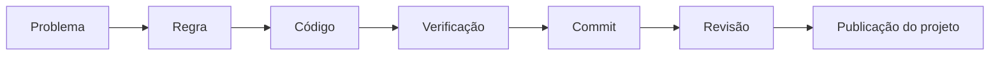

# Módulo 3 — Introdução ao Desenvolvimento de Software

## Capa

**DTEM Treinamentos — Formação Inicial para Carreira em Tecnologia**  
**Público:** iniciantes e pessoas em transição de carreira.  
**Formato:** E-book de estudo e prática em Markdown.  
**Edição pedagógica:** outubro de 2026.  
**Caso de trabalho:** Agenda Clara, empresa e dados fictícios.

## Apresentação


Neste módulo, você vai explicar a construção de um sistema, ler código simples e publicar um projeto educacional com histórico compreensível. O conteúdo foi organizado para estudar antes do encontro, acompanhar a demonstração e revisar a própria entrega depois do feedback. Não é necessário dominar previamente uma profissão: cada tarefa oferece uma entrada concreta e um exemplo de conferência.

Ao estudar, faça uma previsão, execute ou percorra o exemplo manualmente, explique a diferença e tente um caso novo. Copiar a resposta produz um arquivo; explicar como chegou ao resultado produz evidência de aprendizagem.

## Objetivo do módulo

Ao final, o aluno deve conseguir explicar a construção de um sistema, ler código simples e publicar um projeto educacional com histórico compreensível. A comprovação será a entrega descrita ao final, acompanhada da explicação individual.

**Pré-requisitos:** algoritmos e condições do Módulo 2; arquivo de texto salvo e localizado no computador.

## O que o aluno aprenderá e visão geral

- O que é um sistema e como é construído.
- Noções básicas e leitura de código.
- Git e versionamento local.
- GitHub e primeiro projeto publicado.
- Branches, revisão e colaboração.

O módulo se conecta à ementa da formação e usa as regras do [caso contínuo](../atividades/caso-agenda-clara.md). Este E-book reúne conteúdo de estudo, exemplos e atividades para acompanhar e revisar o módulo. O aluno pode usar editor de texto e papel; tarefas que exigem execução precisam receber evidência de execução posteriormente.

## Percurso das aulas

| Aula | Tema | Leitura e prática |
|---|---|---|
| 1 | [Sistemas e construção de software](../aulas/modulo-03-aula-01-sistemas-e-construcao.md) | Tópicos 1 |
| 2 | [Leitura de código e comportamento](../aulas/modulo-03-aula-02-leitura-de-codigo.md) | Tópicos 2 |
| 3 | [Git e histórico local](../aulas/modulo-03-aula-03-git-e-versionamento.md) | Tópicos 3 |
| 4 | [GitHub, revisão e publicação](../aulas/modulo-03-aula-04-github-e-colaboracao.md) | Tópicos 4, 5 |

**Tempo proposto:** quatro encontros de até 90 minutos, com pausa de 5 minutos incluída: até 6 horas ao vivo por módulo. Reservar estudo posterior para concluir atividades e revisar a entrega. A gravação é a do próprio encontro; não há vídeos teóricos prévios obrigatórios.

## Tópico 1 — O que é um sistema e como é construído

### Conceito

Um sistema reúne componentes que recebem entradas, executam regras e produzem resultados para um objetivo.

### Explicação simples

A tela é uma parte da solução. A reserva também depende de regras e de algum lugar onde o estado seja mantido.

### Explicação técnica

Separe interface, regra de negócio, integração e armazenamento. O simulador Agenda Clara implementa regras e estado em memória; não tem interface web nem banco persistente. Em um produto maior, requisitos orientam o desenho, código implementa o comportamento e testes verificam exemplos e riscos. Construção é iterativa: uma descoberta pode exigir voltar à regra. Um protótipo pode validar interação sem implementar toda a lógica, enquanto um programa de linha de comando pode executar regras sem uma tela gráfica.

### Exemplo do mundo real

Em uma compra online, fechar o navegador não deveria apagar um pedido persistido; no simulador, encerrar o processo perde as reservas. Este é um exemplo de aplicação, não uma descrição comprovada de processos internos de uma empresa específica.

### Exemplo dentro de uma empresa

Produto e Dev combinam qual parte do MVP será executável e qual parte continuará ilustrada; QA registra essa limitação no plano. O caso Agenda Clara é fictício e permite observar decisões e resultados com dados controlados.

### Erros comuns de iniciantes

Confundir protótipo com produto pronto; chamar armazenamento em memória de banco persistente.

### Boas práticas

Descrever componentes existentes, ausentes e dependências antes de demonstrar.

### Como isso aparece em vagas

Vocabulário ilustrativo: arquitetura básica, sistemas e integração. Os termos são ilustrativos; a atividade de carreira pede comparar descrições reais selecionadas pelo aluno, com data e link.

### Como isso ajuda na carreira

Ajuda a localizar perguntas e investigar falhas sem atribuí-las automaticamente à tela.

### Exercício prático

### Atividade 1 — Desenhar os componentes do laboratório.

**Contexto profissional e cenário:** no projeto fictício Agenda Clara, o time precisa de uma evidência que outra pessoa consiga revisar. Consulte as regras do [caderno do caso](../atividades/caso-agenda-clara.md).

**Objetivo:** Desenhar os componentes do laboratório. Produza o artefato e explique sua decisão.

**Instruções passo a passo:**

1. Leia o README do simulador.
2. Identifique entrada, regra e estado.
3. Desenhe uma possível interface futura sem afirmar que existe.
4. Registre o efeito de encerrar o processo.

**Entrega esperada:** registro em Markdown, tabela ou desenho legível com entradas, regra ou referência, resultado e justificativa. Nome sugerido: `m03-atividade-01.md`.

**Critérios específicos:** cumprir todas as etapas, preservar as regras citadas e permitir que um colega confira o resultado. Aplicar também a rubrica ao final do módulo.

**Resposta de referência e comentário:** Entrada por chamadas Python; regras na classe Agenda; estado em reservas; saída em dicionários. Uma interface futura chamaria a regra. Encerrar a execução perde o estado porque não há persistência.

**Dica:** escreva sua resposta antes de consultar a referência; depois registre uma diferença e a razão da revisão.

**Variação mais difícil:** Qual componente falta para preservar reservas entre execuções? Acrescente um exemplo novo à entrega e justifique sem copiar o caso resolvido.


## Tópico 2 — Noções básicas e leitura de código

### Conceito

Ler código é reconstruir seu comportamento a partir de entradas, decisões e mudanças de estado.

### Explicação simples

Não precisamos escrever tudo para investigar: podemos acompanhar o que cada linha faz com um exemplo.

### Explicação técnica

Na classe Agenda, self.reservas é um dicionário que associa identificador a dados da reserva. O método consultar monta um conjunto de horários ocupados e filtra o catálogo. return encerra a operação e devolve seu resultado. Em reservar, observe as três recusas antes da criação. super().reservar na classe com defeito chama a implementação de referência depois de transformar a entrada. Você não precisa dominar orientação a objetos aqui; a classe serve para agrupar estado e operações. Comece pelo contrato público e aprofunde uma linha por vez.

### Exemplo do mundo real

Ler uma regra de cálculo ajuda a distinguir um requisito inesperado de um erro de implementação. Este é um exemplo de aplicação, não uma descrição comprovada de processos internos de uma empresa específica.

### Exemplo dentro de uma empresa

QA usa a leitura para explicar por que espaços passam na variante defeituosa, sem inventar detalhes de um servidor inexistente. O caso Agenda Clara é fictício e permite observar decisões e resultados com dados controlados.

### Erros comuns de iniciantes

Adivinhar pelo nome da função; ignorar retorno antecipado; ler sem entrada concreta.

### Boas práticas

Anotar entrada, linha relevante, saída e mudança de estado.

### Como isso aparece em vagas

Vocabulário ilustrativo: leitura de código, entendimento de lógica e colaboração técnica. Os termos são ilustrativos; a atividade de carreira pede comparar descrições reais selecionadas pelo aluno, com data e link.

### Como isso ajuda na carreira

Reduz dependência de explicações vagas e melhora perguntas feitas a Dev.

### Exercício prático

### Atividade 2 — Rastrear duas chamadas do simulador.

**Contexto profissional e cenário:** no projeto fictício Agenda Clara, o time precisa de uma evidência que outra pessoa consiga revisar. Consulte as regras do [caderno do caso](../atividades/caso-agenda-clara.md).

**Objetivo:** Rastrear duas chamadas do simulador. Produza o artefato e explique sua decisão.

**Instruções passo a passo:**

1. Leia reservar na classe Agenda.
2. Acompanhe Ana/H09 em agenda vazia.
3. Acompanhe Bruno/H09 na mesma agenda.
4. Localize a linha que impede a segunda reserva.

**Entrega esperada:** registro em Markdown, tabela ou desenho legível com entradas, regra ou referência, resultado e justificativa. Nome sugerido: `m03-atividade-02.md`.

**Critérios específicos:** cumprir todas as etapas, preservar as regras citadas e permitir que um colega confira o resultado. Aplicar também a rubrica ao final do módulo.

**Resposta de referência e comentário:** A primeira reserva recebe id 1. A segunda encontra H09 fora de consultar() e retorna conflito antes de adicionar dados. O dicionário conserva uma única reserva.

**Dica:** escreva sua resposta antes de consultar a referência; depois registre uma diferença e a razão da revisão.

**Variação mais difícil:** Em qual ponto a chamada deixa de poder criar uma reserva? Acrescente um exemplo novo à entrega e justifique sem copiar o caso resolvido.


## Tópico 3 — Git e versionamento local

### Conceito

Git mantém histórico de mudanças selecionadas em um repositório.

### Explicação simples

Salvar um arquivo muda seu conteúdo. Criar um commit registra uma versão que podemos identificar e comparar.

### Explicação técnica

O diretório de trabalho contém seus arquivos; a área de preparação reúne o que entrará no próximo commit; o histórico guarda os commits. Execute git status para observar, git add para selecionar e git commit para registrar. git diff mostra mudanças ainda não preparadas; git diff --staged mostra as preparadas. git log --oneline ajuda a localizar versões. Um arquivo não rastreado ainda não pertence ao histórico. Faça tudo em uma pasta de exercício, sem usar operações destrutivas de limpeza. Configure identidade de autor conforme a preferência de privacidade da conta.

### Exemplo do mundo real

Um texto sem histórico permite ver apenas a versão atual; com commits podemos explicar a evolução da regra. Este é um exemplo de aplicação, não uma descrição comprovada de processos internos de uma empresa específica.

### Exemplo dentro de uma empresa

Dev registra a correção de RN03 separadamente da reformatação do README, permitindo revisão focada. O caso Agenda Clara é fictício e permite observar decisões e resultados com dados controlados.

### Erros comuns de iniciantes

Usar git add . sem inspecionar; registrar credenciais; mensagens como “coisas”.

### Boas práticas

Verificar status e diff, selecionar arquivos explicitamente e escrever propósito no commit.

### Como isso aparece em vagas

Vocabulário ilustrativo: Git, versionamento e colaboração. Os termos são ilustrativos; a atividade de carreira pede comparar descrições reais selecionadas pelo aluno, com data e link.

### Como isso ajuda na carreira

Permite demonstrar evolução e contribuição pessoal no portfólio.

### Exercício prático

### Atividade 3 — Criar três commits locais com intenção clara.

**Contexto profissional e cenário:** no projeto fictício Agenda Clara, o time precisa de uma evidência que outra pessoa consiga revisar. Consulte as regras do [caderno do caso](../atividades/caso-agenda-clara.md).

**Objetivo:** Criar três commits locais com intenção clara. Produza o artefato e explique sua decisão.

**Instruções passo a passo:**

1. Crie uma pasta de laboratório e copie README e agenda_clara.py.
2. Execute git init e git status.
3. Adicione README e faça o primeiro commit.
4. Adicione simulador em outro commit; melhore a instrução de execução no terceiro.
5. Leia git log --oneline e explique cada versão.

**Entrega esperada:** registro em Markdown, tabela ou desenho legível com entradas, regra ou referência, resultado e justificativa. Nome sugerido: `m03-atividade-03.md`.

**Critérios específicos:** cumprir todas as etapas, preservar as regras citadas e permitir que um colega confira o resultado. Aplicar também a rubrica ao final do módulo.

**Resposta de referência e comentário:** Histórico esperado: apresentar projeto; adicionar simulador de reservas; esclarecer execução. Os hashes variam. O importante é que cada commit tenha mudança verificável e mensagem coerente.

**Dica:** escreva sua resposta antes de consultar a referência; depois registre uma diferença e a razão da revisão.

**Variação mais difícil:** O arquivo salvo já pertence a um commit? Acrescente um exemplo novo à entrega e justifique sem copiar o caso resolvido.


## Tópico 4 — GitHub e primeiro projeto publicado

### Conceito

GitHub hospeda repositórios e oferece recursos de colaboração sobre históricos Git.

### Explicação simples

Git organiza o histórico no seu computador; GitHub permite compartilhar uma cópia e receber contribuições.

### Explicação técnica

Crie um repositório vazio na conta escolhida, sem README automático quando estiver conectando um histórico local existente. Confira o endereço remoto antes de usar git remote add origin e envie a branch correta com git push -u origin main, após verificar seu nome com git branch --show-current. Se a branch local tiver outro nome, use esse nome ou renomeie conscientemente com git branch -M main. Autenticação deve seguir a documentação da plataforma; não incluir tokens no Markdown. Para iniciantes, a interface de upload pode ser uma alternativa, mas registre que ela não demonstra todas as operações locais de Git.

### Exemplo do mundo real

Compartilhar uma pasta por mensagem não oferece a mesma discussão de mudanças que um repositório com histórico. Este é um exemplo de aplicação, não uma descrição comprovada de processos internos de uma empresa específica.

### Exemplo dentro de uma empresa

O aluno publica um laboratório fictício para que um colega consiga executar usando somente o README. O caso Agenda Clara é fictício e permite observar decisões e resultados com dados controlados.

### Erros comuns de iniciantes

Criar README remoto e ignorar históricos divergentes; compartilhar segredo; copiar URL sem verificar a conta.

### Boas práticas

Conferir visibilidade, arquivos e instruções; usar dados fictícios e revisar o conteúdo publicado.

### Como isso aparece em vagas

Vocabulário ilustrativo: GitHub, repositórios e documentação. Os termos são ilustrativos; a atividade de carreira pede comparar descrições reais selecionadas pelo aluno, com data e link.

### Como isso ajuda na carreira

Transforma uma atividade em evidência consultável, sem atribuir experiência empresarial ao exercício.

### Exercício prático

### Atividade 4 — Publicar e verificar o primeiro projeto.

**Contexto profissional e cenário:** no projeto fictício Agenda Clara, o time precisa de uma evidência que outra pessoa consiga revisar. Consulte as regras do [caderno do caso](../atividades/caso-agenda-clara.md).

**Objetivo:** Publicar e verificar o primeiro projeto. Produza o artefato e explique sua decisão.

**Instruções passo a passo:**

1. Crie o repositório e escolha a visibilidade conscientemente.
2. Envie o histórico ou use upload como alternativa declarada.
3. Confira README, código e commits na página.
4. Peça a um colega para localizar a instrução de execução.
5. Registre URL e uma captura sem dados sensíveis.

**Entrega esperada:** registro em Markdown, tabela ou desenho legível com entradas, regra ou referência, resultado e justificativa. Nome sugerido: `m03-atividade-04.md`.

**Critérios específicos:** cumprir todas as etapas, preservar as regras citadas e permitir que um colega confira o resultado. Aplicar também a rubrica ao final do módulo.

**Resposta de referência e comentário:** Entrega contém URL acessível ao avaliador, README com contexto fictício, instruções e limites, código e histórico. Repositório privado precisa ter acesso concedido ao avaliador; link sozinho não prova acessibilidade.

**Dica:** escreva sua resposta antes de consultar a referência; depois registre uma diferença e a razão da revisão.

**Variação mais difícil:** Uma pessoa que nunca viu sua aula consegue executar o projeto? Acrescente um exemplo novo à entrega e justifique sem copiar o caso resolvido.


## Tópico 5 — Branches, revisão e colaboração

### Conceito

Uma mudança colaborativa precisa ser compreensível antes de ser integrada.

### Explicação simples

Prepare uma proposta em separado, mostre o que mudou e explique como verificou.

### Explicação técnica

Crie uma branch de exercício com git switch -c docs/execucao, modifique uma instrução, registre o commit e envie a branch. Abra uma proposta de integração para a branch principal. O revisor lê o diff e verifica problema, resultado e evidência. Se duas pessoas mudarem a mesma região, pode haver conflito: preserve a intenção de ambas, edite a versão final e execute a verificação. Não resolva apenas escolhendo “tudo meu” ou “tudo do outro”. Uma proposta documental pode ser simples; alterações de comportamento exigem cenários relevantes.

### Exemplo do mundo real

Editar um manual em grupo exige discutir qual instrução é correta, não somente qual arquivo é mais recente. Este é um exemplo de aplicação, não uma descrição comprovada de processos internos de uma empresa específica.

### Exemplo dentro de uma empresa

QA revisa exemplos de entrada enquanto Dev revisa o código; Produto verifica se a regra ficou clara. O caso Agenda Clara é fictício e permite observar decisões e resultados com dados controlados.

### Erros comuns de iniciantes

Aprovar sem ler; misturar muitas mudanças; tratar revisão como julgamento pessoal.

### Boas práticas

Propostas pequenas, descrição do problema e critério de aceitação observável.

### Como isso aparece em vagas

Vocabulário ilustrativo: code review, pull request e trabalho em equipe. Os termos são ilustrativos; a atividade de carreira pede comparar descrições reais selecionadas pelo aluno, com data e link.

### Como isso ajuda na carreira

Mostra comunicação e capacidade de receber feedback técnico.

### Exercício prático

### Atividade 5 — Revisar uma melhoria de documentação.

**Contexto profissional e cenário:** no projeto fictício Agenda Clara, o time precisa de uma evidência que outra pessoa consiga revisar. Consulte as regras do [caderno do caso](../atividades/caso-agenda-clara.md).

**Objetivo:** Revisar uma melhoria de documentação. Produza o artefato e explique sua decisão.

**Instruções passo a passo:**

1. Crie a branch e melhore o comando de execução.
2. Abra a proposta de integração ou produza um diff local comentado.
3. Peça ao colega para identificar um risco ou dúvida.
4. Responda e integre somente após conferir a versão final.

**Entrega esperada:** registro em Markdown, tabela ou desenho legível com entradas, regra ou referência, resultado e justificativa. Nome sugerido: `m03-atividade-05.md`.

**Critérios específicos:** cumprir todas as etapas, preservar as regras citadas e permitir que um colega confira o resultado. Aplicar também a rubrica ao final do módulo.

**Resposta de referência e comentário:** Descrição de referência: “A instrução dependia da pasta atual. Agora indica executar a partir da raiz ou entrar na pasta do simulador. Verificação: o caminho resolve em ambos os casos documentados.”

**Dica:** escreva sua resposta antes de consultar a referência; depois registre uma diferença e a razão da revisão.

**Variação mais difícil:** O que um revisor precisa para verificar sua afirmação? Acrescente um exemplo novo à entrega e justifique sem copiar o caso resolvido.


## Exemplos reais do mercado e cenários do dia a dia

1. **O que é um sistema e como é construído:** Em uma compra online, fechar o navegador não deveria apagar um pedido persistido; no simulador, encerrar o processo perde as reservas. Na simulação: Produto e Dev combinam qual parte do MVP será executável e qual parte continuará ilustrada; QA registra essa limitação no plano.

2. **Noções básicas e leitura de código:** Ler uma regra de cálculo ajuda a distinguir um requisito inesperado de um erro de implementação. Na simulação: QA usa a leitura para explicar por que espaços passam na variante defeituosa, sem inventar detalhes de um servidor inexistente.

3. **Git e versionamento local:** Um texto sem histórico permite ver apenas a versão atual; com commits podemos explicar a evolução da regra. Na simulação: Dev registra a correção de RN03 separadamente da reformatação do README, permitindo revisão focada.

4. **GitHub e primeiro projeto publicado:** Compartilhar uma pasta por mensagem não oferece a mesma discussão de mudanças que um repositório com histórico. Na simulação: O aluno publica um laboratório fictício para que um colega consiga executar usando somente o README.

5. **Branches, revisão e colaboração:** Editar um manual em grupo exige discutir qual instrução é correta, não somente qual arquivo é mais recente. Na simulação: QA revisa exemplos de entrada enquanto Dev revisa o código; Produto verifica se a regra ficou clara.

Para distinguir evidência de hipótese, escreva o que você observou, qual regra utilizou e o que ainda depende de validação. Exemplos cotidianos explicam o uso; não são estudos de caso atribuídos a marcas.

## Tabela comparativa

| Elemento | Significado ou uso | Exemplo ou cuidado |
|---|---|---|
| Git | Versiona localmente | Continua útil sem conexão |
| GitHub | Hospeda repositórios e colaboração | Requer acesso para publicação |
| Commit | Fotografia identificada de mudanças selecionadas | Não é backup de todo o computador |
| Branch | Linha de trabalho no histórico | Permite preparar uma mudança |
| Pull request | Proposta de integração com revisão | Não substitui execução dos cenários |

## Diagrama do módulo



Leia o diagrama da esquerda para a direita ou de cima para baixo, seguindo as setas. Explique onde surge uma decisão e como o fluxo retorna após uma falha. Diagramas ajudam a conversar sobre o processo; o comportamento deve ser conferido pelas regras e evidências.

## Glossário

| Termo | Explicação |
|---|---|
| Repositório | Pasta e histórico gerenciado por Git. |
| Commit | Registro identificado de mudanças. |
| Diff | Comparação entre versões. |
| Branch | Linha de desenvolvimento. |
| Pull request | Proposta de integrar mudanças. |
| README | Apresentação e instruções do projeto. |

## Exercícios práticos e mini desafio

As atividades detalhadas em cada tópico compõem o caderno de prática. Para o mini desafio, use o mesmo caso e registre: situação inicial, decisão, razão, resultado esperado e uma limitação.

**Desafio:** Você alterou uma regra, mas o README continua descrevendo a versão anterior. Produza uma revisão que mantenha comportamento, documentação e evidência coerentes.


## Entrega final do módulo

**Entregar:** repositório de portfólio com README, simulador, três commits com propósito e uma alteração revisada.

Inclua no início: título, nome do aluno, data, identificação do projeto educacional e versão usada. Inclua no fim uma reflexão de 5–8 linhas: uma decisão que mudou, evidência que motivou a mudança e uma dúvida a investigar.

**Checklist:**

- [ ] Todos os exercícios indicados no percurso estão identificados.
- [ ] As regras utilizadas e os resultados podem ser conferidos.
- [ ] O mini desafio contém uma justificativa própria.
- [ ] A entrega declara dados fictícios e limites da simulação.
- [ ] A contribuição individual está clara, inclusive em trabalhos em grupo.
- [ ] O arquivo abre e os links necessários estão acessíveis ao avaliador.

### Rubrica e recuperação

| Critério | 0 — revisar | 1 — parcial | 2 — atendido |
|---|---|---|---|
| Correção conceitual | Contradiz a regra | Acerta parte, mas há ambiguidade | Explica e aplica a regra corretamente |
| Completude | Não apresenta o artefato | Faltam etapas ou casos solicitados | Inclui todos os itens do enunciado |
| Evidência verificável | Não permite conferência | Falta entrada, versão ou resultado | Outra pessoa consegue conferir o raciocínio ou reproduzir |
| Justificativa | Decisão sem razão | Razão genérica | Relaciona decisão a regra, risco e resultado |

**Parâmetro formativo:** 6 de 8 pontos, sem zero em correção ou evidência. Não representa regra de certificação. Após o feedback, registre um acerto, uma lacuna e a próxima ação; corrija e reapresente quando solicitado.


## Resumo final para o aluno

- Um sistema reúne componentes que recebem entradas, executam regras e produzem resultados para um objetivo.
- Ler código é reconstruir seu comportamento a partir de entradas, decisões e mudanças de estado.
- Git mantém histórico de mudanças selecionadas em um repositório.
- GitHub hospeda repositórios e oferece recursos de colaboração sobre históricos Git.
- Uma mudança colaborativa precisa ser compreensível antes de ser integrada.

Você demonstra avanço quando consegue produzir a entrega, explicar uma decisão e revisar um erro com evidência. Guarde a primeira versão e a revisão para contar sua evolução no portfólio.

## Laboratório de Git — sequência comentada

Executar em uma pasta nova de exercício, com Git instalado e arquivos README.md e agenda_clara.py. Substituir o endereço remoto pelo repositório que você criou. Os comandos não devem ser executados na raiz do projeto DTEM para praticar inicialização.

```text
git init
git status
git add README.md
git diff --staged
git commit -m "Apresentar o projeto educacional"
git add agenda_clara.py
git commit -m "Adicionar simulador de reservas"
git log --oneline
```

Se Git solicitar identidade, configurar nesta pasta com `git config user.name "Seu nome"` e `git config user.email "Seu e-mail de autoria"`, usando valores escolhidos por você. Não copiar literalmente dados de outra pessoa. Revisar privacidade de autoria conforme sua conta.

Após melhorar o README, observar a diferença e registrar terceiro commit:

```text
git diff
git add README.md
git diff --staged
git commit -m "Esclarecer como executar o laboratório"
```

### Conectar o repositório vazio no GitHub

Criar repositório remoto sem README automático para este caminho inicial. Conferir branch e remoto:

```text
git branch --show-current
git remote -v
git branch -M main
git remote add origin URL_DO_SEU_REPOSITORIO
git push -u origin main
```

`URL_DO_SEU_REPOSITORIO` é um marcador que precisa ser substituído. Se origin já existe, não repita a criação; confira a URL e solicite orientação ao professor se houver divergência. Autenticação segue a documentação oficial; não colocar token no arquivo de projeto. Se houver rejeição por histórico remoto existente, pare para compreender os históricos; não usar envio forçado como solução automática.

### Preparar revisão

```text
git switch -c docs/execucao
git status
```

Editar uma instrução, conferir diff, criar commit e enviar a branch:

```text
git diff
git add README.md
git commit -m "Informar alternativa de execução no Windows"
git push -u origin docs/execucao
```

Na plataforma, criar a proposta de integração. Descrição de referência: “O README agora apresenta python e py como alternativas. O objetivo é reduzir dúvida de comando no Windows. A verificação deve conferir o caminho e executar o simulador no ambiente disponível.”

**Exercício:** explicar qual mudança entra em cada commit e pedir ao colega uma observação do diff. **Entrega:** histórico, proposta ou diff local comentado e evidência de execução. Hashes variam; não comparar um hash fictício como se fosse resultado obrigatório.

## Referências e continuidade

Consultar [ementa local](../ementa.md), [caderno do caso](../atividades/caso-agenda-clara.md) e [laboratório](../portfolio/agenda-clara/README.md). Referências técnicas: [Python](https://docs.python.org/3/tutorial/), [Git](https://git-scm.com/docs/gittutorial), [Scrum Guide](https://scrumguides.org/scrum-guide.html) e [ISTQB CTFL](https://istqb.org/certifications/certified-tester-foundation-level-ctfl-v4-0/). Use a documentação pertinente ao tema; os exemplos, atividades e rubricas são autorais.
