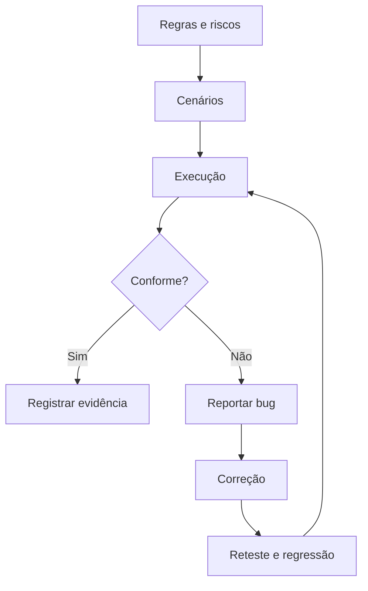

# Módulo 4 — Qualidade de Software — QA

## Capa

**DTEM Treinamentos — Formação Inicial para Carreira em Tecnologia**  
**Edição:** outubro de 2026. **Formato:** Markdown. **Público:** iniciantes e pessoas em transição de carreira.  
**Caso de trabalho:** Agenda Clara — empresa e dados fictícios.

## Apresentação

Você vai aprender a investigar qualidade com regras, riscos e evidências. A prática inclui observar um defeito plantado e explicar sua divergência, sem depender de uma aplicação de terceiros.

Este material combina conteúdo para estudo, exemplos comentados e tarefas que deixam evidências no portfólio. Primeiro faça uma previsão, depois execute ou percorra a situação, explique o resultado e transfira para um caso novo. Ler o exemplo pronto ajuda a revisar; a aprendizagem é comprovada pela explicação e pela entrega própria.

## Objetivo do módulo

Planejar testes, derivar cenários, executar casos e reportar uma divergência reproduzível; distinguir confirmação de correção, regressão e exploração.

**Pré-requisitos:** lógica, leitura de código e execução do laboratório dos módulos 2 e 3. **Resultado observável:** plano de testes, oito casos ligados a RN01–RN08, registro de execução das duas versões, BUG01 e evidência de reteste.

## O que o aluno aprenderá

- Qualidade, riscos e plano de testes.
- Cenários e testes funcionais.
- Teste exploratório.
- Identificação e reporte de bugs.
- Reteste, regressão e decisão de liberação.
- Jira, Azure DevOps e conceito de automação.

## Visão geral e percurso

QA contribui para prevenir problemas e investigar comportamentos ao longo do desenvolvimento. Qualidade é compartilhada; testar não prova ausência de todos os defeitos. A proposta é dominar um processo pequeno e verificável antes de ampliar ferramentas.

| Aula | Tema | Tópicos |
|---|---|---|
| 1 | [Qualidade, riscos e plano](../aulas/modulo-04-aula-01-qualidade-riscos-e-plano.md) | 1 |
| 2 | [Cenários e testes funcionais](../aulas/modulo-04-aula-02-cenarios-e-testes-funcionais.md) | 2 |
| 3 | [Exploração e reporte de bugs](../aulas/modulo-04-aula-03-exploracao-e-bugs.md) | 3, 4 |
| 4 | [Regressão, ferramentas e automação](../aulas/modulo-04-aula-04-regressao-ferramentas-e-automacao.md) | 5, 6 |

## Tópico 1 — Qualidade, riscos e plano de testes

### Conceito

QA contribui para prevenir e identificar problemas; qualidade depende de decisões compartilhadas pelo time.

### Explicação simples

Discutir uma regra confusa antes de construir pode evitar um defeito que seria caro descobrir no final.

### Explicação técnica

Um plano define objetivo, escopo, riscos, estratégia, ambiente, dados, responsabilidades e condições de início e encerramento. Não é necessário um documento enorme, mas deve orientar decisões. Priorize impacto e probabilidade com justificativa. Testes podem revelar falhas e aumentar confiança, sem provar ausência de todo defeito. No laboratório, RN02 importa por conflito operacional; persistência, segurança e concorrência real estão fora do escopo. Registre essas limitações para que um resultado aprovado não seja interpretado como autorização para uso em produção.

### Exemplo do mundo real

Uma agenda bonita ainda pode permitir duas pessoas no mesmo horário. Exemplo de aplicação cotidiana, sem atribuição de processo interno a uma marca.

### Exemplo dentro de uma empresa

Produto explica o impacto, Dev discute controles e QA prepara cenários desde a conversa sobre regras.

### Erros comuns de iniciantes

Esperar tudo ficar pronto; escrever plano como lista de ferramentas; prometer zero defeitos.

### Boas práticas

Relacionar cada risco à evidência necessária e documentar limites.

### Como isso aparece em vagas

Planejamento de testes, análise de risco e qualidade de software. Vocabulário ilustrativo, sem pesquisa de vagas atuais. Compare descrições reais na atividade de carreira.

### Como isso ajuda na carreira

Permite explicar a razão da cobertura escolhida.

### Exercício prático

**Atividade 1: Criar plano de testes de uma página**

**Contexto profissional:** o time da empresa fictícia Agenda Clara precisa revisar esta decisão antes de entregar o MVP. Dados e regras no [caderno do caso](../atividades/caso-agenda-clara.md).

**Objetivo:** Criar plano de testes de uma página, com registro que permita conferência por outra pessoa.

**Passo a passo:**

1. Defina escopo RN01–RN08 e o que está fora.
2. Liste duplicidade, nome inválido e cancelamento incorreto como riscos.
3. Identifique versões, dados e ambiente.
4. Defina início: regras e laboratório disponíveis.
5. Defina encerramento: casos críticos executados, sem defeito impeditivo aberto no escopo.

**Entrega esperada:** plano com objetivo, riscos, estratégia e critérios Identificar nome, versão ou premissas, regra utilizada e justificativa. Nome sugerido: `m04-atividade-01.md`.

**Critérios específicos:** Riscos justificados; escopo delimitado; condições observáveis de início e fim.

**Exemplo de resposta comentada:** Prioridade maior para integridade da reserva por conflito operacional. Executar testes sequenciais nas duas classes; persistência e acesso simultâneo não são comprovados. Não liberar um produto real com base apenas neste laboratório.

**Dica:** faça sua tentativa antes de ler a resposta e explique qualquer revisão.

**Variação mais difícil:** Qual risco não pode ser investigado pelo simulador e o que seria necessário para testá-lo?

## Tópico 2 — Cenários e testes funcionais

### Conceito

Cenário resume uma situação; caso de teste define como executá-la e conferir seu resultado.

### Explicação simples

“Testar reserva” é amplo. “Reservar H09 livre para Ana e confirmar que ele fica ocupado” permite conferência.

### Explicação técnica

Um caso contém ID, regra, pré-condição, dados, passos, esperado e estado final. A execução acrescenta versão, observado, status e evidência. O esperado vem da regra, não do código atual. Reinicie a agenda nos casos independentes; preserve o estado explicitamente nas sequências. Texto vazio e espaços somente são entradas distintas para RN03. Uma recusa não deve alterar reserva anterior. Não use “funcionou” como esperado nem aprove apenas porque nenhuma exceção ocorreu.

### Exemplo do mundo real

Uma compra sem mensagem de erro ainda pode gerar pedido duplicado. Exemplo de aplicação cotidiana, sem atribuição de processo interno a uma marca.

### Exemplo dentro de uma empresa

QA vincula TC02 a RN05 e verifica conflito e preservação da reserva de Ana.

### Erros comuns de iniciantes

Ausência de pré-condição; esperado vago; copiar observado para esperado.

### Boas práticas

Definir resultado antes de executar e conferir estado final.

### Como isso aparece em vagas

Cenários de teste, testes funcionais e documentação. Vocabulário ilustrativo, sem pesquisa de vagas atuais. Compare descrições reais na atividade de carreira.

### Como isso ajuda na carreira

Demonstra raciocínio reproduzível e capacidade de comunicar comportamentos.

### Exercício prático

**Atividade 2: Escrever e executar oito casos de teste**

**Contexto profissional:** o time da empresa fictícia Agenda Clara precisa revisar esta decisão antes de entregar o MVP. Dados e regras no [caderno do caso](../atividades/caso-agenda-clara.md).

**Objetivo:** Escrever e executar oito casos de teste, com registro que permita conferência por outra pessoa.

**Passo a passo:**

1. Crie pelo menos um caso por regra RN01–RN08.
2. Inclua sucesso, conflito, espaços, horário inválido e cancelamento.
3. Registre quando a agenda será reiniciada.
4. Execute na referência e anote observado.
5. Compare o caso de espaços nas duas versões.

**Entrega esperada:** tabela com oito casos e registro de execução Identificar nome, versão ou premissas, regra utilizada e justificativa. Nome sugerido: `m04-atividade-02.md`.

**Critérios específicos:** Cobrir oito regras; especificar dados e estado; registrar versão e resultado.

**Exemplo de resposta comentada:** TC03/RN03: agenda vazia; reservar espaços em H11; esperado nome_invalido e H11 livre. Referência rejeita; variante aceita e ocupa H11. Essa diferença é um defeito simulado, não incidente real.

**Dica:** faça sua tentativa antes de ler a resposta e explique qualquer revisão.

**Variação mais difícil:** Crie um caso que valide preservação do estado após uma recusa.

## Tópico 3 — Teste exploratório

### Conceito

Exploração combina aprendizagem, desenho e execução de testes durante uma investigação orientada.

### Explicação simples

Testar com uma missão e anotações é diferente de tentar ações sem objetivo.

### Explicação técnica

Defina charter, tempo, dados, área e riscos. Durante a sessão, anote caminho, observação, perguntas e hipóteses. Diferencie defeito confirmado, dúvida de requisito e sugestão. Se não existe referência que estabeleça a divergência, registre uma pergunta antes de declarar bug. Experimente cancelar duas vezes, re-reservar e consultar após recusa. Exploração complementa casos preparados e produz informação sobre áreas ainda pouco compreendidas.

### Exemplo do mundo real

Remover e readicionar um item ao carrinho pode revelar um estado ausente no fluxo principal. Exemplo de aplicação cotidiana, sem atribuição de processo interno a uma marca.

### Exemplo dentro de uma empresa

QA investiga se cancelar um id antigo pode remover uma reserva nova no mesmo horário.

### Erros comuns de iniciantes

Confundir exploração com falta de registro; assumir defeito sem regra.

### Boas práticas

Missão curta, notas de sessão e relato dos limites de cobertura.

### Como isso aparece em vagas

Testes exploratórios, análise crítica e investigação. Vocabulário ilustrativo, sem pesquisa de vagas atuais. Compare descrições reais na atividade de carreira.

### Como isso ajuda na carreira

Mostra autonomia para formular perguntas úteis.

### Exercício prático

**Atividade 3: Realizar sessão exploratória de dez minutos**

**Contexto profissional:** o time da empresa fictícia Agenda Clara precisa revisar esta decisão antes de entregar o MVP. Dados e regras no [caderno do caso](../atividades/caso-agenda-clara.md).

**Objetivo:** Realizar sessão exploratória de dez minutos, com registro que permita conferência por outra pessoa.

**Passo a passo:**

1. Escreva missão: investigar cancelamento e re-reserva.
2. Use referência em agenda vazia.
3. Execute cinco sequências e registre entradas e estados.
4. Classifique descobertas como confirmação, dúvida ou sugestão.
5. Indique uma próxima investigação.

**Entrega esperada:** notas de sessão com missão, sequências e descobertas Identificar nome, versão ou premissas, regra utilizada e justificativa. Nome sugerido: `m04-atividade-03.md`.

**Critérios específicos:** Cinco sequências; observação separada de interpretação; conclusão ligada a regra.

**Exemplo de resposta comentada:** Reservar H10, cancelar seu id e reservar H10 outra vez gera novo id. Cancelar o antigo retorna nao_encontrado e preserva a reserva nova. O identificador distingue reservas no mesmo horário.

**Dica:** faça sua tentativa antes de ler a resposta e explique qualquer revisão.

**Variação mais difícil:** Investigue cancelamento inexistente quando há outra reserva ativa.

## Tópico 4 — Identificação e reporte de bugs

### Conceito

Um reporte comunica divergência reproduzível entre esperado e observado.

### Explicação simples

Quem lê precisa repetir o problema e entender o impacto sem refazer toda a investigação.

### Explicação técnica

Inclua título, versão, ambiente, pré-condição, dados, passos, esperado, observado, evidência e impacto. Severidade descreve efeito; prioridade indica ordem de tratamento no contexto. Não são sinônimos e seus níveis variam entre equipes. Não atribua culpa nem trate causa hipotética como fato. No caso, RN03 é o oráculo; a variante aceita espaços. Mesmo podendo ler a causa no código, o reporte precisa mostrar o comportamento e estado resultante.

### Exemplo do mundo real

“Não funciona” não distingue erro de rede, entrada ou regra. Exemplo de aplicação cotidiana, sem atribuição de processo interno a uma marca.

### Exemplo dentro de uma empresa

QA registra BUG01, Dev reproduz e o time discute prioridade antes da correção.

### Erros comuns de iniciantes

Título vago; passos incompletos; classificar sem explicar impacto.

### Boas práticas

Uma divergência por reporte; evidência mínima suficiente; hipótese identificada.

### Como isso aparece em vagas

Bug report, gestão de defeitos, Jira e Azure DevOps. Vocabulário ilustrativo, sem pesquisa de vagas atuais. Compare descrições reais na atividade de carreira.

### Como isso ajuda na carreira

Melhora colaboração técnica e explicações em entrevista.

### Exercício prático

**Atividade 4: Reportar BUG01 — nome somente com espaços**

**Contexto profissional:** o time da empresa fictícia Agenda Clara precisa revisar esta decisão antes de entregar o MVP. Dados e regras no [caderno do caso](../atividades/caso-agenda-clara.md).

**Objetivo:** Reportar BUG01 — nome somente com espaços, com registro que permita conferência por outra pessoa.

**Passo a passo:**

1. Inicie AgendaComDefeito vazia.
2. Reserve espaços em H11 e consulte depois.
3. Registre esperado e observado.
4. Explique impacto na identificação da pessoa.
5. Proponha severidade e prioridade justificadas.

**Entrega esperada:** reporte reproduzível com versão, passos e evidência Identificar nome, versão ou premissas, regra utilizada e justificativa. Nome sugerido: `m04-atividade-04.md`.

**Critérios específicos:** Reproduzível; ligado a RN03; estado conferido; impacto separado da prioridade.

**Exemplo de resposta comentada:** Esperado nome_invalido e H11 livre; observado sucesso, id 1 e H11 ocupado. Impacto: recepção não identifica cliente. Severidade moderada e prioridade alta são propostas contextuais para o MVP, não classificações universais.

**Dica:** faça sua tentativa antes de ler a resposta e explique qualquer revisão.

**Variação mais difícil:** Reescreva o título para permitir localizar rapidamente a funcionalidade e a divergência.

## Tópico 5 — Reteste, regressão e decisão de liberação

### Conceito

Reteste confere a correção específica; regressão investiga efeitos adversos em comportamentos existentes.

### Explicação simples

Depois de corrigir espaços, confira também se reserva e cancelamento continuam funcionando.

### Explicação técnica

Selecione regressão por impacto e risco. Reteste de BUG01 repete os dados originais na versão corrigida; regressão cobre nome válido, conflito, cancelamento e horário fora do catálogo. Status não executado e bloqueado não equivalem a aprovado. Evidência de uma versão anterior não sustenta a versão atual. A referência serve como versão sem o defeito plantado, sem afirmar que é um produto pronto. Um parecer deve dizer decisão, base, limites e riscos residuais.

### Exemplo do mundo real

Corrigir um desconto pode alterar cálculo de reembolso. Exemplo de aplicação cotidiana, sem atribuição de processo interno a uma marca.

### Exemplo dentro de uma empresa

Time usa RN02, RN03 e RN06 para decidir uma release apenas do escopo sequencial simulado.

### Erros comuns de iniciantes

Chamar reteste de regressão completa; reutilizar evidência antiga.

### Boas práticas

Identificar versão, áreas afetadas e riscos ainda abertos.

### Como isso aparece em vagas

Regressão, análise de impacto e release. Vocabulário ilustrativo, sem pesquisa de vagas atuais. Compare descrições reais na atividade de carreira.

### Como isso ajuda na carreira

Ajuda a justificar decisões de qualidade com evidências.

### Exercício prático

**Atividade 5: Executar suíte mínima e emitir parecer**

**Contexto profissional:** o time da empresa fictícia Agenda Clara precisa revisar esta decisão antes de entregar o MVP. Dados e regras no [caderno do caso](../atividades/caso-agenda-clara.md).

**Objetivo:** Executar suíte mínima e emitir parecer, com registro que permita conferência por outra pessoa.

**Passo a passo:**

1. Selecione reteste de espaços, reserva válida, conflito e cancelar/re-reservar.
2. Justifique cada escolha.
3. Execute na referência e registre resultados.
4. Declare liberar, bloquear ou condicionar.
5. Indique duas limitações da decisão.

**Entrega esperada:** registro de quatro sequências e parecer de qualidade Identificar nome, versão ou premissas, regra utilizada e justificativa. Nome sugerido: `m04-atividade-05.md`.

**Critérios específicos:** Distinguir reteste e regressão; decisão sustentada por versão e resultados.

**Exemplo de resposta comentada:** Se os quatro passam, pode liberar a demonstração sequencial das regras cobertas. Não autoriza uso real: concorrência, segurança e persistência permanecem sem validação.

**Dica:** faça sua tentativa antes de ler a resposta e explique qualquer revisão.

**Variação mais difícil:** Um caso crítico ficou bloqueado. Como isso muda seu parecer?

## Tópico 6 — Jira, Azure DevOps e conceito de automação

### Conceito

Ferramentas organizam registros; automação repete verificações por instruções programadas.

### Explicação simples

Um cartão acompanha o bug. Um script repete uma comparação. Pessoas ainda decidem o que importa.

### Explicação técnica

Represente título, descrição, responsável, estado e vínculos. Tipos e campos de Jira e Azure DevOps variam por configuração; use documentação oficial, sem depender de uma tela específica. Em Markdown, simule o mesmo fluxo. Automação envolve preparar estado, chamar operação, comparar saída e reiniciar. Uma asserção como assert agenda.reservar("", "H09")["status"] == "nome_invalido" demonstra a comparação. Use agenda nova. Esta aula introduz a ideia, sem exigir domínio de framework. Fechar um bug precisa de reteste e evidência, não apenas mudança de coluna.

### Exemplo do mundo real

Uma conferência automática pode repetir valores enquanto a pessoa investiga uma experiência nova. Exemplo de aplicação cotidiana, sem atribuição de processo interno a uma marca.

### Exemplo dentro de uma empresa

O time relaciona BUG01, RN03 e TC03 e confere transições com evidências.

### Erros comuns de iniciantes

Automatizar regra indefinida; achar que ferramenta define o processo.

### Boas práticas

IDs estáveis, vínculos e transições explícitas; automatizar verificações repetitivas.

### Como isso aparece em vagas

Jira, Azure DevOps e noções de automação. Vocabulário ilustrativo, sem pesquisa de vagas atuais. Compare descrições reais na atividade de carreira.

### Como isso ajuda na carreira

Permite transferir seu processo entre ferramentas.

### Exercício prático

**Atividade 6: Organizar BUG01 e uma verificação automática conceitual**

**Contexto profissional:** o time da empresa fictícia Agenda Clara precisa revisar esta decisão antes de entregar o MVP. Dados e regras no [caderno do caso](../atividades/caso-agenda-clara.md).

**Objetivo:** Organizar BUG01 e uma verificação automática conceitual, com registro que permita conferência por outra pessoa.

**Passo a passo:**

1. Crie estados aberto, em análise, corrigido e validado.
2. Defina o que permite cada transição.
3. Vincule BUG01 a RN03 e TC03.
4. Escreva preparar, executar e comparar em Python ou pseudocódigo.

**Entrega esperada:** fluxo de cartões e verificação com esperado explícito Identificar nome, versão ou premissas, regra utilizada e justificativa. Nome sugerido: `m04-atividade-06.md`.

**Critérios específicos:** Bug validado somente após evidência; automação tem estado e comparação.

**Exemplo de resposta comentada:** Criar Agenda; reservar espaços; comparar status com nome_invalido. Na variante a comparação falha. BUG01 passa para validado apenas após reteste na versão indicada.

**Dica:** faça sua tentativa antes de ler a resposta e explique qualquer revisão.

**Variação mais difícil:** Qual informação não pode ser perdida ao migrar um cartão entre ferramentas?

## Exemplos reais do mercado e cenários do dia a dia

Na recepção, um horário duplicado gera conflito operacional; um nome inválido impede identificar a pessoa; um cancelamento que não libera horário reduz capacidade. Em produtos de compra, cadastro e suporte, o mesmo raciocínio conecta regra, risco e evidência. O aluno explicará quais desses problemas conseguiu investigar e quais continuam fora do laboratório.

Os exemplos são aplicações ilustrativas. As decisões da Agenda Clara devem ser justificadas com regras e dados fornecidos, separando observação, hipótese e limitação.

## Tabela comparativa

| Elemento | Uso | Cuidado ou exemplo |
|---|---|---|
| Funcional | Confere uma regra | Reserva válida |
| Exploratório | Aprende e investiga com uma missão | Sequências de cancelamento |
| Reteste | Verifica a correção específica | Repetir espaços |
| Regressão | Investiga efeitos adversos da mudança | Reserva e cancelamento após correção |
| Automação | Repete verificações por código | Não decide riscos sozinha |

## Diagrama em Mermaid

Explique cada passagem e indique onde uma evidência pode obrigar o time a voltar a uma decisão anterior. O desenho comunica o processo; não substitui comportamento executado e registrado.

## Glossário

| Termo | Significado |
|---|---|
| Oráculo | Referência para decidir o resultado esperado. |
| Severidade | Impacto do defeito. |
| Prioridade | Ordem de tratamento conforme contexto. |
| Evidência | Registro que sustenta uma observação. |
| Charter | Missão de uma sessão exploratória. |
| Regressão | Efeito adverso de mudança em comportamento existente. |

## Exercícios práticos e mini desafios

As atividades dos tópicos formam o caderno de prática. Além delas, resolva: **Depois de corrigir nome vazio, cancelar não libera mais H10. Que teste identifica a regressão e qual decisão de liberação você recomenda?**

Entregue situação inicial, decisão, evidência, consequência e uma limitação. **Referência para correção:** Reservar H10, cancelar o id retornado, consultar e reservar novamente. H10 deve reaparecer e aceitar nova reserva. Caso contrário, há divergência de RN06; bloquear o escopo afetado e registrar evidência da versão.

## Entrega final do módulo

plano de testes, oito casos ligados a RN01–RN08, registro de execução das duas versões, BUG01 e evidência de reteste.

1. Identificar escopo, riscos, ambiente, dados e limites no plano.
2. Escrever um caso por RN01–RN08, sem esquecer retorno e estado final.
3. Executar casos na referência e o caso de espaços na variante.
4. Produzir BUG01 com passos, esperado, observado, impacto e evidência.
5. Retestar na referência e executar regressão de reserva, conflito e cancelamento.

**Checklist:**

- [ ] Cada artefato informa a regra ou premissa que o sustenta.
- [ ] A evidência permite conferir resultado e versão.
- [ ] Foram atendidos os itens do enunciado, incluindo casos negativos.
- [ ] A contribuição individual está identificada em trabalhos de grupo.
- [ ] Os limites do laboratório e o caráter fictício estão declarados.
- [ ] Há reflexão individual: uma decisão revista, a evidência e o próximo estudo.

### Rubrica e recuperação

| Critério | 0 | 1 | 2 |
|---|---|---|---|
| Correção | Contradiz regra | Parcial ou ambígua | Aplica a regra corretamente |
| Completude | Falta artefato | Faltam itens | Todos os itens pedidos |
| Evidência | Não verificável | Falta dado, versão ou saída | Outra pessoa consegue conferir |
| Justificativa | Ausente | Genérica | Conecta regra, risco e decisão |

Parâmetro formativo proposto: 6/8, sem zero em correção ou evidência. Após o feedback, registre um acerto, uma lacuna e uma ação; corrija, registre a mudança e reapresente quando solicitado. Não é regra comercial de certificação.

## Resumo final para o aluno

- QA contribui para prevenir e identificar problemas; qualidade depende de decisões compartilhadas pelo time.
- Cenário resume uma situação; caso de teste define como executá-la e conferir seu resultado.
- Exploração combina aprendizagem, desenho e execução de testes durante uma investigação orientada.
- Um reporte comunica divergência reproduzível entre esperado e observado.
- Reteste confere a correção específica; regressão investiga efeitos adversos em comportamentos existentes.
- Ferramentas organizam registros; automação repete verificações por instruções programadas.

Guarde a primeira versão e a correção. Na apresentação, explique uma decisão, uma evidência e uma limitação; isso comunica melhor seu aprendizado do que listar ferramentas.

## Referências

[Ementa local](../ementa.md), [caso Agenda Clara](../atividades/caso-agenda-clara.md) e [laboratório](../portfolio/agenda-clara/README.md). Aprofundamento em [ISTQB CTFL](https://istqb.org/certifications/certified-tester-foundation-level-ctfl-v4-0/) e documentação oficial de [Jira](https://support.atlassian.com/jira-software-cloud/) e [Azure Boards](https://learn.microsoft.com/en-us/azure/devops/boards/). Os casos, exercícios e rubricas são autorais.
