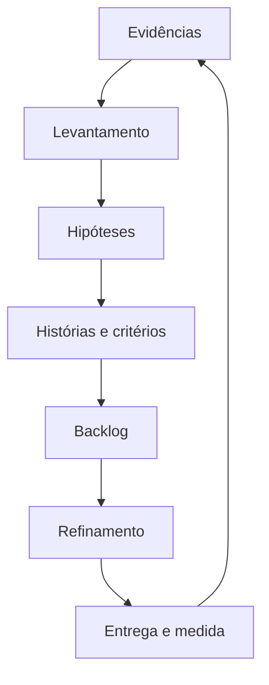

# Módulo 5 — Product Owner e Produto

## Capa

**DTEM Treinamentos — Formação Inicial para Carreira em Tecnologia**  
**Edição:** outubro de 2026. **Formato:** Markdown. **Público:** iniciantes e pessoas em transição de carreira.  
**Caso de trabalho:** Agenda Clara — empresa e dados fictícios.

## Apresentação

Você vai transformar pedidos em problemas compreendidos, histórias e decisões justificadas. O foco é conversar com usuários e times técnicos, sem confundir quantidade de funcionalidades com valor.

Este material combina conteúdo para estudo, exemplos comentados e tarefas que deixam evidências no portfólio. Primeiro faça uma previsão, depois execute ou percorra a situação, explique o resultado e transfira para um caso novo. Ler o exemplo pronto ajuda a revisar; a aprendizagem é comprovada pela explicação e pela entrega própria.

## Objetivo do módulo

Investigar uma necessidade, escrever requisitos testáveis, elaborar histórias com critérios e ordenar um backlog.

**Pré-requisitos:** regras e testes do Módulo 4; colaboração apresentada no Módulo 1. **Resultado observável:** brief do problema, roteiro de entrevista, três histórias completas, backlog com seis itens e ata de refinamento.

## O que o aluno aprenderá

- Produto digital e papel do PO.
- Levantamento de requisitos.
- User Stories.
- Critérios de aceite.
- Backlog e priorização.
- Comunicação com times técnicos.

## Visão geral e percurso

O produto evolui por aprendizagem. Um pedido de funcionalidade é uma hipótese de solução, não prova de necessidade. No caso, consultar, reservar e cancelar formam o MVP; pagamentos e relatórios dependem de investigação adicional.

| Aula | Tema | Tópicos |
|---|---|---|
| 1 | [Produto, problema e PO](../aulas/modulo-05-aula-01-produto-problema-e-po.md) | 1 |
| 2 | [Levantamento e requisitos](../aulas/modulo-05-aula-02-levantamento-e-requisitos.md) | 2 |
| 3 | [Histórias e critérios](../aulas/modulo-05-aula-03-historias-e-criterios.md) | 3, 4 |
| 4 | [Backlog e comunicação](../aulas/modulo-05-aula-04-backlog-e-comunicacao.md) | 5, 6 |

## Tópico 1 — Produto digital e papel do PO

### Conceito

Produto entrega valor ao longo do tempo; o PO ajuda a orientar objetivo e decisões sobre o trabalho.

### Explicação simples

Antes de pedir mais telas, entenda quem precisa delas e qual problema será resolvido.

### Explicação técnica

Distinga output, aquilo entregue, e outcome, efeito gerado para usuário ou negócio. Três telas são saída; redução de conflitos é resultado a avaliar. No Scrum, PO responde por valor e gestão do backlog; não é chefe de Dev e QA. A função concreta varia entre empresas. No caso, 10 conflitos em 50 tentativas representam 20% numa semana fictícia. Para medir evolução, mantenha definição, período e denominador, sem afirmar melhora antes de novas observações.

### Exemplo do mundo real

Muitos cliques em uma função não provam que ela resolveu a reclamação principal. Exemplo de aplicação cotidiana, sem atribuição de processo interno a uma marca.

### Exemplo dentro de uma empresa

PO consulta recepção e time antes de escolher o recorte de agenda.

### Erros comuns de iniciantes

Medir sucesso apenas por funcionalidades; atribuir toda decisão técnica ao PO.

### Boas práticas

Definir usuário, problema, hipótese, métrica e limites.

### Como isso aparece em vagas

Visão de produto, valor de negócio e stakeholders. Vocabulário ilustrativo, sem pesquisa de vagas atuais. Compare descrições reais na atividade de carreira.

### Como isso ajuda na carreira

Ajuda a explorar produto e análise de negócios com expectativas realistas.

### Exercício prático

**Atividade 1: Escrever brief do produto**

**Contexto profissional:** o time da empresa fictícia Agenda Clara precisa revisar esta decisão antes de entregar o MVP. Dados e regras no [caderno do caso](../atividades/caso-agenda-clara.md).

**Objetivo:** Escrever brief do produto, com registro que permita conferência por outra pessoa.

**Passo a passo:**

1. Defina público e problema.
2. Use a base fictícia de 10 conflitos em 50 tentativas.
3. Escreva uma hipótese e uma medida.
4. Indique uma pergunta ainda não respondida.

**Entrega esperada:** brief com contexto, hipótese e métrica Identificar nome, versão ou premissas, regra utilizada e justificativa. Nome sugerido: `m05-atividade-01.md`.

**Critérios específicos:** Separar resultado de entrega; identificar base fictícia e denominador.

**Dica:** faça sua tentativa antes de ler a resposta e explique qualquer revisão.

**Variação mais difícil:** Uma queda em conflitos ocorreu junto com queda no uso. Como isso afeta sua interpretação?

## Tópico 2 — Levantamento de requisitos

### Conceito

Levantar requisitos é compreender necessidades, restrições e comportamentos esperados com os envolvidos.

### Explicação simples

Perguntar sobre a última reserva duplicada produz mais informação que perguntar se a pessoa quer uma agenda bonita.

### Explicação técnica

Use entrevista, observação e análise de chamados. Separe evidência, interpretação e hipótese. Funcionais descrevem comportamento; requisitos de qualidade descrevem características verificáveis; restrições limitam a solução. “Rápido” exige cenário, medida e condição. Confirme RN01–RN08 e marque concorrência real como questão de extensão. Evite perguntas indutivas que apresentam a solução antes de entender o problema.

### Exemplo do mundo real

Um pedido de relatório pode esconder a necessidade de saber quem ainda não chegou. Exemplo de aplicação cotidiana, sem atribuição de processo interno a uma marca.

### Exemplo dentro de uma empresa

PO escuta recepção e consulta os testes para esclarecer cancelamento inexistente.

### Erros comuns de iniciantes

Inventar dados de usuário; requisitos sem fonte; esconder conflito entre interessados.

### Boas práticas

Perguntas abertas, exemplos e confirmação de entendimento.

### Como isso aparece em vagas

Levantamento de requisitos, análise de negócio e comunicação. Vocabulário ilustrativo, sem pesquisa de vagas atuais. Compare descrições reais na atividade de carreira.

### Como isso ajuda na carreira

Constrói repertório de investigação útil em Produto e QA.

### Exercício prático

**Atividade 2: Simular entrevista e classificar requisitos**

**Contexto profissional:** o time da empresa fictícia Agenda Clara precisa revisar esta decisão antes de entregar o MVP. Dados e regras no [caderno do caso](../atividades/caso-agenda-clara.md).

**Objetivo:** Simular entrevista e classificar requisitos, com registro que permita conferência por outra pessoa.

**Passo a passo:**

1. Escreva cinco perguntas abertas.
2. Entrevistem em dupla usando o caso.
3. Marque respostas adicionais como hipóteses.
4. Classifique três requisitos e uma restrição.
5. Registre uma ambiguidade e plano de validação.

**Entrega esperada:** roteiro e registro de entrevista com classificação Identificar nome, versão ou premissas, regra utilizada e justificativa. Nome sugerido: `m05-atividade-02.md`.

**Critérios específicos:** Cinco perguntas; fontes ou hipóteses explícitas; requisito verificável.

**Dica:** faça sua tentativa antes de ler a resposta e explique qualquer revisão.

**Variação mais difícil:** Qual pergunta ajudaria a descobrir uma exceção não mencionada?

## Tópico 3 — User Stories

### Conceito

Uma história expressa necessidade e benefício sob a perspectiva de quem recebe valor.

### Explicação simples

Quem quer fazer o quê, e para qual benefício?

### Explicação técnica

O formato Como/quero/para ajuda a iniciar conversa, mas não garante qualidade. Uma história precisa de exemplos e tamanho adequado. Não force toda tarefa técnica nesse formato. Divida por recortes úteis, respeitando dependências. Evite benefícios circulares, como “quero reservar para reservar”. Consultar, reservar e cancelar têm propósitos distintos. “Adicionar banco” descreve solução técnica; manter reserva após encerrar aplicativo descreve necessidade de persistência, ainda fora do laboratório.

### Exemplo do mundo real

Um cliente precisa recuperar uma compra; o banco de dados é um meio para atender essa necessidade. Exemplo de aplicação cotidiana, sem atribuição de processo interno a uma marca.

### Exemplo dentro de uma empresa

PO escreve US02, Dev discute integridade e QA deriva cenários.

### Erros comuns de iniciantes

História enorme; usuário genérico; benefício circular.

### Boas práticas

Perfil, propósito, exemplos e dependências claros.

### Como isso aparece em vagas

User Stories e documentação de produto. Vocabulário ilustrativo, sem pesquisa de vagas atuais. Compare descrições reais na atividade de carreira.

### Como isso ajuda na carreira

Produz artefatos revisáveis de comunicação com o time.

### Exercício prático

**Atividade 3: Criar três histórias do MVP**

**Contexto profissional:** o time da empresa fictícia Agenda Clara precisa revisar esta decisão antes de entregar o MVP. Dados e regras no [caderno do caso](../atividades/caso-agenda-clara.md).

**Objetivo:** Criar três histórias do MVP, com registro que permita conferência por outra pessoa.

**Passo a passo:**

1. Escreva US01 consultar, US02 reservar e US03 cancelar.
2. Use perfil e benefício concreto.
3. Vincule às RN correspondentes.
4. Registre uma dependência e uma pendência.

**Entrega esperada:** três histórias com vínculos e propósito Identificar nome, versão ou premissas, regra utilizada e justificativa. Nome sugerido: `m05-atividade-03.md`.

**Critérios específicos:** Perfil e valor claros; cobertura do MVP; regras identificadas.

**Dica:** faça sua tentativa antes de ler a resposta e explique qualquer revisão.

**Variação mais difícil:** Divida uma história grande sem perder o benefício do recorte.

## Tópico 4 — Critérios de aceite

### Conceito

Critérios de aceite descrevem condições verificáveis de uma necessidade específica.

### Explicação simples

Dizem o que deve acontecer no sucesso e na recusa.

### Explicação técnica

Dado/Quando/Então separa contexto, ação e resultado; não é sintaxe obrigatória. Critérios de história são específicos; Definition of Done é padrão comum do incremento. Para US02, cubra sucesso, conflito, espaços e horário fora do catálogo. Confira estado, não só mensagem. Critérios ajudam a derivar testes, sem limitar toda exploração. Não inclua desempenho vago nem detalhe de implementação sem necessidade.

### Exemplo do mundo real

“Compra concluída” fica ambíguo sem definir cobrança e criação do pedido. Exemplo de aplicação cotidiana, sem atribuição de processo interno a uma marca.

### Exemplo dentro de uma empresa

QA transforma critério de conflito em caso; Dev garante preservação da reserva.

### Erros comuns de iniciantes

Somente fluxo positivo; “ser intuitivo” sem condição; confundir aceite e DoD.

### Boas práticas

Contexto, ação, resultado e estado definidos.

### Como isso aparece em vagas

Critérios de aceite, BDD e refinamento. Vocabulário ilustrativo, sem pesquisa de vagas atuais. Compare descrições reais na atividade de carreira.

### Como isso ajuda na carreira

Reduz ambiguidade e conecta Produto a QA.

### Exercício prático

**Atividade 4: Escrever critérios positivos e negativos**

**Contexto profissional:** o time da empresa fictícia Agenda Clara precisa revisar esta decisão antes de entregar o MVP. Dados e regras no [caderno do caso](../atividades/caso-agenda-clara.md).

**Objetivo:** Escrever critérios positivos e negativos, com registro que permita conferência por outra pessoa.

**Passo a passo:**

1. Descreva sucesso e conflito de US02.
2. Inclua espaços e H12 inválido.
3. Descreva cancelamento ativo e inexistente.
4. Converta um critério em caso de teste.

**Entrega esperada:** critérios para três histórias e caso derivado Identificar nome, versão ou premissas, regra utilizada e justificativa. Nome sugerido: `m05-atividade-04.md`.

**Critérios específicos:** Testabilidade; positivos e negativos; estado final explícito.

**Dica:** faça sua tentativa antes de ler a resposta e explique qualquer revisão.

**Variação mais difícil:** Qual comportamento indevido passaria se você conferisse só a mensagem?

## Tópico 5 — Backlog e priorização

### Conceito

Backlog é uma lista ordenada e evolutiva de trabalho do produto.

### Explicação simples

Uma lista de desejos precisa virar uma ordem explicável.

### Explicação técnica

Compare valor, risco, esforço e dependências. Matriz impacto/esforço ajuda conversa, mas notas sem evidência não são verdade objetiva. MoSCoW separa Must, Should, Could e Won't para um horizonte; ainda é preciso ordenar dentro das categorias. Capacidade limita o recorte. Registrar custo de oportunidade mostra o que foi adiado. Mudança de evidência pode justificar nova ordem. No MVP, cancelar depende de reserva identificada; pagamento e relatórios continuam fora.

### Exemplo do mundo real

Tema visual tem valor, mas não resolve um bloqueio que impede compra. Exemplo de aplicação cotidiana, sem atribuição de processo interno a uma marca.

### Exemplo dentro de uma empresa

PO prioriza integridade de reserva antes de relatório por impacto operacional.

### Erros comuns de iniciantes

Tudo urgente; pontuação sem base; ignorar dependência.

### Boas práticas

Evidência, horizonte, capacidade e razões de adiamento.

### Como isso aparece em vagas

Priorização, backlog e visão de negócio. Vocabulário ilustrativo, sem pesquisa de vagas atuais. Compare descrições reais na atividade de carreira.

### Como isso ajuda na carreira

Ajuda a defender decisões e negociar escopo.

### Exercício prático

**Atividade 5: Ordenar backlog com seis itens**

**Contexto profissional:** o time da empresa fictícia Agenda Clara precisa revisar esta decisão antes de entregar o MVP. Dados e regras no [caderno do caso](../atividades/caso-agenda-clara.md).

**Objetivo:** Ordenar backlog com seis itens, com registro que permita conferência por outra pessoa.

**Passo a passo:**

1. Liste consultar, reservar, cancelar, persistência, relatório e pagamento.
2. Identifique MVP e fora do recorte.
3. Justifique cada posição.
4. Registre dependências.
5. Inclua a correção de RN03 e reavalie a ordem.

**Entrega esperada:** backlog ordenado com seis itens e correção justificada Identificar nome, versão ou premissas, regra utilizada e justificativa. Nome sugerido: `m05-atividade-05.md`.

**Critérios específicos:** Ordem explicada; dependências; adiamentos e correção considerados.

**Dica:** faça sua tentativa antes de ler a resposta e explique qualquer revisão.

**Variação mais difícil:** O que você adiou e qual foi o custo dessa decisão?

## Tópico 6 — Comunicação com times técnicos

### Conceito

Refinamento esclarece e divide itens com colaboração.

### Explicação simples

Alinhe o que será feito, como conferir e o que ainda falta saber.

### Explicação técnica

PO traz objetivo e prioridade; Dev discute viabilidade; QA questiona exemplos e riscos. Registre decisões e pendências com responsável. Não imponha prazo sem capacidade nem descreva tudo como “só um botão”. O laboratório confirma unicidade sequencial, sem garantir chamadas simultâneas. Esse limite precisa aparecer no escopo e na comunicação. Refinamento é atividade contínua; não um evento formal obrigatório do Scrum.

### Exemplo do mundo real

Um botão pode envolver regra, integração e estados. Exemplo de aplicação cotidiana, sem atribuição de processo interno a uma marca.

### Exemplo dentro de uma empresa

O time identifica ausência de identidade e não promete controle de acesso inexistente.

### Erros comuns de iniciantes

Não registrar decisão; esconder dúvida; prometer capacidade não discutida.

### Boas práticas

Objetivo, exemplos, acordos e retorno com evidência.

### Como isso aparece em vagas

Facilitação, refinamento e colaboração multidisciplinar. Vocabulário ilustrativo, sem pesquisa de vagas atuais. Compare descrições reais na atividade de carreira.

### Como isso ajuda na carreira

Ajuda a conduzir conversas e pedir apoio especializado.

### Exercício prático

**Atividade 6: Conduzir refinamento de US02**

**Contexto profissional:** o time da empresa fictícia Agenda Clara precisa revisar esta decisão antes de entregar o MVP. Dados e regras no [caderno do caso](../atividades/caso-agenda-clara.md).

**Objetivo:** Conduzir refinamento de US02, com registro que permita conferência por outra pessoa.

**Passo a passo:**

1. Distribua papéis PO, Dev e QA.
2. Leia história e critérios.
3. Cada papel faz duas perguntas.
4. Registre três decisões e uma pendência.
5. Reescreva um critério após a conversa.

**Entrega esperada:** ata breve e critério revisado Identificar nome, versão ou premissas, regra utilizada e justificativa. Nome sugerido: `m05-atividade-06.md`.

**Critérios específicos:** Perguntas úteis; decisões claras; pendência com responsável.

**Dica:** faça sua tentativa antes de ler a resposta e explique qualquer revisão.

**Variação mais difícil:** Qual dúvida impede iniciar e qual pode ficar fora do MVP?

## Exemplos reais do mercado e cenários do dia a dia

No dia a dia, recepção pode pedir um relatório quando precisa identificar faltas; patrocinador pode pedir pagamento quando o problema urgente é conflito. Produto investiga o objetivo, Dev discute viabilidade e QA questiona os exemplos. O aluno registra o que sabe e o que precisa confirmar.

Os exemplos são aplicações ilustrativas. As decisões da Agenda Clara devem ser justificadas com regras e dados fornecidos, separando observação, hipótese e limitação.

## Tabela comparativa

| Elemento | Uso | Cuidado ou exemplo |
|---|---|---|
| Problema | Dificuldade observada | Reservas duplicadas |
| Solução | Hipótese para tratar o problema | Bloquear horário ocupado |
| Requisito | Comportamento ou condição necessária | Uma reserva ativa por horário |
| História | Necessidade sob perspectiva de usuário | Cancelar para liberar |
| Aceite | Condição específica verificável | H10 fica livre |
| Backlog | Lista ordenada e evolutiva | Valor, risco e dependências |

## Diagrama em Mermaid

Explique cada passagem e indique onde uma evidência pode obrigar o time a voltar a uma decisão anterior. O desenho comunica o processo; não substitui comportamento executado e registrado.

## Glossário

| Termo | Significado |
|---|---|
| Stakeholder | Pessoa ou grupo com interesse no produto. |
| MVP | Menor recorte útil para entregar valor e aprender. |
| Hipótese | Proposição ainda sujeita a validação. |
| Critério de aceite | Condição verificável de uma necessidade. |
| Custo de oportunidade | O que se adia ao escolher algo. |
| Refinamento | Esclarecimento e divisão de itens com colaboração. |

## Exercícios práticos e mini desafios

As atividades dos tópicos formam o caderno de prática. Além delas, resolva: **O patrocinador pede pagamento online, mas usuários relatam reservas duplicadas. Qual próximo passo você recomenda?**

Entregue situação inicial, decisão, evidência, consequência e uma limitação.

## Entrega final do módulo

brief do problema, roteiro de entrevista, três histórias completas, backlog com seis itens e ata de refinamento.

1. Descrever problema, público, hipótese e métrica com denominador.
2. Simular entrevista sem apresentar resposta inventada como dado real.
3. Escrever US01 consultar, US02 reservar e US03 cancelar.
4. Adicionar critérios positivos e negativos e vincular às RN.
5. Ordenar seis itens e registrar dependências, razões e pendências.

**Checklist:**

- [ ] Cada artefato informa a regra ou premissa que o sustenta.
- [ ] A evidência permite conferir resultado e versão.
- [ ] Foram atendidos os itens do enunciado, incluindo casos negativos.
- [ ] A contribuição individual está identificada em trabalhos de grupo.
- [ ] Os limites do laboratório e o caráter fictício estão declarados.
- [ ] Há reflexão individual: uma decisão revista, a evidência e o próximo estudo.

### Rubrica e recuperação

| Critério | 0 | 1 | 2 |
|---|---|---|---|
| Correção | Contradiz regra | Parcial ou ambígua | Aplica a regra corretamente |
| Completude | Falta artefato | Faltam itens | Todos os itens pedidos |
| Evidência | Não verificável | Falta dado, versão ou saída | Outra pessoa consegue conferir |
| Justificativa | Ausente | Genérica | Conecta regra, risco e decisão |

Parâmetro formativo proposto: 6/8, sem zero em correção ou evidência. Após o feedback, registre um acerto, uma lacuna e uma ação; corrija, registre a mudança e reapresente quando solicitado. Não é regra comercial de certificação.

## Resumo final para o aluno

- Produto entrega valor ao longo do tempo; o PO ajuda a orientar objetivo e decisões sobre o trabalho.
- Levantar requisitos é compreender necessidades, restrições e comportamentos esperados com os envolvidos.
- Uma história expressa necessidade e benefício sob a perspectiva de quem recebe valor.
- Critérios de aceite descrevem condições verificáveis de uma necessidade específica.
- Backlog é uma lista ordenada e evolutiva de trabalho do produto.
- Refinamento esclarece e divide itens com colaboração.

Guarde a primeira versão e a correção. Na apresentação, explique uma decisão, uma evidência e uma limitação; isso comunica melhor seu aprendizado do que listar ferramentas.

## Referências

[Ementa local](../ementa.md), [caso Agenda Clara](../atividades/caso-agenda-clara.md) e [laboratório](../portfolio/agenda-clara/README.md). Referência de responsabilidades em [Scrum Guide](https://scrumguides.org/scrum-guide.html). Os casos, exercícios e rubricas são autorais.
