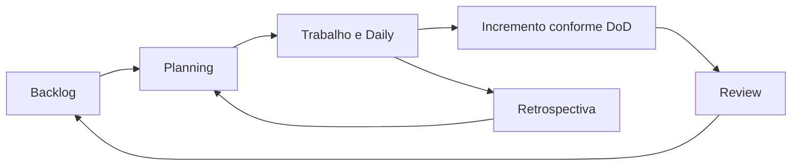

# Módulo 6 — Gestão de Projetos Tech

## Capa

**DTEM Treinamentos — Formação Inicial para Carreira em Tecnologia**  
**Edição:** outubro de 2026. **Formato:** Markdown. **Público:** iniciantes e pessoas em transição de carreira.  
**Caso de trabalho:** Agenda Clara — empresa e dados fictícios.

## Apresentação

Você vai organizar trabalho com objetivo, capacidade e transparência. A simulação permite experimentar eventos e decisões sem reduzir gestão a preencher um quadro.

Este material combina conteúdo para estudo, exemplos comentados e tarefas que deixam evidências no portfólio. Primeiro faça uma previsão, depois execute ou percorra a situação, explique o resultado e transfira para um caso novo. Ler o exemplo pronto ajuda a revisar; a aprendizagem é comprovada pela explicação e pela entrega própria.

## Objetivo do módulo

Distinguir projeto e produto, aplicar noções de Scrum e Kanban e conduzir uma Sprint simulada com evidências.

**Pré-requisitos:** histórias, critérios e backlog do Módulo 5. **Resultado observável:** plano de Sprint simulada, quadro com políticas e limites, registros de Daily, Review e Retrospectiva e análise de capacidade.

## O que o aluno aprenderá

- Projetos, objetivos, riscos e capacidade.
- Scrum e responsabilidades no time.
- Planning e Daily.
- Review, Retrospectiva e Definition of Done.
- Kanban, políticas e métricas de fluxo.
- Ferramentas e comunicação de projeto.

## Visão geral e percurso

Um projeto tem recorte e objetivo; um produto pode continuar evoluindo depois dele. Scrum oferece estrutura de inspeção e adaptação; Kanban orienta gerenciamento de fluxo. Ferramentas apoiam visibilidade, sem substituir acordos. A simulação de aula comprime tempo e deve ser identificada como exercício, não uma implantação completa de Scrum.

| Aula | Tema | Tópicos |
|---|---|---|
| 1 | [Projetos e capacidade](../aulas/modulo-06-aula-01-projetos-e-capacidade.md) | 1 |
| 2 | [Scrum, Planning e Daily](../aulas/modulo-06-aula-02-scrum-planning-e-daily.md) | 2, 3 |
| 3 | [Review, Retrospectiva e DoD](../aulas/modulo-06-aula-03-review-retrospectiva-e-dod.md) | 4 |
| 4 | [Kanban e ferramentas](../aulas/modulo-06-aula-04-kanban-e-ferramentas.md) | 5, 6 |

## Tópico 1 — Projetos, objetivos, riscos e capacidade

### Conceito

Gerir um projeto é coordenar objetivo, recorte, pessoas, dependências e riscos.

### Explicação simples

Uma lista de tarefas não informa por que o trabalho existe nem se cabe no tempo disponível.

### Explicação técnica

Defina resultado, escopo, responsáveis e restrições. Capacidade é estimativa de disponibilidade, não promessa: três pessoas com duas horas cada oferecem seis horas brutas; eventos, revisão e imprevistos também consomem tempo. Esforço de itens e duração de calendário diferem por paralelismo e dependências. Use margem transparente e revise previsões quando houver evidência. Não converta pontos relativos de história automaticamente em horas. Registre riscos com impacto, ação e responsável.

### Exemplo do mundo real

Uma mudança de atendimento pode depender de treinamento além do software. Exemplo de aplicação cotidiana, sem atribuição de processo interno a uma marca.

### Exemplo dentro de uma empresa

Time planeja reserva e cancelamento, considerando quem revisará e testará.

### Erros comuns de iniciantes

Preencher 100% da disponibilidade; ignorar revisão; tratar estimativa como compromisso infalível.

### Boas práticas

Meta clara, capacidade visível e riscos com ação.

### Como isso aparece em vagas

Gestão de projetos, planejamento e riscos. Vocabulário ilustrativo, sem pesquisa de vagas atuais. Compare descrições reais na atividade de carreira.

### Como isso ajuda na carreira

Ajuda a comunicar previsão e limitações com responsabilidade.

### Exercício prático

**Atividade 1: Calcular capacidade e escolher recorte**

**Contexto profissional:** o time da empresa fictícia Agenda Clara precisa revisar esta decisão antes de entregar o MVP. Dados e regras no [caderno do caso](../atividades/caso-agenda-clara.md).

**Objetivo:** Calcular capacidade e escolher recorte, com registro que permita conferência por outra pessoa.

**Passo a passo:**

1. Use três participantes com 120 minutos disponíveis cada.
2. Reserve 90 minutos totais para eventos e revisão e 60 para margem.
3. Calcule capacidade restante.
4. Selecione tarefas e justifique dependências.

**Entrega esperada:** tabela de capacidade, recorte e riscos Identificar nome, versão ou premissas, regra utilizada e justificativa. Nome sugerido: `m06-atividade-01.md`.

**Critérios específicos:** Cálculo coerente; distinção entre disponibilidade e esforço; margem explícita.

**Dica:** faça sua tentativa antes de ler a resposta e explique qualquer revisão.

**Variação mais difícil:** Uma pessoa perdeu 60 minutos. O que precisa ser renegociado?

## Tópico 2 — Scrum e responsabilidades no time

### Conceito

Scrum estrutura colaboração e adaptação para produzir incrementos úteis em Sprints.

### Explicação simples

O time escolhe uma meta, entrega um recorte verificável e aprende para o próximo ciclo.

### Explicação técnica

As responsabilidades formais são Product Owner, Scrum Master e Developers. No contexto do framework, Developers inclui especialistas que constroem qualquer parte do incremento, inclusive testes. QA e Dev continuam especialidades úteis, sem virar subequipes obrigatórias. PO responde por valor; Scrum Master ajuda efetividade e compreensão do framework; Developers planejam e adaptam o trabalho. Uma Sprint tem duração fixa de até um mês. O exercício comprime eventos para aprendizagem e não deve ser apresentado como uso completo em produção.

### Exemplo do mundo real

Uma equipe precisa coordenar especialidades sem criar uma cadeia em que cada pessoa só se preocupa com sua parte. Exemplo de aplicação cotidiana, sem atribuição de processo interno a uma marca.

### Exemplo dentro de uma empresa

QA participa de critérios e teste, Dev de implementação e todos do padrão de qualidade.

### Erros comuns de iniciantes

Scrum Master como distribuidor de tarefas; QA somente no final; PO impondo plano técnico.

### Boas práticas

Colaboração, objetivo comum e responsabilidades compreendidas.

### Como isso aparece em vagas

Scrum, times ágeis e colaboração. Vocabulário ilustrativo, sem pesquisa de vagas atuais. Compare descrições reais na atividade de carreira.

### Como isso ajuda na carreira

Ajuda a participar de conversas sem confundir cargo e responsabilidade.

### Exercício prático

**Atividade 2: Mapear responsabilidades em três decisões**

**Contexto profissional:** o time da empresa fictícia Agenda Clara precisa revisar esta decisão antes de entregar o MVP. Dados e regras no [caderno do caso](../atividades/caso-agenda-clara.md).

**Objetivo:** Mapear responsabilidades em três decisões, com registro que permita conferência por outra pessoa.

**Passo a passo:**

1. Escolha prioridade, plano técnico e qualidade.
2. Identifique quem contribui e quem responde pela decisão.
3. Inclua especialidades QA e Dev no trabalho conjunto.
4. Registre uma situação que exige colaboração.

**Entrega esperada:** matriz comentada de responsabilidades Identificar nome, versão ou premissas, regra utilizada e justificativa. Nome sugerido: `m06-atividade-02.md`.

**Critérios específicos:** PO/SM/Developers corretos; qualidade compartilhada; especialidade sem subequipe obrigatória.

**Dica:** faça sua tentativa antes de ler a resposta e explique qualquer revisão.

**Variação mais difícil:** Como uma pessoa de QA pode contribuir antes da implementação?

## Tópico 3 — Planning e Daily

### Conceito

Planning define por que, o que e como trabalhar; Daily inspeciona progresso e adapta plano.

### Explicação simples

Planejar é escolher um objetivo viável. Conversar diariamente é ajustar o caminho até ele.

### Explicação técnica

Planning reúne objetivo, seleção e plano. Developers selecionam trabalho considerando capacidade e DoD em colaboração com PO. Daily Scrum é evento de 15 minutos para Developers; não uma prestação de contas ao gerente. O formato pode variar e os três relatos tradicionais não são obrigatórios. No exercício, usar cinco minutos para simular e indicar a compressão. Reportar bloqueio precisa de impacto e próximo passo. Durante a Sprint, escopo pode ser esclarecido e negociado sem colocar a meta em risco.

### Exemplo do mundo real

Dizer “trabalhei ontem” informa atividade, mas não mostra progresso até o objetivo. Exemplo de aplicação cotidiana, sem atribuição de processo interno a uma marca.

### Exemplo dentro de uma empresa

Um bloqueio no teste de cancelamento faz o time revisar a ordem das tarefas.

### Erros comuns de iniciantes

Daily como relatório individual; planejar sem meta; esconder bloqueio.

### Boas práticas

Foco em objetivo, trabalho restante e adaptação.

### Como isso aparece em vagas

Sprint Planning, Daily e facilitação. Vocabulário ilustrativo, sem pesquisa de vagas atuais. Compare descrições reais na atividade de carreira.

### Como isso ajuda na carreira

Melhora comunicação objetiva em equipe.

### Exercício prático

**Atividade 3: Simular Planning e Daily com bloqueio**

**Contexto profissional:** o time da empresa fictícia Agenda Clara precisa revisar esta decisão antes de entregar o MVP. Dados e regras no [caderno do caso](../atividades/caso-agenda-clara.md).

**Objetivo:** Simular Planning e Daily com bloqueio, com registro que permita conferência por outra pessoa.

**Passo a passo:**

1. Defina meta: reserva correta e cancelamento verificado.
2. Selecione tarefas que cabem na capacidade.
3. Introduza bloqueio: ambiente de um participante indisponível.
4. Faça Daily focada em impacto e próximo passo.
5. Registre ajuste e responsável.

**Entrega esperada:** meta, tarefas, bloqueio e decisão registrada Identificar nome, versão ou premissas, regra utilizada e justificativa. Nome sugerido: `m06-atividade-03.md`.

**Critérios específicos:** Meta útil; plano viável; ajuste preserva objetivo e qualidade.

**Dica:** faça sua tentativa antes de ler a resposta e explique qualquer revisão.

**Variação mais difícil:** Um pedido urgente não ajuda a meta. Como discutir com PO?

## Tópico 4 — Review, Retrospectiva e Definition of Done

### Conceito

Review inspeciona produto; Retrospectiva inspeciona o modo de trabalhar; DoD define padrão comum de conclusão.

### Explicação simples

Uma conversa pergunta se entregamos algo útil; a outra pergunta como melhorar nossa forma de trabalhar.

### Explicação técnica

Review envolve resultado e feedback para ajustar próximos passos, não apenas apresentação ou aprovação formal. Retrospectiva identifica melhoria concreta para efetividade e qualidade. DoD aplica padrão comum: código ou artefato revisto, evidência relevante e documentação atualizada no laboratório. Critérios de aceite são específicos por história. Item que não atende DoD não integra incremento concluído. Registrar estado real evita demonstrar documentação como se fosse funcionalidade implementada.

### Exemplo do mundo real

Uma demonstração pode agradar, mas a equipe ainda precisa discutir atrasos e causas de retrabalho em outro momento. Exemplo de aplicação cotidiana, sem atribuição de processo interno a uma marca.

### Exemplo dentro de uma empresa

Na Review, recepção pede clareza do cancelamento; na Retrospectiva, time decide revisar critérios antes de iniciar.

### Erros comuns de iniciantes

Misturar produto e processo; concluir por pressão de prazo; aceitar teste sem versão.

### Boas práticas

Resultado verificável e ação de melhoria com responsável e medida.

### Como isso aparece em vagas

Review, Retrospectiva e Definition of Done. Vocabulário ilustrativo, sem pesquisa de vagas atuais. Compare descrições reais na atividade de carreira.

### Como isso ajuda na carreira

Demonstra capacidade de receber feedback e melhorar processo.

### Exercício prático

**Atividade 4: Conduzir Review e Retrospectiva**

**Contexto profissional:** o time da empresa fictícia Agenda Clara precisa revisar esta decisão antes de entregar o MVP. Dados e regras no [caderno do caso](../atividades/caso-agenda-clara.md).

**Objetivo:** Conduzir Review e Retrospectiva, com registro que permita conferência por outra pessoa.

**Passo a passo:**

1. Defina DoD com três condições verificáveis.
2. Demonstre um item concluído e um incompleto.
3. Registre feedback sobre produto.
4. Escolha uma melhoria de processo, responsável e sinal de sucesso.

**Entrega esperada:** DoD, notas de Review e uma ação de Retrospectiva Identificar nome, versão ou premissas, regra utilizada e justificativa. Nome sugerido: `m06-atividade-04.md`.

**Critérios específicos:** Distinguir eventos; não concluir item sem padrão; melhoria verificável.

**Dica:** faça sua tentativa antes de ler a resposta e explique qualquer revisão.

**Variação mais difícil:** Um item atende aceite, mas não tem evidência de teste. Pode ser concluído pela DoD proposta?

## Tópico 5 — Kanban, políticas e métricas de fluxo

### Conceito

Kanban torna trabalho visível e orienta melhoria do fluxo com políticas explícitas.

### Explicação simples

Começar menos tarefas pode ajudar a terminar mais.

### Explicação técnica

Um quadro é parte da prática, não Kanban completo por si só. Defina fluxo, ponto de início e fim, limites de WIP e políticas. Exemplo: pronto, em execução, em verificação e concluído; WIP de dois itens somando execução e verificação. Bloqueio deve permanecer visível e normalmente continua contando como trabalho iniciado. Lead time depende do ponto de compromisso escolhido; cycle time mede início até fim; throughput conta itens concluídos por período. Não comparar números de times diferentes sem contexto.

### Exemplo do mundo real

Dez pedidos iniciados e nenhum entregue não significam boa capacidade de atendimento. Exemplo de aplicação cotidiana, sem atribuição de processo interno a uma marca.

### Exemplo dentro de uma empresa

Time limita início para ajudar a concluir cancelamento antes de abrir relatório.

### Erros comuns de iniciantes

Quadro sem políticas; mover bloqueado para esconder WIP; contar iniciado como entregue.

### Boas práticas

Definir limites, observar gargalos e concluir antes de iniciar.

### Como isso aparece em vagas

Kanban, métricas de fluxo e melhoria contínua. Vocabulário ilustrativo, sem pesquisa de vagas atuais. Compare descrições reais na atividade de carreira.

### Como isso ajuda na carreira

Ajuda a comunicar gargalos e decisões de trabalho.

### Exercício prático

**Atividade 5: Simular quadro com limite de WIP**

**Contexto profissional:** o time da empresa fictícia Agenda Clara precisa revisar esta decisão antes de entregar o MVP. Dados e regras no [caderno do caso](../atividades/caso-agenda-clara.md).

**Objetivo:** Simular quadro com limite de WIP, com registro que permita conferência por outra pessoa.

**Passo a passo:**

1. Crie quatro colunas e políticas.
2. Use cinco cartões do backlog.
3. Defina WIP 2 para execução mais verificação.
4. Introduza bloqueio e decida como manter visível.
5. Conte concluídos e identifique gargalo.

**Entrega esperada:** quadro antes/depois, políticas e análise de fluxo Identificar nome, versão ou premissas, regra utilizada e justificativa. Nome sugerido: `m06-atividade-05.md`.

**Critérios específicos:** Limite respeitado; bloqueio visível; métrica com período definido.

**Dica:** faça sua tentativa antes de ler a resposta e explique qualquer revisão.

**Variação mais difícil:** Por que mover bloqueado para fora do limite pode distorcer a análise?

## Tópico 6 — Ferramentas e comunicação de projeto

### Conceito

Ferramentas registram acordos e estados; gestão exige interpretar e agir sobre essas informações.

### Explicação simples

Mudar de Jira para Azure DevOps não deveria apagar o sentido do trabalho.

### Explicação técnica

Use título, objetivo, responsável, estado, dependências, evidência e motivo de bloqueio. Campos variam por ferramenta e configuração. Links devem ligar história, tarefa, bug e teste. Defina estados e política de transição antes de configurar a tela. O relatório de andamento deve comunicar objetivo, progresso, risco e decisão necessária, sem apenas enumerar tarefas. Cartões em papel ou Markdown são alternativas para o curso.

### Exemplo do mundo real

Uma lista de tarefas sem dependências não mostra que um atraso bloqueia outras entregas. Exemplo de aplicação cotidiana, sem atribuição de processo interno a uma marca.

### Exemplo dentro de uma empresa

Time mantém US02, TC03 e BUG01 relacionados e comunica impacto na meta.

### Erros comuns de iniciantes

Ferramenta como substituta de conversa; estados contraditórios; relatório longo sem decisão.

### Boas práticas

Uma fonte de estado, vínculos e mensagens orientadas a ação.

### Como isso aparece em vagas

Jira, Azure DevOps, comunicação e gestão de trabalho. Vocabulário ilustrativo, sem pesquisa de vagas atuais. Compare descrições reais na atividade de carreira.

### Como isso ajuda na carreira

Facilita colaboração em organizações com ferramentas diferentes.

### Exercício prático

**Atividade 6: Produzir quadro e atualização executiva**

**Contexto profissional:** o time da empresa fictícia Agenda Clara precisa revisar esta decisão antes de entregar o MVP. Dados e regras no [caderno do caso](../atividades/caso-agenda-clara.md).

**Objetivo:** Produzir quadro e atualização executiva, com registro que permita conferência por outra pessoa.

**Passo a passo:**

1. Represente história, tarefa, bug e teste com IDs.
2. Vincule os quatro artefatos.
3. Defina transição para concluído.
4. Escreva atualização de quatro linhas: meta, progresso, risco e pedido.

**Entrega esperada:** cartões vinculados e comunicação breve Identificar nome, versão ou premissas, regra utilizada e justificativa. Nome sugerido: `m06-atividade-06.md`.

**Critérios específicos:** Rastreabilidade; estado coerente; pedido acionável.

**Dica:** faça sua tentativa antes de ler a resposta e explique qualquer revisão.

**Variação mais difícil:** Qual decisão seu relatório espera de quem recebe?

## Exemplos reais do mercado e cenários do dia a dia

No cotidiano, uma solicitação urgente compete com a meta; uma tarefa bloqueada consome atenção; dez itens iniciados podem gerar menos entrega que dois concluídos. O time precisa comunicar risco e ajustar plano sem esconder trabalho incompleto.

Os exemplos são aplicações ilustrativas. As decisões da Agenda Clara devem ser justificadas com regras e dados fornecidos, separando observação, hipótese e limitação.

## Tabela comparativa

| Elemento | Uso | Cuidado ou exemplo |
|---|---|---|
| Projeto | Recorte temporário com objetivo | Implantar MVP |
| Produto | Valor e evolução contínuos | Agenda usada e melhorada |
| Scrum | Inspeção e adaptação em Sprints | Meta, eventos e incremento |
| Kanban | Gerenciamento do fluxo | Políticas e limites de trabalho |
| Review | Inspeciona produto e adapta próximos passos | Feedback sobre reserva |
| Retrospectiva | Inspeciona modo de trabalhar | Melhorar revisão de critérios |

## Diagrama em Mermaid

Explique cada passagem e indique onde uma evidência pode obrigar o time a voltar a uma decisão anterior. O desenho comunica o processo; não substitui comportamento executado e registrado.

## Glossário

| Termo | Significado |
|---|---|
| Sprint Goal | Objetivo que orienta a Sprint. |
| Capacidade | Disponibilidade estimada para trabalho. |
| WIP | Trabalho iniciado e ainda não concluído. |
| Impedimento | Algo que dificulta progresso. |
| DoD | Padrão comum que define trabalho concluído. |
| Cycle time | Tempo de um item entre início e conclusão. |

## Exercícios práticos e mini desafios

As atividades dos tópicos formam o caderno de prática. Além delas, resolva: **Uma pessoa ficará ausente e surge um bug que afeta a reserva. Replaneje sem abandonar qualidade nem fingir capacidade inexistente.**

Entregue situação inicial, decisão, evidência, consequência e uma limitação.

## Entrega final do módulo

plano de Sprint simulada, quadro com políticas e limites, registros de Daily, Review e Retrospectiva e análise de capacidade.

1. Definir meta, recorte e capacidade disponível.
2. Selecionar itens por valor e dependências; decompor em tarefas.
3. Definir política de entrada e saída e Definition of Done.
4. Simular bloqueio, Daily e ajuste de plano.
5. Realizar Review sobre resultado e Retrospectiva sobre processo.

**Checklist:**

- [ ] Cada artefato informa a regra ou premissa que o sustenta.
- [ ] A evidência permite conferir resultado e versão.
- [ ] Foram atendidos os itens do enunciado, incluindo casos negativos.
- [ ] A contribuição individual está identificada em trabalhos de grupo.
- [ ] Os limites do laboratório e o caráter fictício estão declarados.
- [ ] Há reflexão individual: uma decisão revista, a evidência e o próximo estudo.

### Rubrica e recuperação

| Critério | 0 | 1 | 2 |
|---|---|---|---|
| Correção | Contradiz regra | Parcial ou ambígua | Aplica a regra corretamente |
| Completude | Falta artefato | Faltam itens | Todos os itens pedidos |
| Evidência | Não verificável | Falta dado, versão ou saída | Outra pessoa consegue conferir |
| Justificativa | Ausente | Genérica | Conecta regra, risco e decisão |

Parâmetro formativo proposto: 6/8, sem zero em correção ou evidência. Após o feedback, registre um acerto, uma lacuna e uma ação; corrija, registre a mudança e reapresente quando solicitado. Não é regra comercial de certificação.

## Resumo final para o aluno

- Gerir um projeto é coordenar objetivo, recorte, pessoas, dependências e riscos.
- Scrum estrutura colaboração e adaptação para produzir incrementos úteis em Sprints.
- Planning define por que, o que e como trabalhar; Daily inspeciona progresso e adapta plano.
- Review inspeciona produto; Retrospectiva inspeciona o modo de trabalhar; DoD define padrão comum de conclusão.
- Kanban torna trabalho visível e orienta melhoria do fluxo com políticas explícitas.
- Ferramentas registram acordos e estados; gestão exige interpretar e agir sobre essas informações.

Guarde a primeira versão e a correção. Na apresentação, explique uma decisão, uma evidência e uma limitação; isso comunica melhor seu aprendizado do que listar ferramentas.

## Referências

[Ementa local](../ementa.md), [caso Agenda Clara](../atividades/caso-agenda-clara.md) e [laboratório](../portfolio/agenda-clara/README.md). Definições em [Scrum Guide](https://scrumguides.org/scrum-guide.html) e referência de fluxo em [Kanban Guide](https://kanbanguides.org/). Os casos, exercícios e rubricas são autorais.
