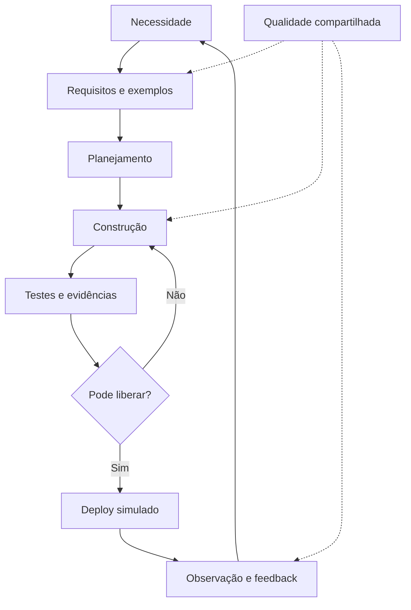

# Módulo 7 — SDLC — Ciclo de Vida do Software

## Capa

**DTEM Treinamentos — Formação Inicial para Carreira em Tecnologia**  
**Edição:** outubro de 2026. **Formato:** Markdown. **Público:** iniciantes e pessoas em transição de carreira.  
**Caso de trabalho:** Agenda Clara — empresa e dados fictícios.

## Apresentação

Você vai conectar as decisões anteriores em um fluxo que sai da necessidade e retorna ao aprendizado após a entrega. O foco é enxergar dependências, prevenção de problemas e evidências.

Este material combina conteúdo para estudo, exemplos comentados e tarefas que deixam evidências no portfólio. Primeiro faça uma previsão, depois execute ou percorra a situação, explique o resultado e transfira para um caso novo. Ler o exemplo pronto ajuda a revisar; a aprendizagem é comprovada pela explicação e pela entrega própria.

## Objetivo do módulo

Desenhar um fluxo de requisitos até operação, vincular artefatos e propor controles de qualidade antes e depois da implementação.

**Pré-requisitos:** entregas de QA, Produto e Gestão dos módulos 4–6. **Resultado observável:** diagrama completo de SDLC, matriz de rastreabilidade, checklist de release simulada e plano de resposta a falha.

## O que o aluno aprenderá

- SDLC e integração entre áreas.
- Requisitos, desenvolvimento e rastreabilidade.
- Testes antecipados e Shift Left.
- Deploy, release, observação e resposta a falhas.

## Visão geral e percurso

SDLC organiza atividades de descoberta, construção, verificação, entrega e evolução. As atividades podem se sobrepor e se repetir. Um desenho linear ajuda a começar, mas não descreve toda realidade. Participação de QA e validação de hipóteses ocorrem antes do fim.

| Aula | Tema | Tópicos |
|---|---|---|
| 1 | [SDLC e integração](../aulas/modulo-07-aula-01-sdlc-e-integracao.md) | 1 |
| 2 | [Rastreabilidade e impacto](../aulas/modulo-07-aula-02-rastreabilidade-e-impacto.md) | 2 |
| 3 | [Shift Left e prevenção](../aulas/modulo-07-aula-03-shift-left-e-prevencao.md) | 3 |
| 4 | [Release e operação](../aulas/modulo-07-aula-04-release-e-operacao.md) | 4 |

## Tópico 1 — SDLC e integração entre áreas

### Conceito

SDLC reúne atividades necessárias para criar, entregar, operar e evoluir software.

### Explicação simples

A vida do sistema começa antes do código e continua depois que ele é entregue.

### Explicação técnica

Descoberta identifica necessidade; requisitos tornam comportamento explícito; planejamento define recorte; construção implementa; testes geram evidências; entrega disponibiliza; operação observa e aprende. Não são departamentos que passam uma caixa sem conversar. Métodos iterativos repetem essas atividades em recortes; algumas acontecem em paralelo. Produto, Dev, QA, Dados e Infra contribuem conforme contexto. O laboratório cobre regras e verificação local; operação e infraestrutura são discutidas e simuladas.

### Exemplo do mundo real

Um app continua sendo corrigido e melhorado depois de instalado pelos primeiros usuários. Exemplo de aplicação cotidiana, sem atribuição de processo interno a uma marca.

### Exemplo dentro de uma empresa

Uma reclamação na recepção retorna a Produto e QA para revisar o fluxo de cancelamento.

### Erros comuns de iniciantes

Tratar etapas como sequência rígida universal; achar que depois do deploy acabou.

### Boas práticas

Mostrar retorno de feedback e participação compartilhada.

### Como isso aparece em vagas

Ciclo de desenvolvimento e times multidisciplinares. Vocabulário ilustrativo, sem pesquisa de vagas atuais. Compare descrições reais na atividade de carreira.

### Como isso ajuda na carreira

Ajuda a localizar responsabilidades e evidências no trabalho.

### Exercício prático

**Atividade 1: Desenhar fluxo completo do sistema**

**Contexto profissional:** o time da empresa fictícia Agenda Clara precisa revisar esta decisão antes de entregar o MVP. Dados e regras no [caderno do caso](../atividades/caso-agenda-clara.md).

**Objetivo:** Desenhar fluxo completo do sistema, com registro que permita conferência por outra pessoa.

**Passo a passo:**

1. Liste necessidade, requisitos, planejamento, código, teste, entrega e operação.
2. Ligue etapas e inclua retorno de feedback.
3. Indique contribuição de cinco áreas.
4. Marque o que é executado e o que é simulado.

**Entrega esperada:** diagrama com papéis, retornos e limites Identificar nome, versão ou premissas, regra utilizada e justificativa. Nome sugerido: `m07-atividade-01.md`.

**Critérios específicos:** Cobertura do ciclo; feedback; distinção de execução e simulação.

**Exemplo de resposta comentada:** Feedback da recepção retorna a requisitos. QA contribui em exemplos e execução; Dados define medida; Infra discute observação futura. No laboratório, deploy real e monitoramento não existem.

**Dica:** faça sua tentativa antes de ler a resposta e explique qualquer revisão.

**Variação mais difícil:** Que retorno falta em um fluxo que termina nos testes?

## Tópico 2 — Requisitos, desenvolvimento e rastreabilidade

### Conceito

Rastreabilidade permite seguir uma necessidade até as evidências que sustentam sua implementação.

### Explicação simples

Se a regra mudar, você precisa saber quais histórias, testes e documentos serão afetados.

### Explicação técnica

Use IDs estáveis e relações úteis. RN03 está ligada a US02, TC03, BUG01 e versão corrigida. A matriz não precisa relacionar tudo com tudo; deve apoiar análise de cobertura e impacto. Link quebrado ou versão indefinida enfraquece evidência. Desenvolvimento deve preservar regra, documentação e histórico. Uma mudança de critério exige investigar código e casos derivados. Não conclua cobertura só por ter uma linha: conferir se o teste realmente verifica a regra e o estado.

### Exemplo do mundo real

Um manual e o programa podem divergir após alteração de política. Exemplo de aplicação cotidiana, sem atribuição de processo interno a uma marca.

### Exemplo dentro de uma empresa

Time localiza rapidamente todos os artefatos afetados pela validação de espaços.

### Erros comuns de iniciantes

IDs inconsistentes; matriz decorativa; evidência de versão errada.

### Boas práticas

Poucos vínculos claros e revisão quando a regra muda.

### Como isso aparece em vagas

Rastreabilidade, documentação e análise de impacto. Vocabulário ilustrativo, sem pesquisa de vagas atuais. Compare descrições reais na atividade de carreira.

### Como isso ajuda na carreira

Ajuda a investigar mudanças e explicar contribuição.

### Exercício prático

**Atividade 2: Construir matriz de rastreabilidade**

**Contexto profissional:** o time da empresa fictícia Agenda Clara precisa revisar esta decisão antes de entregar o MVP. Dados e regras no [caderno do caso](../atividades/caso-agenda-clara.md).

**Objetivo:** Construir matriz de rastreabilidade, com registro que permita conferência por outra pessoa.

**Passo a passo:**

1. Liste RN02, RN03 e RN06.
2. Ligue a histórias, testes e bugs aplicáveis.
3. Indique versão ou estado de verificação.
4. Escolha uma mudança e identifique impactos.

**Entrega esperada:** matriz com três regras e análise de mudança Identificar nome, versão ou premissas, regra utilizada e justificativa. Nome sugerido: `m07-atividade-02.md`.

**Critérios específicos:** Vínculos coerentes; evidência identificada; impacto explicado.

**Exemplo de resposta comentada:** RN03 → US02 → TC03 → BUG01 → referência para reteste. Se RN03 passar a exigir tamanho mínimo, casos e código atuais precisam revisão, sem afirmar que a regra nova já está coberta.

**Dica:** faça sua tentativa antes de ler a resposta e explique qualquer revisão.

**Variação mais difícil:** Como identificar uma regra sem teste e um teste sem regra?

## Tópico 3 — Testes antecipados e Shift Left

### Conceito

Shift left antecipa feedback e prevenção de defeitos para momentos anteriores da construção.

### Explicação simples

Pergunte sobre nomes compostos por espaços antes de implementar a reserva.

### Explicação técnica

Revisar requisitos, exemplos, protótipos e código gera informação antes do teste final. Antecipar não significa remover testes posteriores. No caso, uma conversa sobre nome útil revelaria a diferença entre não vazio e não composto por espaços. Testabilidade pede condição observável; requisito vago precisa de refinamento. Organize uma revisão em três perspectivas: valor, viabilidade e verificabilidade. Avalie o custo de detectar ambiguidade cedo, sem inventar percentuais universais de economia.

### Exemplo do mundo real

Revisar uma instrução antes de imprimir evita repetir o erro em todos os exemplares. Exemplo de aplicação cotidiana, sem atribuição de processo interno a uma marca.

### Exemplo dentro de uma empresa

PO, Dev e QA alinham exemplos de RN03; depois verificam execução na versão entregue.

### Erros comuns de iniciantes

Shift left como ferramenta específica; usar revisão para dispensar execução.

### Boas práticas

Exemplos cedo, hipóteses explícitas e testes posteriores relevantes.

### Como isso aparece em vagas

Shift Left Testing, prevenção e colaboração. Vocabulário ilustrativo, sem pesquisa de vagas atuais. Compare descrições reais na atividade de carreira.

### Como isso ajuda na carreira

Mostra capacidade de contribuir antes de receber uma entrega pronta.

### Exercício prático

**Atividade 3: Realizar revisão antecipada de uma regra**

**Contexto profissional:** o time da empresa fictícia Agenda Clara precisa revisar esta decisão antes de entregar o MVP. Dados e regras no [caderno do caso](../atividades/caso-agenda-clara.md).

**Objetivo:** Realizar revisão antecipada de uma regra, com registro que permita conferência por outra pessoa.

**Passo a passo:**

1. Leia “nome obrigatório” sem exemplos.
2. Liste ambiguidades de vazio, espaços e tipos.
3. Proponha critérios verificáveis.
4. Defina testes e quem precisa participar.
5. Registre o que ainda será conferido após implementar.

**Entrega esperada:** regra refinada, exemplos e plano de verificação Identificar nome, versão ou premissas, regra utilizada e justificativa. Nome sugerido: `m07-atividade-03.md`.

**Critérios específicos:** Ambiguidade identificada; exemplo verificável; execução posterior preservada.

**Exemplo de resposta comentada:** Nome textual com conteúdo após strip. Exemplos: Ana aceita; vazio e espaços recusados. Rever antes do código e testar depois retorno e ausência de alteração de estado.

**Dica:** faça sua tentativa antes de ler a resposta e explique qualquer revisão.

**Variação mais difícil:** Qual ambiguidade só seria descoberta ao observar a operação?

## Tópico 4 — Deploy, release, observação e resposta a falhas

### Conceito

Entrega precisa identificar versão, critérios de liberação e forma de perceber e tratar falhas.

### Explicação simples

Colocar algo no ar e confirmar que está útil são decisões relacionadas, mas distintas.

### Explicação técnica

Deploy disponibiliza versão em ambiente; release libera a entrega para uso conforme estratégia. Eles podem ocorrer juntos ou separadamente. No curso, deploy é simulado: escolher versão, executar verificações e registrar decisão, sem publicar serviço. Defina verificação rápida, indicador, responsável e condição de reversão. Rollback nem sempre é seguro: mudanças em dados ou esquema podem exigir plano específico. No laboratório em memória, voltar à classe anterior é comparação didática e perde estado; não é um procedimento de produção. Observação precisa de ação diante de sinal ruim.

### Exemplo do mundo real

Uma atualização pode ser instalada para um grupo pequeno antes de ser liberada a todos. Exemplo de aplicação cotidiana, sem atribuição de processo interno a uma marca.

### Exemplo dentro de uma empresa

Time só demonstra referência após reteste; falha crítica exige voltar ao plano e revisar evidências.

### Erros comuns de iniciantes

Chamar execução local de deploy real; rollback como solução universal; medir sem ação.

### Boas práticas

Versão identificada, checklist, condição de parada e limites explícitos.

### Como isso aparece em vagas

Deploy, release, monitoramento e gestão de incidentes. Vocabulário ilustrativo, sem pesquisa de vagas atuais. Compare descrições reais na atividade de carreira.

### Como isso ajuda na carreira

Ajuda a explicar riscos de entrega mesmo sem administrar infraestrutura.

### Exercício prático

**Atividade 4: Criar checklist de release e reversão simuladas**

**Contexto profissional:** o time da empresa fictícia Agenda Clara precisa revisar esta decisão antes de entregar o MVP. Dados e regras no [caderno do caso](../atividades/caso-agenda-clara.md).

**Objetivo:** Criar checklist de release e reversão simuladas, com registro que permita conferência por outra pessoa.

**Passo a passo:**

1. Identifique versão e escopo.
2. Defina verificações de reserva e cancelamento.
3. Defina sinal de falha e responsável.
4. Descreva parar demonstração e retornar à versão de referência.
5. Registre perda de estado e limites.

**Entrega esperada:** checklist, decisão e plano de resposta simulado Identificar nome, versão ou premissas, regra utilizada e justificativa. Nome sugerido: `m07-atividade-04.md`.

**Critérios específicos:** Versão e evidências; gatilho acionável; não confundir com produção.

**Exemplo de resposta comentada:** Liberar demonstração da referência se cenários críticos passam. Se duplicidade ou cancelamento incorreto ocorrer, interromper, registrar entrada/estado, corrigir e repetir. Reinício perde reservas; nenhuma estratégia de migração real foi implementada.

**Dica:** faça sua tentativa antes de ler a resposta e explique qualquer revisão.

**Variação mais difícil:** Qual risco aparece se uma versão nova altera dados persistidos?

## Exemplos reais do mercado e cenários do dia a dia

Uma regra ambígua gera implementação divergente; uma mudança sem teste causa regressão; uma entrega sem observação mantém problemas invisíveis. No caso, RN03 pode ser discutida, implementada, testada, corrigida e registrada em release, formando uma cadeia de evidências.

Os exemplos são aplicações ilustrativas. As decisões da Agenda Clara devem ser justificadas com regras e dados fornecidos, separando observação, hipótese e limitação.

## Tabela comparativa

| Elemento | Uso | Cuidado ou exemplo |
|---|---|---|
| Requisito | Define condição | Pode mudar com aprendizagem |
| Construção | Implementa comportamento | Não encerra a discussão |
| Verificação | Confere regra e risco | Não só após implementar |
| Deploy | Disponibiliza versão no ambiente | Não igual a aprovar valor |
| Release | Libera uso ou comunica entrega | Pode ocorrer separada do deploy |
| Monitoramento | Observa operação | Exige indicadores e ação |

## Diagrama em Mermaid

Explique cada passagem e indique onde uma evidência pode obrigar o time a voltar a uma decisão anterior. O desenho comunica o processo; não substitui comportamento executado e registrado.

## Glossário

| Termo | Significado |
|---|---|
| SDLC | Atividades ao longo da vida do software. |
| Shift left | Antecipar feedback e prevenção de problemas. |
| Rastreabilidade | Relação entre necessidade, implementação e evidência. |
| Deploy | Disponibilização de uma versão em ambiente. |
| Release | Liberação de uma entrega para uso. |
| Rollback | Retorno controlado a versão anterior quando aplicável. |

## Exercícios práticos e mini desafios

As atividades dos tópicos formam o caderno de prática. Além delas, resolva: **Um requisito muda após testes concluídos. Como manter o fluxo e os artefatos coerentes?**

Entregue situação inicial, decisão, evidência, consequência e uma limitação. **Referência para correção:** Registrar mudança e motivo, analisar impacto, revisar história/critério, código, casos e documentação; executar cenários afetados e regressão; atualizar versão e decisão de release. Não reutilizar aprovação anterior sem avaliar a mudança.

## Entrega final do módulo

diagrama completo de SDLC, matriz de rastreabilidade, checklist de release simulada e plano de resposta a falha.

1. Desenhar necessidade, requisitos, planejamento, construção, testes, deploy e operação.
2. Indicar participação de Produto, Dev, QA, Dados e Infra em mais de uma etapa.
3. Vincular RN03, US02, TC03, BUG01 e versão corrigida.
4. Definir condição de liberação e reversão simuladas.
5. Registrar limite de infraestrutura e medição não implementadas.

**Checklist:**

- [ ] Cada artefato informa a regra ou premissa que o sustenta.
- [ ] A evidência permite conferir resultado e versão.
- [ ] Foram atendidos os itens do enunciado, incluindo casos negativos.
- [ ] A contribuição individual está identificada em trabalhos de grupo.
- [ ] Os limites do laboratório e o caráter fictício estão declarados.
- [ ] Há reflexão individual: uma decisão revista, a evidência e o próximo estudo.

### Rubrica e recuperação

| Critério | 0 | 1 | 2 |
|---|---|---|---|
| Correção | Contradiz regra | Parcial ou ambígua | Aplica a regra corretamente |
| Completude | Falta artefato | Faltam itens | Todos os itens pedidos |
| Evidência | Não verificável | Falta dado, versão ou saída | Outra pessoa consegue conferir |
| Justificativa | Ausente | Genérica | Conecta regra, risco e decisão |

Parâmetro formativo proposto: 6/8, sem zero em correção ou evidência. Após o feedback, registre um acerto, uma lacuna e uma ação; corrija, registre a mudança e reapresente quando solicitado. Não é regra comercial de certificação.

## Resumo final para o aluno

- SDLC reúne atividades necessárias para criar, entregar, operar e evoluir software.
- Rastreabilidade permite seguir uma necessidade até as evidências que sustentam sua implementação.
- Shift left antecipa feedback e prevenção de defeitos para momentos anteriores da construção.
- Entrega precisa identificar versão, critérios de liberação e forma de perceber e tratar falhas.

Guarde a primeira versão e a correção. Na apresentação, explique uma decisão, uma evidência e uma limitação; isso comunica melhor seu aprendizado do que listar ferramentas.

## Referências

[Ementa local](../ementa.md), [caso Agenda Clara](../atividades/caso-agenda-clara.md) e [laboratório](../portfolio/agenda-clara/README.md). Aprofundamento em [ISTQB CTFL](https://istqb.org/certifications/certified-tester-foundation-level-ctfl-v4-0/) e [Git](https://git-scm.com/docs/gittutorial). Os casos, exercícios e rubricas são autorais.
