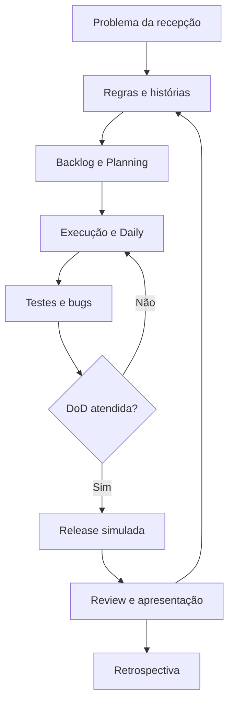

# Módulo 8 — Projeto Final — Agenda Clara

## Capa

**DTEM Treinamentos — Formação Inicial para Carreira em Tecnologia**  
**Edição:** outubro de 2026. **Formato:** Markdown. **Público:** iniciantes e pessoas em transição de carreira.  
**Caso de trabalho:** Agenda Clara — empresa e dados fictícios.

## Apresentação

Este projeto reúne os artefatos da formação em uma entrega coerente e uma apresentação de decisões. Você atuará em papéis simulados, executará testes no laboratório e demonstrará sua contribuição individual.

Este material combina conteúdo para estudo, exemplos comentados e tarefas que deixam evidências no portfólio. Primeiro faça uma previsão, depois execute ou percorra a situação, explique o resultado e transfira para um caso novo. Ler o exemplo pronto ajuda a revisar; a aprendizagem é comprovada pela explicação e pela entrega própria.

## Objetivo do módulo

Integrar requisitos, backlog, testes, bugs, Sprint e decisão de release em um projeto educacional de portfólio.

**Pré-requisitos:** entregas dos módulos 2–7; acesso ao laboratório e possibilidade de revisar documentos. **Resultado observável:** dossiê Agenda Clara com requisitos, três histórias, backlog, oito casos executados, dois reportes simulados, Sprint, SDLC, release e apresentação de cinco minutos.

## O que o aluno aprenderá

- Problema, escopo e requisitos do projeto.
- Backlog, Sprint e colaboração.
- Testes, bugs e evidências do projeto.
- SDLC, release e apresentação profissional.

## Visão geral e percurso

A empresa fictícia tem conflitos de agenda. O MVP consulta, reserva e cancela; login, pagamento, notificações e concorrência real ficam fora. O projeto não exige criar um site: a classe Python é a implementação de regras; interface pode ser desenhada; deploy é simulado. A demonstração precisa declarar exatamente o que foi executado.

| Aula | Tema | Tópicos |
|---|---|---|
| 1 | [Kickoff e requisitos](../aulas/modulo-08-aula-01-kickoff-e-requisitos.md) | 1 |
| 2 | [Sprint e execução](../aulas/modulo-08-aula-02-sprint-e-execucao.md) | 2 |
| 3 | [Testes e defeitos](../aulas/modulo-08-aula-03-testes-e-defeitos.md) | 3 |
| 4 | [Release e apresentação](../aulas/modulo-08-aula-04-release-e-apresentacao.md) | 4 |


## Tópico 1 — Problema, escopo e requisitos do projeto

### Conceito

Um projeto integrado começa por um problema delimitado e critérios de sucesso verificáveis.

### Explicação simples

Dizer o que será entregue e o que ficou fora evita demonstrar mais do que foi realmente construído.

### Explicação técnica

Retome base fictícia de 20% de conflitos. Objetivo do laboratório é demonstrar integridade sequencial e clareza das regras, sem comprovar redução em operação real. Perfis simulados: cliente solicita; recepção acompanha; PO prioriza; QA investiga; integrante Dev lê e altera código; facilitação organiza. O kit ao final fornece histórias e critérios para serem revisados e personalizados. Registre decisões de escopo e perguntas futuras. O fluxo passa por consulta, escolha, validação, reserva e cancelamento.

### Exemplo do mundo real

Um projeto pequeno com evidências claras pode comunicar mais aprendizado que um app amplo sem funcionamento verificável. Exemplo de aplicação cotidiana, sem atribuição de processo interno a uma marca.

### Exemplo dentro de uma empresa

Agenda Clara escolhe resolver conflito e cancelamento antes de adicionar pagamento.

### Erros comuns de iniciantes

Expandir escopo sem tempo; esconder partes desenhadas; declarar resultado de negócio não medido.

### Boas práticas

Recorte, premissas e critérios explícitos.

### Como isso aparece em vagas

Projeto prático, requisitos e entendimento de negócio. Vocabulário ilustrativo, sem pesquisa de vagas atuais. Compare descrições reais na atividade de carreira.

### Como isso ajuda na carreira

Ajuda a apresentar portfólio com honestidade e clareza.

### Exercício prático

**Atividade 1: Fechar o recorte e escrever requisitos**

**Contexto profissional:** o time da empresa fictícia Agenda Clara precisa revisar esta decisão antes de entregar o MVP. Dados e regras no [caderno do caso](../atividades/caso-agenda-clara.md).

**Objetivo:** Fechar o recorte e escrever requisitos, com registro que permita conferência por outra pessoa.

**Passo a passo:**

1. Leia RN01–RN08 e o kit.
2. Defina problema e objetivo do MVP.
3. Revise US01–US03 e critérios.
4. Registre fora do escopo e duas perguntas.
5. Desenhe jornada e identifique partes executáveis.

**Entrega esperada:** requisitos.md e jornada Identificar nome, versão ou premissas, regra utilizada e justificativa. Nome sugerido: `m08-atividade-01.md`.

**Critérios específicos:** Três histórias; positivos/negativos; escopo e limites.

**Exemplo de resposta comentada:** MVP consulta, reserva única sequencial e cancelamento. Não inclui autenticação ou concorrência real. Critério central: tentativa em horário ocupado preserva reserva original.

**Dica:** faça sua tentativa antes de ler a resposta e explique qualquer revisão.

**Variação mais difícil:** Como reformular a promessa se o aluno só produzir protótipo, sem execução?


## Tópico 2 — Backlog, Sprint e colaboração

### Conceito

O projeto transforma necessidade em recorte de trabalho com meta, capacidade e decisões registradas.

### Explicação simples

O time combina uma entrega possível e mostra o que mudou quando surgiram dificuldades.

### Explicação técnica

Planeje Sprint simulada de duas rodadas distribuídas nas aulas; a compressão é didática. Meta: demonstrar reserva e cancelamento conforme regras. Backlog inclui consulta, reserva, cancelamento, validação de nome, documentação e evidências. Estime capacidade de cada encontro, não toda semana como se fosse disponibilidade integral. Daily simulada registra risco e ajuste. DoD: regra atendida, casos relevantes executados, documentação atualizada e revisão. Review recebe feedback de produto; Retrospectiva propõe uma melhoria.

### Exemplo do mundo real

Uma equipe precisa diminuir recorte quando perde capacidade, sem simplesmente esconder tarefa incompleta. Exemplo de aplicação cotidiana, sem atribuição de processo interno a uma marca.

### Exemplo dentro de uma empresa

Time adia relatório para concluir correção de RN03 e teste de cancelamento.

### Erros comuns de iniciantes

Meta igual a lista de tarefas; atribuir tudo a uma pessoa; inventar reuniões que não aconteceram.

### Boas práticas

Registro curto, papéis rotativos e contribuição individual.

### Como isso aparece em vagas

Trabalho em equipe, gestão ágil e comunicação. Vocabulário ilustrativo, sem pesquisa de vagas atuais. Compare descrições reais na atividade de carreira.

### Como isso ajuda na carreira

Demonstra participação e decisão em contexto colaborativo.

### Exercício prático

**Atividade 2: Organizar Sprint simulada e dois ajustes**

**Contexto profissional:** o time da empresa fictícia Agenda Clara precisa revisar esta decisão antes de entregar o MVP. Dados e regras no [caderno do caso](../atividades/caso-agenda-clara.md).

**Objetivo:** Organizar Sprint simulada e dois ajustes, com registro que permita conferência por outra pessoa.

**Passo a passo:**

1. Defina meta e capacidade.
2. Ordene seis itens e decomponha tarefas.
3. Crie quadro com WIP 2.
4. Registre Daily com um bloqueio.
5. Faça Review e Retrospectiva com uma melhoria concreta.

**Entrega esperada:** sprint.md com quadro, eventos e decisões Identificar nome, versão ou premissas, regra utilizada e justificativa. Nome sugerido: `m08-atividade-02.md`.

**Critérios específicos:** Capacidade; meta; bloqueio real ou claramente simulado; eventos distintos.

**Exemplo de resposta comentada:** Bloqueio fictício: participante sem ambiente. Ajuste: execução em dupla em computador disponível; adiar relatório. DoD permanece. Ação de melhoria: verificar ambiente antes do encontro.

**Dica:** faça sua tentativa antes de ler a resposta e explique qualquer revisão.

**Variação mais difícil:** Como demonstrar sua contribuição se o grupo usou o mesmo dossiê?


## Tópico 3 — Testes, bugs e evidências do projeto

### Conceito

A execução deve sustentar o que o projeto afirma sobre comportamento e qualidade.

### Explicação simples

Mostre a entrada, o esperado, o observado e a versão; o leitor não deve depender da sua memória.

### Explicação técnica

Use oito casos do kit e acrescente uma sequência própria. Execute referência e variante, reiniciando estado quando previsto. BUG01 pode ser reproduzido; BUG02 é fornecido como um registro fictício de uma terceira versão inexistente no código. Documente esse tipo de evidência. Não afirmar execução de BUG02. Reteste de BUG01 usa referência; análise de BUG02 propõe passos e critério de correção sem tratar a proposta como executada. Distinga falha, dúvida e melhoria. Vincule regras, histórias e casos.

### Exemplo do mundo real

Um print isolado não prova todo o caminho nem identifica a versão. Exemplo de aplicação cotidiana, sem atribuição de processo interno a uma marca.

### Exemplo dentro de uma empresa

QA apresenta BUG01 e explica por que a ocupação de H11 reforça a evidência.

### Erros comuns de iniciantes

Misturar simulação e execução; aprovar sem estado; contar caso não executado como passado.

### Boas práticas

Versões identificadas e registros honestos de cobertura.

### Como isso aparece em vagas

Casos de teste, bugs, evidência e rastreabilidade. Vocabulário ilustrativo, sem pesquisa de vagas atuais. Compare descrições reais na atividade de carreira.

### Como isso ajuda na carreira

Produz material para explicar investigação técnica.

### Exercício prático

**Atividade 3: Executar testes e produzir dois reportes**

**Contexto profissional:** o time da empresa fictícia Agenda Clara precisa revisar esta decisão antes de entregar o MVP. Dados e regras no [caderno do caso](../atividades/caso-agenda-clara.md).

**Objetivo:** Executar testes e produzir dois reportes, com registro que permita conferência por outra pessoa.

**Passo a passo:**

1. Execute oito casos de referência e a divergência de espaços.
2. Registre entrada, retorno e estado.
3. Produza BUG01.
4. Analise registro fornecido de BUG02 e declare simulado.
5. Adicione uma sequência própria e parecer de qualidade.

**Entrega esperada:** testes.md e bugs.md com evidências identificadas Identificar nome, versão ou premissas, regra utilizada e justificativa. Nome sugerido: `m08-atividade-03.md`.

**Critérios específicos:** Oito casos; dois tipos de bug diferenciados; nenhuma execução inventada.

**Exemplo de resposta comentada:** BUG01 viola RN03 na variante. BUG02 descreve RN06 violada em versão fictícia: cancelamento retorna sucesso, mas horário não reaparece. A referência fornecida não tem esse defeito; produzir plano de confirmação, não falso resultado.

**Dica:** faça sua tentativa antes de ler a resposta e explique qualquer revisão.

**Variação mais difícil:** Que evidência adicional você pediria antes de confirmar BUG02 num produto real?


## Tópico 4 — SDLC, release e apresentação profissional

### Conceito

Uma entrega profissional conecta decisões, execução, limites e próximo passo.

### Explicação simples

Conte o problema, mostre uma decisão e uma evidência e explique o que ainda precisa melhorar.

### Explicação técnica

O dossiê liga RN03 a US02, TC03, BUG01 e reteste. A release é simulada: selecionar referência, executar verificações e emitir parecer limitado ao laboratório. Plano de parada indica interromper se regra crítica divergir. A apresentação de cinco minutos cobre problema (45s), escopo e decisão (60s), demonstração/evidência (90s), colaboração (45s) e limites/próximos passos (60s). A defesa individual pergunta por uma regra ou decisão para avaliar entendimento além do arquivo do grupo.

### Exemplo do mundo real

Em entrevista, explicar uma escolha e seus limites oferece evidência melhor que listar ferramentas usadas. Exemplo de aplicação cotidiana, sem atribuição de processo interno a uma marca.

### Exemplo dentro de uma empresa

O aluno demonstra conflito e cancelamento, reconhecendo ausência de banco persistente.

### Erros comuns de iniciantes

Portfólio como experiência profissional fictícia; roteiro sem prova; links inacessíveis.

### Boas práticas

Declaração educacional, evidências acessíveis e contribuição própria.

### Como isso aparece em vagas

Portfólio, apresentação e comunicação de decisões. Vocabulário ilustrativo, sem pesquisa de vagas atuais. Compare descrições reais na atividade de carreira.

### Como isso ajuda na carreira

Ajuda a sustentar narrativa honesta em seleção.

### Exercício prático

**Atividade 4: Preparar release e apresentação**

**Contexto profissional:** o time da empresa fictícia Agenda Clara precisa revisar esta decisão antes de entregar o MVP. Dados e regras no [caderno do caso](../atividades/caso-agenda-clara.md).

**Objetivo:** Preparar release e apresentação, com registro que permita conferência por outra pessoa.

**Passo a passo:**

1. Desenhe SDLC do recorte.
2. Monte checklist e decisão de release simulada.
3. Revise README e acesso aos arquivos.
4. Prepare apresentação com tempos definidos.
5. Responda uma pergunta sobre risco e limitação.

**Entrega esperada:** release.md, diagrama e roteiro de apresentação Identificar nome, versão ou premissas, regra utilizada e justificativa. Nome sugerido: `m08-atividade-04.md`.

**Critérios específicos:** Decisão sustentada; demonstração limitada ao implementado; contribuição individual.

**Exemplo de resposta comentada:** Liberar apenas demonstração sequencial da referência com evidências dos casos críticos. Próximos passos: persistência, identidade e concorrência requerem novos requisitos e desenho, antes de prometer produto operacional.

**Dica:** faça sua tentativa antes de ler a resposta e explique qualquer revisão.

**Variação mais difícil:** Se o avaliador discordar da prioridade, como responder com evidências?


## Exemplos reais do mercado e cenários do dia a dia

Na apresentação, o patrocinador pergunta por que pagamento foi adiado, Dev pergunta qual versão foi testada e recepção relata uma reserva sem nome. O aluno precisa responder com backlog, evidências e limites, reconhecendo o que ainda depende de implementação.

Os exemplos são aplicações ilustrativas. As decisões da Agenda Clara devem ser justificadas com regras e dados fornecidos, separando observação, hipótese e limitação.

## Tabela comparativa

| Elemento | Uso | Cuidado ou exemplo |
|---|---|---|
| Implementado | Regras em Python e estado em memória | Execução local |
| Protótipo | Desenho da jornada | Não prova comportamento |
| Bug executável | RN03 na variante | Pode ser reproduzido |
| Incidente fornecido | BUG02 em registro fictício | Não existe na referência |
| Deploy simulado | Decisão e checklist | Nenhum serviço publicado |
| Portfólio | Artefatos e contribuição | Declarar experiência educacional |

## Diagrama em Mermaid



Explique cada passagem e indique onde uma evidência pode obrigar o time a voltar a uma decisão anterior. O desenho comunica o processo; não substitui comportamento executado e registrado.

## Glossário

| Termo | Significado |
|---|---|
| Dossiê | Conjunto organizado de evidências do projeto. |
| MVP | Recorte útil da solução. |
| Rastreabilidade | Vínculo entre decisões e verificações. |
| Evidência executada | Registro produzido ao rodar um cenário. |
| Incidente simulado | Situação inventada fornecida para análise. |
| Contribuição individual | Parte realizada e explicada pela pessoa. |

## Exercícios práticos e mini desafios

As atividades dos tópicos formam o caderno de prática. Além delas, resolva: **Durante a Review, o patrocinador exige um prazo para pagamento real. Responda sem prometer uma solução que o time não investigou.**

Entregue situação inicial, decisão, evidência, consequência e uma limitação. **Referência para correção:** Explicar escopo atual, benefício entregue e hipótese do novo pedido. Propor investigação de integrações, segurança, esforço e critérios antes de estimar. Registrar pedido no backlog futuro e preservar evidência da entrega atual.

## Entrega final do módulo

dossiê Agenda Clara com requisitos, três histórias, backlog, oito casos executados, dois reportes simulados, Sprint, SDLC, release e apresentação de cinco minutos.

1. Organizar requisitos.md, testes.md, bugs.md, sprint.md, release.md e aprendizados.md.
2. Usar os modelos de referência do kit do projeto e preencher com sua execução.
3. Conferir vínculos entre RN, histórias, casos, bugs e versões.
4. Revisar links, evidências e declaração de projeto fictício.
5. Apresentar em cinco minutos e responder uma pergunta sem consultar resposta pronta.

**Checklist:**

- [ ] Cada artefato informa a regra ou premissa que o sustenta.
- [ ] A evidência permite conferir resultado e versão.
- [ ] Foram atendidos os itens do enunciado, incluindo casos negativos.
- [ ] A contribuição individual está identificada em trabalhos de grupo.
- [ ] Os limites do laboratório e o caráter fictício estão declarados.
- [ ] Há reflexão individual: uma decisão revista, a evidência e o próximo estudo.

### Rubrica e recuperação

| Critério | 0 | 1 | 2 |
|---|---|---|---|
| Correção | Contradiz regra | Parcial ou ambígua | Aplica a regra corretamente |
| Completude | Falta artefato | Faltam itens | Todos os itens pedidos |
| Evidência | Não verificável | Falta dado, versão ou saída | Outra pessoa consegue conferir |
| Justificativa | Ausente | Genérica | Conecta regra, risco e decisão |

Parâmetro formativo proposto: 6/8, sem zero em correção ou evidência. Após o feedback, registre um acerto, uma lacuna e uma ação; corrija, registre a mudança e reapresente quando solicitado. Não é regra comercial de certificação.

## Resumo final para o aluno

- Um projeto integrado começa por um problema delimitado e critérios de sucesso verificáveis.
- O projeto transforma necessidade em recorte de trabalho com meta, capacidade e decisões registradas.
- A execução deve sustentar o que o projeto afirma sobre comportamento e qualidade.
- Uma entrega profissional conecta decisões, execução, limites e próximo passo.

Guarde a primeira versão e a correção. Na apresentação, explique uma decisão, uma evidência e uma limitação; isso comunica melhor seu aprendizado do que listar ferramentas.

## Referências

[Ementa local](../ementa.md), [caso Agenda Clara](../atividades/caso-agenda-clara.md) e [laboratório](../portfolio/agenda-clara/README.md). Bases dos processos em [Scrum Guide](https://scrumguides.org/scrum-guide.html), [Git](https://git-scm.com/docs/gittutorial) e [ISTQB CTFL](https://istqb.org/certifications/certified-tester-foundation-level-ctfl-v4-0/). Os casos, exercícios e rubricas são autorais.

## Kit do projeto — referências para execução

### Empresa, problema e perfis

Agenda Clara é um estúdio fictício. A recepção usa mensagens e planilha manual, com conflitos em 10 de 50 tentativas fictícias. Objetivo do sistema: consultar disponibilidade, reservar sem duplicidade sequencial e cancelar liberando o horário.

Cliente e recepcionista são perfis de uso simulados. PO, QA e integrante Dev/organização são papéis de trabalho rotativos. Não há autenticação implementada; os perfis não representam controle de acesso.

### Backlog inicial

| ID | Item | Razão e dependência | Recorte |
|---|---|---|---|
| PB01 | Consultar catálogo e disponibilidade | Base para escolher horário | MVP |
| PB02 | Reservar nome e horário válidos | Fluxo central; depende de PB01 | MVP |
| PB03 | Recusar conflito | Integridade; ligado a PB02 | MVP |
| PB04 | Cancelar pelo id | Libera capacidade; depende de PB02 | MVP |
| PB05 | Validar nome após remover espaços | Qualidade da identificação | MVP |
| PB06 | Documentar e executar evidências | Sustenta conclusão do recorte | MVP |
| PB07 | Persistir reservas | Exige armazenamento e novas decisões | Futuro |
| PB08 | Pagamento online | Demanda e integração não investigadas | Fora do MVP |

### Histórias e critérios de aceite fornecidos

**US01 — Consulta:** Como cliente, quero ver horários disponíveis para escolher uma opção que ainda pode ser reservada.

- Dada agenda vazia, ao consultar, retornar H09, H10 e H11.
- Dado H09 ocupado, ao consultar, retornar H10 e H11.
- Dado catálogo totalmente ocupado, retornar lista vazia; não inventar novo horário.

**US02 — Reserva:** Como cliente, quero reservar um horário disponível para garantir meu atendimento no recorte simulado.

- Nome com conteúdo e horário livre: retornar sucesso e id; ocupar horário.
- Horário ocupado: retornar conflito e preservar reserva anterior.
- Nome vazio ou apenas espaços: retornar nome_invalido, sem ocupar horário.
- Horário fora do catálogo: retornar horario_invalido, sem criar reserva.

**US03 — Cancelamento:** Como recepcionista, quero cancelar uma reserva ativa para disponibilizar o horário novamente.

- Id existente: retornar cancelado, remover reserva e liberar horário.
- Id inexistente: retornar nao_encontrado e preservar demais reservas.
- Após cancelar, o mesmo horário pode receber nova reserva com novo id.

### Casos de teste de referência

Executar cada caso em uma agenda nova, exceto os passos da mesma sequência. Usar o id retornado na reserva, sem supor id fixo em agenda reutilizada.

| ID / regra | Preparação e ação | Esperado e estado final |
|---|---|---|
| TC01 / RN01 | Agenda nova; consultar | H09, H10, H11 |
| TC02 / RN02/RN05 | Reservar Ana/H09; depois Bruno/H09 | Primeira sucesso; segunda conflito; Ana preservada |
| TC03 / RN03 | Reservar espaços/H11 | nome_invalido; H11 livre |
| TC04 / RN04 | Reservar Ana/H10 | sucesso com id; H10 ausente de consultar |
| TC05 / RN05 | H09 ocupado; repetir pedido | conflito; quantidade não aumenta |
| TC06 / RN06 | Reservar H10; cancelar id; consultar | cancelado; H10 livre |
| TC07 / RN07 | Reservar H09; cancelar 999 | nao_encontrado; H09 continua ocupado |
| TC08 / RN08 | Reservar Dani/H12 | horario_invalido; agenda intacta |

Acrescentar **TC09 próprio**: uma sequência diferente que combine ações e estado. Por exemplo, cancelar duas vezes e confirmar que a segunda recusa não altera uma nova reserva. O aluno explica sua escolha.

### BUG01 — defeito executável e plantado

| Campo | Referência |
|---|---|
| Título | Reserva aceita nome composto somente por espaços |
| Versão | AgendaComDefeito |
| Regra / caso | RN03 / TC03 |
| Pré-condição | Nova agenda vazia |
| Passos | Reservar nome com três espaços em H11; consultar |
| Esperado | nome_invalido; H11 livre |
| Observado de referência | sucesso, id 1; H11 ocupado |
| Impacto | Reserva sem identificação útil |
| Proposta de prioridade | Alta antes de liberar MVP; discutir contexto |
| Reteste | Executar mesma entrada em Agenda e registrar resultado produzido pelo aluno |

A saída acima é referência prevista pela leitura do código. A entrega do aluno precisa registrar sua própria execução ou declarar simulação manual.

### BUG02 — registro de incidente fictício fornecido

**Origem:** cenário inventado de uma versão chamada `registro-cancelamento-v0`, que não existe no simulador entregue.

```text
09:00 — consultar -> [H09, H10, H11]
09:01 — reservar Carla/H10 -> sucesso, id 7
09:02 — cancelar id 7 -> cancelado
09:03 — consultar -> [H09, H11]
```

Esperado por RN06: H10 deve reaparecer. Observação fornecida: H10 continua ausente. O aluno produz reporte baseado no registro, indicando **evidência fornecida e fictícia**. Plano de confirmação: obter versão e ambiente, repetir reserva/cancelamento/consulta e verificar estado. Não afirmar que executou essa falha na classe Agenda.

### Organização da Sprint e Daily simulada

Meta: demonstrar reserva correta e cancelamento verificável. Rodada 1: requisitos, leitura e planejamento. Rodada 2: execução, correções e fechamento. Reservar capacidade para revisar evidências. Quadro: pronto, em execução, em verificação, concluído; WIP 2 nas duas colunas intermediárias somadas.

**Registro de Daily de referência:** “A meta continua viável. TC03 falhou na variante e bloqueia liberação dessa versão. Vamos retestar na referência e manter versão identificada. A dupla QA/Dev confirma resultado antes da próxima revisão.”

**DoD do exercício:** critérios atendidos no recorte; cenários relevantes executados; bugs impeditivos tratados; documentos coerentes; contribuição individual registrada. Documento pronto não representa funcionalidade não implementada.

### SDLC e release simulada

Usar o diagrama do módulo e a matriz RN → US → TC → BUG → versão. Checklist de liberação:

- [ ] Identificar classe ou commit usado.
- [ ] Executar reserva válida, conflito e cancelamento.
- [ ] Confirmar recusa de nome somente com espaços.
- [ ] Verificar documentos e vínculos.
- [ ] Declarar o que não foi testado.
- [ ] Registrar decisão, responsável e condição de interrupção.

Se regra crítica divergir, interromper a demonstração, registrar estado e repetir após correção. Comparar versões localmente é uma simulação de reversão; reiniciar perde dados e não representa um plano de rollback de produção.

### Apresentação estilo empresa e checklist de avaliação

| Parte | Tempo | Evidência |
|---|---:|---|
| Problema e contexto | 45 s | Dados fictícios e usuário |
| Escopo e decisão | 60 s | Backlog e critério |
| Demonstração | 90 s | Caso executado com versão |
| Colaboração | 45 s | Registro de contribuição |
| Limites e evolução | 60 s | Riscos e próximo passo |

Na avaliação serão observados: coerência entre regra e teste; oito casos executados; BUG01 e BUG02 corretamente identificados; decisão de release sustentada; eventos diferenciados; vínculos acessíveis; defesa individual. Em trabalhos em grupo, cada pessoa deve conseguir explicar a parte que produziu ou revisou.

**Exemplo de frase para portfólio:** “Projeto educacional Agenda Clara: elaborei critérios de reserva, executei testes sequenciais e documentei uma divergência simulada de validação. O laboratório usa Python e estado em memória; não implementei serviço de produção.”
