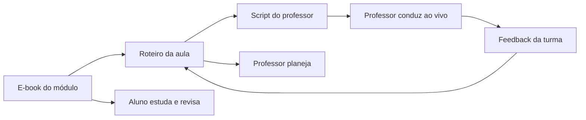

# Arquitetura dos Materiais — DTEM Treinamentos

## Princípio

A formação possui três camadas com responsabilidades diferentes:

> **E-book = o que aprender**  
> **Roteiro de Aula = o que ensinar, praticar e avaliar**  
> **Script do Professor = como conduzir a aula ao vivo**

## 1. E-book — material do aluno

Local: `/ebooks`

Pode conter:

- conteúdo conceitual;
- exemplos;
- diagramas e tabelas;
- exercícios;
- mini desafios;
- critérios transparentes;
- entrega final;
- resumo;
- referências.

Não deve conter:

- falas do professor;
- gabaritos internos;
- respostas de referência para correção;
- orientação de condução;
- links para scripts internos;
- tempo operacional do professor.

## 2. Roteiro — contrato pedagógico da aula

Locais: `/aulas` e `/bonus`

Responde:

> **O que esta aula ensina, pratica e avalia?**

Deve definir:

- objetivo;
- resultados esperados;
- conceitos;
- exemplos;
- demonstração central;
- dinâmica;
- exercício individual;
- perguntas de verificação;
- critérios;
- tarefa;
- entrega;
- conexão com a trilha.

Não deve conter gabaritos, falas prontas ou intervenções detalhadas.

## 3. Script — camada operacional do professor

Locais: `/aulas/scripts` e `/bonus/scripts`

Responde:

> **Como eu conduzo exatamente o Roteiro ao vivo?**

Acrescenta:

- preparação;
- falas sugeridas;
- perguntas diagnósticas;
- respostas esperadas;
- transições;
- passos da demonstração;
- intervenções;
- ajuda graduada;
- gabaritos internos;
- fechamento;
- controle de tempo.

## 4. Invariante de alinhamento

O Script **não pode alterar** silenciosamente:

- objetivo;
- demonstração;
- dinâmica;
- exercício;
- critérios;
- tarefa;
- entrega.

Esses elementos pertencem ao contrato do Roteiro.

Se a condução revelar que a atividade precisa mudar, alterar Roteiro e Script juntos.



## 5. Ordem de uso do professor

```text
Trilha
  ↓
Roteiro da aula
  ↓
E-book no recorte da aula
  ↓
Script do professor
  ↓
Atividade / laboratório
  ↓
Encontro ao vivo
  ↓
Feedback e revisão
```

O Roteiro vem antes do E-book na preparação porque primeiro o professor precisa saber **qual recorte da matéria** será ensinado. O E-book então aprofunda esse recorte.

## 6. Progressão de linguagem

- M2: lógica em Python;
- M3: comparação controlada com JavaScript/TypeScript;
- M4: contexto de automação com JS/TS;
- módulos posteriores reutilizam conceitos sem obrigar mudança abrupta de linguagem.

## 7. Validação editorial

### Antes de entregar E-book ao aluno

- [ ] não contém instrução ao professor;
- [ ] não contém gabarito interno;
- [ ] não contém link para script;
- [ ] critérios estão escritos para o aluno;
- [ ] exemplos diferenciam simulação de realidade.

### Antes de aprovar Roteiro

- [ ] objetivo é observável;
- [ ] demonstração ensina o objetivo;
- [ ] dinâmica pratica o conteúdo;
- [ ] exercício individual verifica compreensão própria;
- [ ] tarefa consolida a aula;
- [ ] próxima aula corresponde à trilha.

### Antes de aprovar Script

- [ ] “Alinhamento obrigatório” é idêntico ao Roteiro;
- [ ] nenhuma atividade central foi substituída;
- [ ] respostas esperadas correspondem às perguntas do Roteiro;
- [ ] não há pré-requisito futuro;
- [ ] conteúdo cabe em até 90 minutos;
- [ ] falas podem ser adaptadas sem alterar critério;
- [ ] exemplos e gabaritos permanecem internos.
