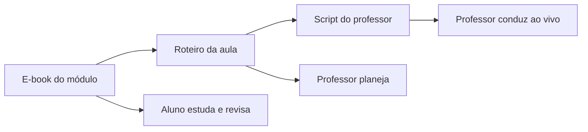

# Arquitetura dos materiais — DTEM Treinamentos

## Objetivo

Separar claramente os materiais destinados ao aluno dos materiais internos de planejamento e condução do professor.

A organização oficial passa a seguir três camadas:

> **E-book = o que aprender**  
> **Roteiro de aula = o que ensinar e praticar naquela aula**  
> **Script do professor = como conduzir a aula ao vivo**

## 1. E-books — material do aluno

Local: `/ebooks`

Os E-books podem ser disponibilizados diretamente aos alunos.

Devem conter:

- apresentação e objetivo do módulo;
- desenvolvimento dos conceitos;
- exemplos de mercado;
- cenários empresariais;
- tabelas e diagramas;
- glossário;
- exercícios;
- mini desafios;
- critérios transparentes das entregas;
- entrega final;
- resumo para revisão;
- referências e materiais complementares.

Não devem conter:

- falas prontas para o professor;
- scripts de condução;
- instruções como “pergunte”, “aguarde”, “se o aluno responder...”;
- gabaritos internos;
- respostas de referência para correção;
- orientações de devolutiva destinadas ao professor;
- planejamento de tempo do docente;
- links para scripts internos do professor.

Critérios de avaliação podem ser mostrados ao aluno quando ajudarem a compreender o que será esperado, desde que escritos em linguagem voltada ao estudante.

## 2. Roteiros de aula — planejamento pedagógico

Local: `/aulas`

O roteiro é um documento de planejamento do professor.

Ele responde:

> O que esta aula precisa ensinar, praticar e avaliar?

Deve conter:

- tema;
- objetivo observável;
- conteúdos;
- duração e blocos gerais;
- materiais necessários;
- exemplos planejados;
- demonstração prevista;
- dinâmica;
- exercício individual;
- perguntas de verificação;
- critérios das atividades;
- tarefa para casa;
- conexão com a próxima aula;
- referências.

Não deve duplicar o script.

Evitar no roteiro:

- falas completas;
- transições prontas;
- respostas esperadas;
- gabaritos;
- instruções detalhadas de intervenção;
- minuto a minuto operacional.

## 3. Scripts do professor — condução ao vivo

Local: `/aulas/scripts` e `/bonus/scripts`

O script é material interno do professor.

Ele responde:

> Como conduzir esta aula ao vivo?

Pode conter:

- cronograma minuto a minuto;
- falas sugeridas;
- o que mostrar em cada bloco;
- perguntas de diagnóstico;
- respostas esperadas;
- transições;
- gabaritos comentados;
- intervenções para dificuldades;
- estratégias para diferentes ritmos da turma;
- como corrigir;
- como fechar a aula;
- checklist de preparação.

O script pode referenciar o E-book e o roteiro, mas não deve ser disponibilizado como material padrão do aluno.

## 4. Relacionamento entre os materiais

### Exemplo

Para **Módulo 1 — Aula 1**:

- E-book explica mercado tech e áreas de TI;
- roteiro define quais conceitos, exemplos, atividades e entregas entram na aula;
- script define o que o professor fala, pergunta, mostra e corrige ao longo dos 90 minutos.

## 5. Regra editorial

Antes de publicar ou entregar um material ao aluno, verificar:

- [ ] há alguma instrução falando diretamente com o professor?
- [ ] há gabarito ou resposta de correção que deveria ficar oculta?
- [ ] há link para script interno?
- [ ] há planejamento de condução que não ajuda o aluno a estudar?
- [ ] a linguagem está escrita para quem aprende?

Se qualquer resposta for “sim”, mover o conteúdo para o roteiro ou script correspondente.

## 6. Ordem recomendada de manutenção

Ao alterar um módulo:

1. atualizar o E-book com o conteúdo conceitual;
2. revisar o roteiro para selecionar o recorte da aula;
3. revisar o script para adequar a condução ao vivo;
4. verificar se atividades, critérios e entregas continuam consistentes entre os três arquivos;
5. executar uma revisão final de separação aluno/professor.
